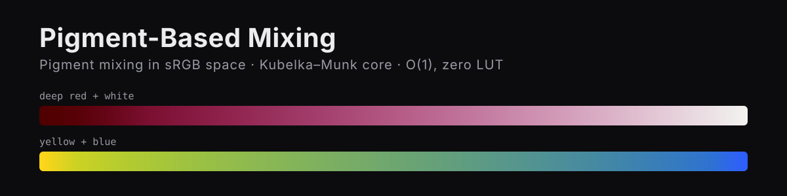

<h1 align="center">Pigment-Based Mixing (PBM)</h1>

<p align="center">
  
</p>

<p align="center">
  <strong>English</strong>
  &nbsp;·&nbsp;
  <a href="./README.zh-CN.md">简体中文</a>
</p>

Pigment-Based Mixing (PBM) is a real-time RGB pigment color mixing algorithm built on the Kubelka–Munk (K–M) two-flux theory — with **no spectral data, no lookup tables, no conditional patches, O(1) constant time**. It is physics-inspired in structure and reference-calibrated in constants (fitted to Mixbox 2.0, whose latent space is trained on measured pigment spectra), inheriting part of the reference's physical plausibility transitively. In plain sRGB display-value space it reproduces reference paint-mixing behavior: yellow and blue make green, complementary pairs turn into muddy neutrals instead of gray, and deep colors lightened with white stay saturated instead of turning gray. The model is a two-stage formula — an analytic K–M mixing core plus a repair layer (per-channel power-law target, additive harmonic correction, soft role assignment) — that is exchange-symmetric up to floating-point rounding: `F(b, t, α) ≡ F(t, b, 1−α)` to 6.7×10⁻¹⁶.

- Demo: [`demo/color-mixing-demo.html`](demo/color-mixing-demo.html) (self-contained; only the Mixbox reference requires network)
- Evaluation: [`demo/color-mixing-evaluation.html`](demo/color-mixing-evaluation.html) (CIEDE2000 validation, full test-suite statistics)

---

## Overview

Mixing paints in RGB space behaves like mixing colored *lights* — complementary pairs collapse to gray, and dark colors mixed with white turn gray, dull, and dark. The Kubelka–Munk model predicts real pigment behavior, but it traditionally requires spectral reflectance data per pigment and per-wavelength integration, which is impractical for real-time RGB software.

**PBM** keeps the physical K–M structure (analytical K/S defaults, Duncan concentration superposition, joint cross-channel matrix, mutual-absorption correction) while operating purely in sRGB display-value space — **no spectral data, no lookup tables, O(1) constant time**; its constants are reference-calibrated (fitted to the output of Mixbox 2.0, whose latent space is trained on measured pigment spectra), so PBM inherits part of the reference's physical plausibility transitively, bounded by its measured deviation from it (T5 mean 2.258, held-out T3 2.719–2.852). A two-stage formula repairs the structurally defective "dark + white" mixing (per-channel power-law target) and the complementary-mixing families (additive harmonic correction over a unified 17-feature ratio template with chroma soft-attenuation; no trigonometric function), merged by a soft role assignment λ that makes the model exchange-symmetric up to floating-point rounding; a symmetric endpoint-compression map φ fixes both α → 0/1 tails.

## Key Properties

| Property | Value |
|---|---|
| Physical core | Kubelka–Munk + Duncan (K/S, concentration superposition) |
| Input / Output | sRGB display values, RGB-in / RGB-out |
| Spectral data | **Not required** (analytical defaults) |
| Lookup tables | **None** |
| Complexity | O(1), ~0.23 µs/mix in JS host realm (~1.4× Mixbox LUT, ~14× RGB lerp) |
| Identity | α=0/1 exact |
| Continuity | Smooth (soft σ gating + C¹ smoothsteps), neighborhood-continuous (max single-step ΔE00 1.39) |
| Exchange symmetry | F(b, t, α) ≡ F(t, b, 1−α), max observed RGB diff 6.7×10⁻¹⁶ |
| Fitted constants | 17 harmonic features × 3 channels (51 coefficients, least squares) + 14 scalars (coordinate descent) |
| Accuracy (ΔE00 vs Mixbox 2.0) | T5 dark+white mean 2.258 / max 7.3; T1 3.286 / max 15.0, T2 2.667, T3 2.777; T5E two-sided tail 2.441 / max 9.5; tail 1.678; held-out T3 2.719–2.852; T5-heldout 2.377 |

## Usage

Open `demo/color-mixing-demo.html` in any modern browser — page scripts are bundled under `demo/` and the shared algorithm library under `javascript/color-mixing.js`; only the Mixbox reference is loaded from the official CDN.

The reference implementation is a single pure function in `javascript/color-mixing.js` (UMD: `window.ColorMixing` in the browser, `require()` in Node):

```html
<script src="javascript/color-mixing.js"></script>
<script>
  // ColorMixing.mixPbm(base, tint, a) — a = tint share (α=0 → base, α=1 → tint)
  var base = [0.051, 0.106, 0.267];  // deep blue  #0D1B44
  var tint = [1, 1, 1];              // titanium white #FFFFFF
  var a    = 0.5;                    // mixing ratio

  var mixed = ColorMixing.mixPbm(base, tint, a);
  // => [r, g, b] in [0,1]
  document.body.style.background = 'rgb(' + mixed.map(v => Math.round(v * 255)) + ')';
</script>
```

Headless / CI: the evaluation page exposes a pure-function suite on `window.__Suite` (runs in Node without a browser via `tools/suite-loader.js`):

```js
const { loadSuite } = require('./tools/suite-loader');
const { suite } = loadSuite({ mixboxSource: fs.readFileSync(mixboxJs, 'utf8') });
const { validateDeltaE2000, buildReport, runT4, buildT5, buildT5Random,
        deltaE2000, de76, MODELS, THRESHOLDS } = suite;

validateDeltaE2000();   // Sharma/Wu/Dalal 34 reference pairs, max deviation < 1e-4
const report = buildReport({ seed: 20260808, n: 2000 });
```

Regression gate for model changes: `node tools/run-regression.js` asserts the suite metrics, endpoint identity, exchange symmetry and neighborhood continuity against [`tools/regression-baseline.json`](tools/regression-baseline.json) and exits non-zero on any deviation.

## Multi-Language Implementations

The PBM algorithm is implemented in four languages with **numerically identical output** (verified by `tools/check-cross-language.js`: 2000 random pairs, max ΔE00 < 1e-6 against the JS reference — only libm rounding, well below the 0.001 tolerance):

| Language | File(s) | API |
|---|---|---|
| JavaScript | `javascript/color-mixing.js` | `ColorMixing.mixPbm(base, tint, a)` |
| Python | `python/color_mixing.py` | `mix_pbm(base, tint, a)` |
| Java | `java/ColorMixing.java` | `ColorMixing.mixPbm(double[], double[], double)` |
| C++ | `cpp/color_mixing.h` (header-only) | `color_mixing::mix_pbm(...)` |

All constants (the tuned 5-parameter family frozen into the model, the 17-feature × 51-coefficient harmonic template, the K–M core constants) are byte-identical across languages — single source of truth: `javascript/color-mixing.js`. The Python/Java/C++ builds also ship a stdin CLI (input `r1,g1,b1,r2,g2,b2,a` per line, output the mixed `r,g,b` at 9 decimals) used by the consistency test:

```bash
echo "0.988,0.827,0,0,0.129,0.522,0.5" | python python/color_mixing.py
node tools/check-cross-language.js   # compiles Java (javac) + C++ (g++ or MSVC via vswhere) on the fly
```

## Reference Deep Colors

The T5 "dark + white" suite — the core design target of the per-channel power-law repair ([paper](docs/color-mixing-algorithm.pdf), §3.4):

| Color | Hex | Float RGB | Family |
|---|---|---|---|
| Deep blue | `#0D1B44` | 0.051, 0.106, 0.267 | pain point |
| Navy | `#000080` | 0.000, 0.000, 0.502 | pain point |
| Royal blue | `#001B75` | 0.000, 0.106, 0.459 | pain point |
| Ultramarine dark | `#001E80` | 0.000, 0.118, 0.502 | pain point |
| Dark violet | `#080248` | 0.031, 0.008, 0.282 | pain point |
| Dark red | `#5F1708` | 0.373, 0.090, 0.031 | pain point |
| Crimson dark | `#5E0F1A` | 0.369, 0.059, 0.102 | pain point |
| Dark ochre | `#4A3A05` | 0.290, 0.227, 0.020 | pain point |
| Near-black red | `#280501` | 0.157, 0.020, 0.004 | pain point (gating exemption) |
| Near-black red | `#250903` | 0.145, 0.035, 0.012 | pain point (gating exemption) |
| Deep blue | `#0A2A6E` | 0.039, 0.165, 0.431 | family extension |
| Deep red | `#8E1F0A` | 0.557, 0.122, 0.039 | family extension |
| Deep green | `#005A32` | 0.000, 0.353, 0.196 | family extension |
| Deep green | `#00552B` | 0.000, 0.333, 0.169 | family extension |
| Deep teal | `#00585E` | 0.000, 0.345, 0.369 | family extension |
| Deep purple | `#2A0A5E` | 0.165, 0.039, 0.369 | family extension |
| Deep purple | `#4A0B6E` | 0.290, 0.043, 0.431 | family extension |
| Deep magenta | `#6E0B4A` | 0.431, 0.043, 0.290 | family extension |
| Burnt orange | `#7A3B00` | 0.478, 0.231, 0.000 | family extension |
| Ochre | `#6E4A00` | 0.431, 0.290, 0.000 | family extension |

## Examples

| Page | Description |
|---|---|
| [`color-mixing-demo.html`](demo/color-mixing-demo.html) | Mixing bench (bilingual, English by default; `?lang=zh`) — five parallel ratio strips (PBM, Mixbox reference, independent synthetic-spectra truth, RGB interpolation, display-value K–M) over the whole tint share, drag-to-sample with live ΔE00, base/tint pickers, and a stress-pair table (complementary, RYB mismatch, white/black, dark + white) at three ratios |
| [`color-mixing-evaluation.html`](demo/color-mixing-evaluation.html) | Evaluation suite (bilingual, English by default; `?lang=zh`) — CIEDE2000 replication check (34 reference pairs), T1–T5E statistics with per-suite tiles, family breakdown, endpoint identity, worst-pair analysis, JSON report export; `?run=1&seed=…&n=…` runs a shareable configuration on load |

## Synthetic-Spectra Validation (§5.8)

PBM is additionally validated against an **independent synthetic spectral world** whose synthetic pigment spectra combine two documented bases (Appendix C.1): **first-principles pigment chemistry** for band positions (Gaussian absorption bands from transition-metal d–d / organic π–π\* transitions; logistic absorption edges of semiconductor-type pigments; yellow/orange/red steep edges in the blue-green region, blue/green red-side edges, magenta's green-region band), and **public measurement calibration** for the numerical parameters — amplitudes/widths/bases/scattering are fitted (coordinate descent, ΔE00 ≤ 1.2) to the publicly available BabelColor X-Rite ColorChecker Classic averaged spectra [Pascale 2012] (30-chart average, 24 formulated color-card patches, 10 nm; the reference data are the source's public measurements [Pascale 2012], and `tools/spectral/calibrate.js` reproduces the fit targets and shape statistics from a local copy). 29 pigments (24 hues + 5 darkened derivations for the dark + white suites), 10 nm / 380–750 nm:

- Triangulation (PBM / Mixbox / RGB / raw K–M vs. the spectral truth on P1–P5E): **PBM's accuracy is comparable to Mixbox on all six suites** (means: P1 6.43 vs 6.46, P2 12.42 vs 12.71, P3 5.42 vs 5.10, P5 8.30 vs 8.86, P5-buff 5.03 vs 4.56, P5E 3.32 vs 3.39; every pair of 95% CIs overlaps) — neither model was trained on this world, indicating that the fitted precision is not an artifact of overfitting. PBM is closer on P1, P2, P5, and P5E; the reference is closer on P3 and P5-buff. Mean hue error |Δhue| is lower for PBM on five of six suites (10.4° P1, 9.6° P5, 2.6° P5E; P5-buff 0.11° higher).
- Residual per-suite mean errors (3.32–12.42 ΔE00) are structural: two-constant spectral K–M mixing vs Mixbox's trained latent polynomial over surrogate pigments.
- Tooling: `tools/run-physical.js` (evaluation), `tools/spectral/` (synthetic data + two-constant pipeline + `calibrate.js` calibration reproduction), `verify-synthetic.js` (dual validation: family hue windows + spectral shape facts + mixing physics), `make-fig-physical.py` (Figure 8).

## Documentation

- [`docs/color-mixing-algorithm.pdf`](docs/color-mixing-algorithm.pdf) — Technical paper (LaTeX source: [`docs/paper/main-en.tex`](docs/paper/main-en.tex)): formalization, parameter estimation, ablation, continuity, runtime, and synthetic-spectra validation
- [`docs/review.zh-CN.md`](docs/review.zh-CN.md) — Implementation notes (Chinese): measurement caveats, tooling, rejected variants, and known gaps
- [`docs/paper/README.md`](docs/paper/README.md) — Paper build instructions, figure pipeline, and tooling map
- [`README.zh-CN.md`](README.zh-CN.md) — 简体中文版本（中文论文：[`docs/color-mixing-algorithm.zh-CN.pdf`](docs/color-mixing-algorithm.zh-CN.pdf)）

## Mixbox Reference

- Šárka Sochorová and Ondřej Jamriška. **Practical Pigment Mixing for Digital Painting**. *ACM Trans. Graph.* 40(6), Article 234, 2021 (SIGGRAPH).
- The `mixbox.js` reference is loaded from the official CDN ([scrtwpns.com/mixbox.js](https://scrtwpns.com/mixbox.js), © Secret Weapons 2022) under **CC BY-NC 4.0** for research comparison only and must not be used in commercial products.

## License

- Repository content (README, docs, and the PBM implementations in `javascript/`, `python/`, `java/`, `cpp/`, `demo/`): **MIT License** — see [`LICENSE`](LICENSE)
- Mixbox reference (official CDN): **CC BY-NC 4.0** (loaded from `https://scrtwpns.com/mixbox.js`, not bundled in this repository)

Copyright (c) 2026 Saikel-Orado-Liu aka GameGeek-Saikel

