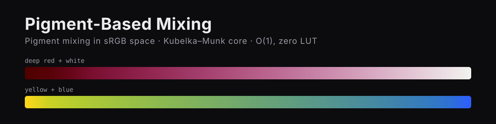

<h1 align="center">颜料基混色（PBM）</h1>

<p align="center">
  
</p>

<p align="center">
  <a href="./README.md">English</a>
  &nbsp;·&nbsp;
  <strong>简体中文</strong>
</p>

**颜料基混色（PBM）** 是以 Kubelka–Munk（K–M）双流理论为物理骨架的实时 RGB 颜料混色算法——**无需光谱数据、零查找表、无条件补丁、O(1) 常数时间**。结构物理启发、常数参考校准（拟合自 Mixbox 2.0——其潜空间训练自实测颜料光谱），传递性地继承参考的部分物理合理性。它全程在 sRGB 显示值空间内复现参考级颜料混色行为：黄+蓝得绿、互补色对混合趋向泥色而非灰阶、深色加白保持饱和浅色而非灰白。模型为两阶段公式——解析 K–M 混色核心 + 修复层（逐通道幂律目标、加性谐波修正、软角色分配）——交换对称在浮点舍入范围内成立：`F(b, t, α) ≡ F(t, b, 1−α)` 精度达 6.7×10⁻¹⁶。

- 演示：[`demo/color-mixing-demo.html`](demo/color-mixing-demo.html)（自包含；仅 Mixbox 参考需网络）
- 评估：[`demo/color-mixing-evaluation.html`](demo/color-mixing-evaluation.html)（CIEDE2000 验证、全测试集统计）

---

## 概述

在 RGB 空间混颜料等同于混"彩色光"——互补色对趋向灰色，深色加白则灰、脏、暗。Kubelka–Munk 模型能正确预测真实颜料行为，但传统上需要每种颜料的光谱反射率并做逐波长积分，无法用于实时 RGB 软件。

**PBM** 保留 K-M 的物理结构（解析 K/S 默认、Duncan 浓度叠加、联合跨通道矩阵、互吸收修正），全程在 sRGB 显示值空间运算——**无需光谱数据、零查找表、O(1) 常数时间**；其常数参考校准（拟合自 Mixbox 2.0 的输出——该参考的潜空间训练自实测颜料光谱），传递性地继承参考的部分物理合理性，误差带由相对参考的实测偏差界定（T5 均值 2.258、留出 T3 2.719–2.852）。两阶段公式修复"深色+白"混合的结构性缺陷（逐通道幂律目标）与互补混色家族（统一 17 特征比值模板 + 色度软衰减的加性谐波修正，不含三角函数），由软角色分配 λ 合并并在浮点舍入范围内保证交换对称；对称端点压缩映射 φ 修复 α → 0/1 双侧尾端。

## 关键性质

| 性质 | 值 |
|---|---|
| 物理骨架 | Kubelka–Munk + Duncan（K/S、浓度叠加） |
| 输入输出 | sRGB 显示值，RGB-in / RGB-out |
| 光谱数据 | **不需要**（解析默认） |
| 查找表 | **无** |
| 复杂度 | O(1)，JS 宿主 realm 单次混色 ~0.23 µs（~1.4× Mixbox LUT、~14× RGB lerp） |
| 恒等 | α=0/1 精确 |
| 连续性 | 平滑（软 σ 门控 + C¹ smoothstep），邻域连续（最大单步 ΔE00 1.39） |
| 交换对称 | F(b, t, α) ≡ F(t, b, 1−α)，实测最大 RGB 差 6.7×10⁻¹⁶ |
| 拟合常数 | 17 个谐波特征 × 3 通道（51 系数，最小二乘）+ 14 个标量（坐标下降） |
| 精度（ΔE00 vs Mixbox 2.0） | T5 深色+白 mean 2.258 / max 7.3；T1 3.286 / max 15.0、T2 2.667、T3 2.777；T5E 双侧尾端 2.441 / max 9.5；tail 1.678；留出 T3 2.719–2.852；T5-heldout 2.377 |

## 用法

用任意现代浏览器打开 `demo/color-mixing-demo.html` 即可——页面脚本收在 `demo/` 下，共享算法库在 `javascript/color-mixing.js`；仅 Mixbox 参考由官方 CDN 加载。

参考实现是 `javascript/color-mixing.js` 中的单个纯函数（UMD：浏览器 `window.ColorMixing`，Node `require()`）：

```html
<script src="javascript/color-mixing.js"></script>
<script>
  // ColorMixing.mixPbm(base, tint, a) — a 为染色占比（α=0 → 基色，α=1 → 染色色）
  var base = [0.051, 0.106, 0.267];  // 深蓝 #0D1B44
  var tint = [1, 1, 1];              // 钛白 #FFFFFF
  var a    = 0.5;                    // 混色配比

  var mixed = ColorMixing.mixPbm(base, tint, a);
  // => [r, g, b]，范围 [0,1]
  document.body.style.background = 'rgb(' + mixed.map(v => Math.round(v * 255)) + ')';
</script>
```

无头 / CI：评估页在 `window.__Suite` 上暴露纯函数套件（经 `tools/suite-loader.js` 可在 Node 中无浏览器运行）：

```js
const { loadSuite } = require('./tools/suite-loader');
const { suite } = loadSuite({ mixboxSource: fs.readFileSync(mixboxJs, 'utf8') });
const { validateDeltaE2000, buildReport, runT4, buildT5, buildT5Random,
        deltaE2000, de76, MODELS, THRESHOLDS } = suite;

validateDeltaE2000();   // Sharma/Wu/Dalal 34 组参考色差对，最大偏差 < 1e-4
const report = buildReport({ seed: 20260808, n: 2000 });
```

模型改动的回归门禁：`node tools/run-regression.js` 对照 [`tools/regression-baseline.json`](tools/regression-baseline.json) 断言套件指标、端点恒等、交换对称与邻域连续性，任一项超差即以非零退出码失败。

## 多语言实现

PBM 算法以四种语言实现，**输出数值一致**（`tools/check-cross-language.js` 验证：2000 组随机对，与 JS 基准的最大 ΔE00 < 1e-6——仅 libm 舍入差异，远低于 0.001 容差）：

| 语言 | 文件 | API |
|---|---|---|
| JavaScript | `javascript/color-mixing.js` | `ColorMixing.mixPbm(base, tint, a)` |
| Python | `python/color_mixing.py` | `mix_pbm(base, tint, a)` |
| Java | `java/ColorMixing.java` | `ColorMixing.mixPbm(double[], double[], double)` |
| C++ | `cpp/color_mixing.h`（header-only） | `color_mixing::mix_pbm(...)` |

所有常量（冻结的 5 参数族、17 特征模板 × 51 系数的谐波模板、K–M 核心常量）跨语言逐位一致——单一事实源：`javascript/color-mixing.js`。Python/Java/C++ 另附 stdin CLI（每行输入 `r1,g1,b1,r2,g2,b2,a`，输出 9 位小数的混合 `r,g,b`），供一致性测试使用：

```bash
echo "0.988,0.827,0,0,0.129,0.522,0.5" | python python/color_mixing.py
node tools/check-cross-language.js   # 自动编译 Java（javac）与 C++（g++ 或经 vswhere 找 MSVC）
```

## 参考深色板

T5「深色+白」专项——逐通道幂律修复的核心设计目标（[论文](docs/color-mixing-algorithm.zh-CN.pdf) §3.4）：

| 色 | Hex | 浮点 RGB | 家族 |
|---|---|---|---|
| 深蓝 | `#0D1B44` | 0.051, 0.106, 0.267 | 痛点色 |
| 藏青 | `#000080` | 0.000, 0.000, 0.502 | 痛点色 |
| 宝蓝 | `#001B75` | 0.000, 0.106, 0.459 | 痛点色 |
| 深群青 | `#001E80` | 0.000, 0.118, 0.502 | 痛点色 |
| 深紫 | `#080248` | 0.031, 0.008, 0.282 | 痛点色 |
| 深红 | `#5F1708` | 0.373, 0.090, 0.031 | 痛点色 |
| 深绯 | `#5E0F1A` | 0.369, 0.059, 0.102 | 痛点色 |
| 深赭 | `#4A3A05` | 0.290, 0.227, 0.020 | 痛点色 |
| 近黑红 | `#280501` | 0.157, 0.020, 0.004 | 痛点色（门控豁免区） |
| 近黑红 | `#250903` | 0.145, 0.035, 0.012 | 痛点色（门控豁免区） |
| 深蓝 | `#0A2A6E` | 0.039, 0.165, 0.431 | 家族扩展 |
| 深红 | `#8E1F0A` | 0.557, 0.122, 0.039 | 家族扩展 |
| 深绿 | `#005A32` | 0.000, 0.353, 0.196 | 家族扩展 |
| 深绿 | `#00552B` | 0.000, 0.333, 0.169 | 家族扩展 |
| 深青 | `#00585E` | 0.000, 0.345, 0.369 | 家族扩展 |
| 深紫 | `#2A0A5E` | 0.165, 0.039, 0.369 | 家族扩展 |
| 深紫 | `#4A0B6E` | 0.290, 0.043, 0.431 | 家族扩展 |
| 深品红 | `#6E0B4A` | 0.431, 0.043, 0.290 | 家族扩展 |
| 焦橙 | `#7A3B00` | 0.478, 0.231, 0.000 | 家族扩展 |
| 赭黄 | `#6E4A00` | 0.431, 0.290, 0.000 | 家族扩展 |

## 示例

| 页面 | 说明 |
|---|---|
| [`color-mixing-demo.html`](demo/color-mixing-demo.html) | 混色台（中英双语，默认英文；`?lang=zh` 切中文）——五条沿混合比铺开的色带（本模型 / Mixbox 参考 / 独立合成光谱真值 / RGB 插值 / 显示值 K–M），拖动取样并实时显示 ΔE00，含基色与染色选择、以及四族压力对在三档配比下的对照表 |
| [`color-mixing-evaluation.html`](demo/color-mixing-evaluation.html) | 评估套件（中英双语，默认英文；`?lang=zh` 切中文）——CIEDE2000 复刻验证（34 组参考色差对）、T1–T5E 统计与套件卡片、按色族细分、端点恒等、最差对分析、JSON 报告导出；`?run=1&seed=…&n=…` 可在打开时直接跑一套可分享的配置 |

## 合成光谱验证（§5.8）

PBM 另以**独立合成光谱世界**验证——其合成颜料光谱建立在两个有据可查的基础上（附录 C.1）：**第一性原理颜料化学**给定带位置（高斯吸收带：过渡金属 d–d / 有机 π–π* 跃迁；逻辑斯蒂吸收边：半导体型颜料；黄/橙/红在蓝-绿区陡吸收边、蓝/绿红侧上升边、品红绿区吸收带），**公开测量数据标定**给定数值参数——幅度/宽度/基底/散射经坐标下降拟合（ΔE00 ≤ 1.2）到公开可得的 BabelColor X-Rite ColorChecker Classic 平均光谱 [Pascale 2012]（30 张色卡平均、24 个配方色卡补丁、10 nm；参考数据为来源站点公开测量数据 [Pascale 2012]，`tools/spectral/calibrate.js` 可从本地副本复现拟合目标与形状统计）。29 个颜料（24 色相 + 5 个深色派生用于深色+白套件），10 nm / 380–750 nm：

- 三角验证（PBM / Mixbox / RGB / raw K–M vs 光谱真值，P1–P5E）：**PBM 在全部六个套件上与 Mixbox 相当**（均值：P1 6.43 vs 6.46、P2 12.42 vs 12.71、P3 5.42 vs 5.10、P5 8.30 vs 8.86、P5-buff 5.03 vs 4.56、P5E 3.32 vs 3.39；每对 95% CI 均重叠）——两者都未训练于该世界，表明拟合精度不是对 Mixbox 输出的过拟合伪影。PBM 在 P1、P2、P5、P5E 上更接近；参考在 P3、P5-buff 上更接近。平均色相误差 |Δhue| 在六个套件中的五个更低（10.4° P1、9.6° P5、2.6° P5E；P5-buff 高 0.11°）。
- 各套件剩余平均误差（3.32–12.42 ΔE00）是结构性的：两常数光谱 K–M 混色 vs Mixbox 代理颜料的训练潜空间多项式。
- 工具：`tools/run-physical.js`（评测）、`tools/spectral/`（合成数据 + 两常数管线 + `calibrate.js` 标定复现）、`verify-synthetic.js`（双验证：族色相窗 + 光谱形状事实 + 混色物理）、`make-fig-physical.py`（图 8）。

## 文档

- [`docs/color-mixing-algorithm.zh-CN.pdf`](docs/color-mixing-algorithm.zh-CN.pdf) — 技术论文（LaTeX 源：[`docs/paper/main-zh.tex`](docs/paper/main-zh.tex)）：形式化、参数估计、消融、连续性、运行时间与合成光谱验证
- [`docs/review.zh-CN.md`](docs/review.zh-CN.md) — 实现说明：测量注意事项、工具、未采纳方案与已知缺口
- [`docs/paper/README.md`](docs/paper/README.md) — 论文构建、插图管线与工具索引
- [`README.md`](README.md) — English version（英文论文：[`docs/color-mixing-algorithm.pdf`](docs/color-mixing-algorithm.pdf)）

## Mixbox 参考

- Šárka Sochorová and Ondřej Jamriška. **Practical Pigment Mixing for Digital Painting**. *ACM Trans. Graph.* 40(6), Article 234, 2021 (SIGGRAPH).
- Mixbox 参考库 `mixbox.js`（© Secret Weapons 2022）由官方 CDN（[scrtwpns.com/mixbox.js](https://scrtwpns.com/mixbox.js)）加载，按 **CC BY-NC 4.0** 分发，**仅供研究对照，不进入任何商业产品**。

## 许可证

- 仓库主体（README、文档，以及 `javascript/`、`python/`、`java/`、`cpp/`、`demo/` 中的 PBM 实现）：**MIT License**——见 [`LICENSE`](LICENSE)
- Mixbox 参考段（官方 CDN）：**CC BY-NC 4.0**（自 `https://scrtwpns.com/mixbox.js` 加载，不随本仓库分发）

Copyright (c) 2026 Saikel-Orado-Liu aka GameGeek-Saikel

