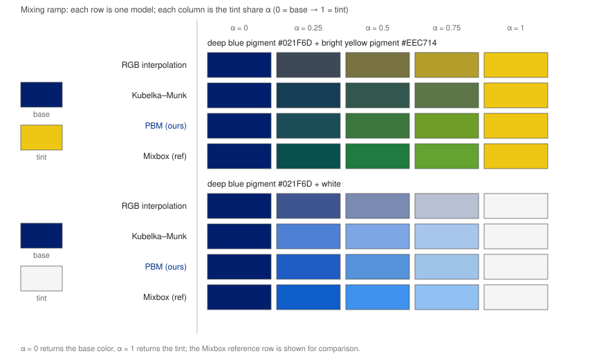
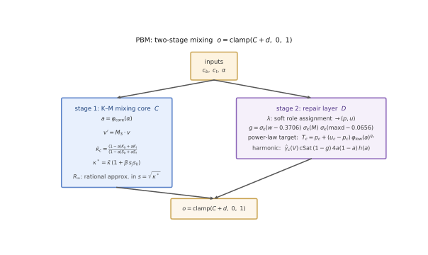
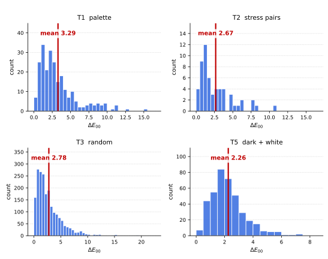
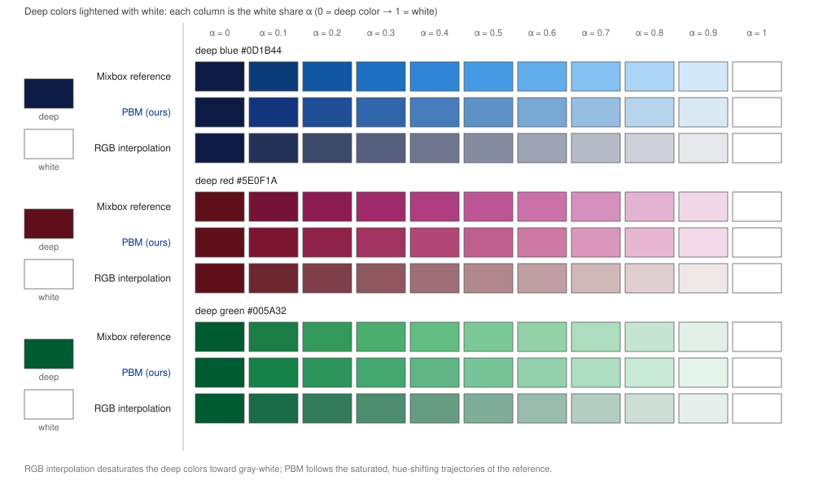
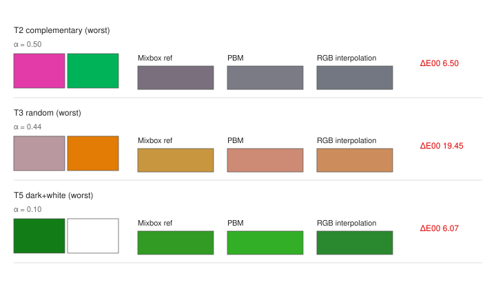
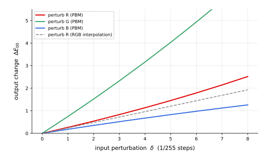
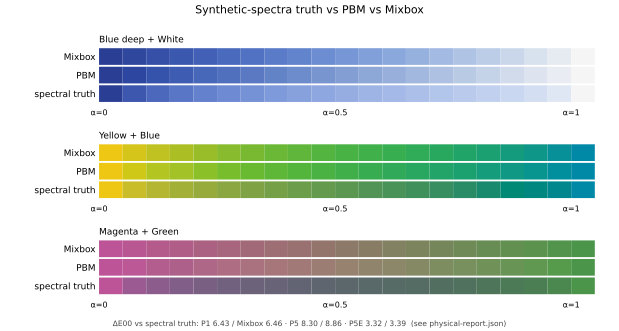
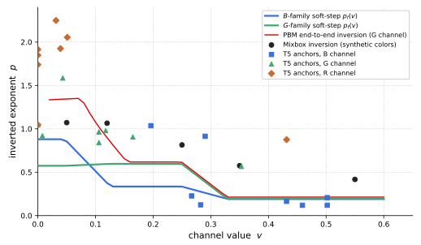

# Physics-Inspired Analytic Pigment Mixing: A Reference-Calibrated Kubelka–Munk Model without Lookup Tables

Author Name, Affiliation, Country

## Abstract

In paint-like media, colors are mixed by pigments, yet rendering pipelines mix them by linear interpolation in RGB. The two behave very differently: blue and yellow become green when mixed as paints but gray when mixed as colors of light, and deep colors lightened with white stay saturated with real paints but turn gray in software. The Kubelka–Munk (K–M) model predicts the pigment behavior, but requires per-pigment spectral data and per-wavelength integration, which has kept it out of software built on the RGB representation.

We present Pigment-Based Mixing (PBM), an analytic color-mixing model that operates directly on sRGB display values, in an RGB-in / RGB-out fashion. PBM combines a K–M/Duncan mixing core with a repair layer of three continuously blended mechanisms — a per-channel power-law target for dark + white mixing, an additive harmonic correction for complementary color pairs, and a soft role assignment that makes the model strictly exchange-symmetric. The model is reference-calibrated: its constants are fitted to the output of Mixbox 2.0, whose latent space is trained on measured pigment spectra, and PBM thereby inherits the reference's physical plausibility.

PBM is O(1) and fully analytic — no spectral data, no lookup tables, no iteration — exactly identity at α = 0/1, neighborhood-continuous, and strictly exchange-symmetric (maximum RGB difference 3.3×10⁻¹⁶). Measured against Mixbox 2.0, PBM reaches a mean ΔE00 of 2.41 on the dark + white suite and 2.9–3.1 on held-out random pairs; against an independent synthetic spectral world computed from two-constant spectral K–M mixing, it matches the reference on every suite, indicating no overfitting.

## CCS Concepts: • Computing methodologies → Rendering; • Software and its engineering → Software functional properties.

Additional Key Words and Phrases: pigment mixing, Kubelka–Munk, sRGB, CIEDE2000, Mixbox, color mixing model

## ACM Reference Format:

Author Name. 2026. Physics-Inspired Analytic Pigment Mixing: A Reference-Calibrated Kubelka–Munk Model without Lookup Tables. ACM Trans. Graph. 45, 6, Article XXX (December 2026), 12 pages. https://doi.org/10.1145/XXXXXXX.XXXXXXX

## 1 Introduction

Mix blue and yellow paint and you get green. Mix the same two colors in any painting software and you get gray. The reason is not a bug in the software but in its color representation: painting programs are built around RGB, which models the mixing of colored lights. When blue and yellow light hit the same spot, their spectra add up and the result is gray — but paints get their color from pigment particles that selectively absorb and scatter light, and that behavior is highly non-linear. Blue and yellow making green is the most striking consequence; two others matter just as much for painting. Complementary pairs mixed together produce muddy neutrals (olives, browns, dark violets) instead of gray, and deep colors lightened with white stay saturated and shift hue instead of turning gray (Figure 1). None of these behaviors can be produced by linear interpolation in RGB (Figure 1, top rows).



**Figure 1:** In real life, deep blue and yellow make green, and deep colors lightened with white stay vivid. In today's painting software they mix toward gray instead. PBM rectifies this: the top block mixes a deep blue pigment with a bright yellow pigment and the bottom block the deep blue with white, each row showing one model (RGB interpolation, spectral K–M, PBM, Mixbox reference); each column is the tint share α = 0–1. The K–M row is the synthetic spectral truth of §5.8 — synthetic pigment spectra mixed by two-constant Duncan superposition — with the inputs being the rendered colors of the pure pigments; PBM tracks the same hue families (yellow × blue → green, deep + white stays saturated).

The physical reference for pigment mixing is the Kubelka–Munk two-flux model: the reflectance of an opaque paint layer is R∞(κ) = 1 + κ − √(κ² + 2κ) with κ = K/S, and Duncan (1940) showed that mixed pigments superpose their absorption and scattering coefficients linearly by concentration. K–M reproduces pigment behavior with remarkable accuracy, yet it has never been adopted by painting software. The reasons are practical, not scientific. K–M requires the spectral reflectance of each pigment, which cannot be obtained from RGB values; the persistent representation would have to grow from three channels to per-pixel spectra; and mixing two arbitrary RGB colors would require inverting the model — an iterative optimization with no analytic inverse, costing about 25 ms per mix (§5.7).

Mixbox (Sochorová and Jamriška, SIGGRAPH 2021) made K–M practical by a different route: it maps each RGB color into a 7-dimensional latent space trained on measured pigment spectra, mixes latents linearly, and decodes back to RGB. The result is the most accurate pigment-mixing model available, at the price of multi-megabyte lookup tables and a trained latent mapping that cannot be reduced to an analytic primitive — and the reference implementation is distributed under a non-commercial license.

This paper presents PBM (Pigment-Based Mixing), a fully analytic model that pursues the same goal in plain sRGB display-value space. PBM retains the K–M structure and repairs its one structural defect: in display-value space, the scattering of white (S = 1) dominates the mixture and washes out every channel of a deep pigment (§3.2). The model is a composition of two stages. The first is the analytic **K–M mixing core** (analytic K/S defaults, κ concentration superposition, a cross-channel mixing matrix, a mutual-absorption correction, and a symmetric endpoint-compression progress map φ). The second is the **repair layer**, composed of three continuously blended analytic mechanisms:

- a **per-channel power-law target** that repairs the structurally defective "dark + white" region (§3.4);
- an additive **harmonic correction** that reproduces the complementary-mixing families from a unified 19-feature template with chroma soft-attenuation — one continuous formula, no conditional patches (§3.4);
- a **soft role assignment** λ that makes the whole model strictly exchange-symmetric: F(b, t, α) ≡ F(t, b, 1−α) to 3.3×10⁻¹⁶ (§5.6).

Throughout this paper, "physics-inspired" refers to the K–M/Duncan structure of the model: its constants are fitted to the output of a reference implementation (Mixbox 2.0, §4), not to direct measurements of real paints. Because the reference's latent space is trained on measured pigment spectra, PBM inherits physical plausibility transitively; its accuracy against real paints is bounded by the reference's own accuracy plus PBM's measured deviation from it (§5.3, §6).

We design PBM against three requirements, which we consider essential for a color-mixing model to be practical in real-world software:

1. work directly on sRGB display values — no spectral data, no additional per-pixel channels;
2. handle all RGB colors — no clipping or distortion, exact α = 0/1 identity, and neighborhood continuity;
3. be fully analytic — no precomputed tables or trained data, independently implementable.

*Contribution.* Our main contribution is an analytic, reference-calibrated pigment-mixing model in sRGB display-value space that combines a physics-inspired K–M skeleton with full analyticity, strict exchange symmetry, and near-reference accuracy (Table 1) — implementable independently on any platform, without trained lookup tables or license restrictions. We additionally provide a reproducible parameter-estimation methodology based on output measurements of a reference implementation (§4), an ablation study quantifying each component (§5.4), and an evaluation against Mixbox 2.0 and an independent synthetic-spectral world (§5.3, §5.8), with an explicit in-sample / held-out split and bootstrap confidence intervals. The reference implementation is available at https://github.com/GameGeek-Saikel/pigment-based-mixing.

**Table 1: Positioning against the design requirements R1–R3 (§1) and measured accuracy (mean ΔE00; in-sample T5 and held-out T3, §5.3).**

| Model | R1: RGB-in/RGB-out | R2: identity / continuity | R3: fully analytic | T5 mean | Held-out T3 mean |
|-------|--------------------|--------------------------|-------------------|---------|------------------|
| **PBM (ours)** | ✓ | ✓ | ✓ | 2.41 | 2.90–3.07 |
| Mixbox 2.0 | ✓ | ✓ | ✗ (256³ LUT, trained) | reference | reference |
| RGB interpolation | ✓ | ✓ | ✓ | 8.13 | 3.27–3.46 |
| Raw K–M superposition | ✓ | ✓ | ✓ | 10.30 | 3.92–4.01 |

The rest of this paper is organized as follows. Section 2 reviews the physics of pigment mixing and related work. Section 3 formalizes PBM. Section 4 describes the parameter-estimation methodology. Section 5 reports the evaluation, and Section 6 discusses limitations.

## 2 Background and Related Work

### 2.1 The Physics of Pigment Mixing

The color sensation of a paint film arises from selective absorption and scattering of light by pigment particles; it is this wavelength-selective behavior that makes a mixture of blue and yellow paint appear green. The model of Kubelka and Munk [1931] predicts this outcome: given the absorption and scattering coefficients K_i(λ), S_i(λ) of N pigments and their concentrations c (non-negative, summing to one), the coefficients of the mixture are determined by linear superposition [Duncan 1940],

$$
K(c, \lambda) = \textstyle\sum_i c_i K_i(\lambda), \qquad
S(c, \lambda) = \textstyle\sum_i c_i S_i(\lambda),
$$

and the reflectance of an opaque layer is R∞(κ) = 1 + κ − √(κ² + 2κ) with κ = K/S. To display the mixture, the reflectance spectrum is integrated with an illuminant (D65) and the CIE standard observer functions, optionally with Saunderson's [1942] surface correction, and converted to sRGB — a pipeline introduced to computer graphics by Haase and Meyer [1992]; see Wyszecki and Stiles [2000] for the underlying colorimetry.

The K–M model has never been adopted by painting software in practice: it requires per-pigment spectral data and per-wavelength integrals, the persistent representation would have to grow from three RGB channels to per-pixel spectra, and some RGB colors cannot be mixed out of any known pigments [Pointer 1980].

### 2.2 Related Work

**RGB mixing.** Linear interpolation (the "lerp"), to which blending, smudging and compositing reduce, mimics colored-light mixing: blue and yellow mix to gray, and colors lose saturation when mixed with white — exactly the defects PBM is designed to repair.

**RYB mixing.** Gossett and Chen [2004] interpolate eight hand-picked colors in a 3D cube so that blue + yellow turns green; the colors produced are far from real pigment behavior (Table 1: 19.53 on T5).

**Subtractive mixing.** Overlaid-filter models account only for absorption, not scattering: yellow + blue yields green but too dark and off-hue. Hybrid subtractive–additive formulas [Simonot and Hébert 2014] lighten the result but share the color error.

**Data-driven approaches.** Lu et al. [2014] interpolate example pigment mixtures only at predetermined ratios; pigment-palette extraction [Aharoni-Mack et al. 2017; Tan et al. 2019] and reduced-order parametric models [Shugrina et al. 2020] target artwork manipulation, not interactive painting.

**Mixbox.** Sochorová and Jamriška [2021] encode an RGB color into a 7-dimensional latent vector — four pigment concentrations (Phthalo Blue, Quinacridone Magenta, Hansa Yellow, Titanium White) plus three additive residuals — trained on real pigment spectra so that latent mixtures stay inside the sRGB gamut, and mix latents linearly with precomputed 256³ encoder/decoder tables. Mixbox is the most accurate pigment-mixing model available; we adopt its public implementation as the reference for estimation and evaluation. But its mapping is trained and table-based, not analytic. PBM pursues the same goal — practical K–M-based mixing in RGB-in / RGB-out fashion — with a fully analytic model.

## 3 The Model

### 3.1 Overview and Notation

PBM operates purely on sRGB display values in [0, 1]: no linearization, transfer-function application, or color-space conversion is performed at any point. The model is a composition of two stages:

$$
\mathbf o = \mathrm{clamp}\big(\mathbf C + \mathbf d,\ 0,\ 1\big), \qquad
\mathbf C = \mathrm{Core}(\mathbf c_b, \mathbf c_t, \alpha), \qquad
\mathbf d = \mathrm{RepairLayer}(\mathbf c_b, \mathbf c_t, \alpha, \mathbf C)
$$

The repair layer is role-asymmetric while the core is symmetric; a λ-blended combination of the two role assignments makes the whole model **strictly exchange-symmetric**:

$$
F(\mathbf c_b, \mathbf c_t, \alpha) \equiv F(\mathbf c_t, \mathbf c_b, 1-\alpha)
$$

measured to hold to a maximum RGB difference of 3.3 × 10⁻¹⁶ (§5.6).

Notation: base color $\mathbf c_b$ and tint color $\mathbf c_t$ (sRGB display-value triplets in [0, 1]), ratio $\alpha = \mathrm{clamp}(A, 0, 1)$ — the **tint share** (α = 0 yields the base, α = 1 the tint); the **pigment endpoint** $\mathbf p$ and the **bright end** $\mathbf u$ are decided by the soft role assignment λ (§3.4): the darker-maximum input plays the pigment, the other the bright end; from the pigment endpoint we derive $M = \max(\mathbf p)$, $m = \min(\mathbf p)$, $\mathrm{maxd} = M - m$, and the shared white floor $w = \max(\min(\mathbf p), \min(\mathbf u))$; $\sigma_k(x) = \mathrm{clamp}(k x, 0, 1)$ is the soft step with slope k, and $\mathrm{ss}(x; a, b)$ the C¹ smoothstep over [a, b].

### 3.2 The Structural Defect of Display-Value κ Mixing

The physical core of PBM mixes in sRGB display-value space. When one of the colors is white (display value 1.0), the white pigment has K = 0 and S = 1, whereas a deep pigment has S ≈ 0.05–0.35. The scattering of the white dominates the denominator at any α, and all channel κ values collapse together. Take the deep blue #0D1B44 = (0.051, 0.106, 0.267) mixed with white at α = 0.5 (R channel):

$$
\bar\kappa_R = \frac{0.5 \cdot K(0.051) + 0.5 \cdot K(1)}{0.5 \cdot S(0.051) + 0.5 \cdot S(1)} = \frac{0.5 \cdot 0.451}{0.5 \cdot 0.051 + 0.5 \cdot 1} = 0.429
$$

which yields R∞ ≈ 0.41, while the Mixbox reference reads R = 0.28 — the absorbing channel is *washed out by the white*; the bright channel (B) reads 0.89 in the reference versus 0.53 in the model — it is *under-lightened*. This is a **structural** defect of K/S mixing in display-value space: the S = 1 of white dominates the scattering of any deep pigment at any α, and no scaling of K/S can repair it at the mixing stage, because K̄ and S̄ are structurally clamped by the α weighting. Raw K–M superposition measures 10.30 mean ΔE00 on the dark + white suite (§5.3).

### 3.3 The Mixing Core

Both inputs are transformed by the cross-channel mixing matrix M₃ (row sums one — wide-band mixing), and absorption/scattering are the analytic defaults:

$$
\mathbf v' = M_3\,\mathbf v, \qquad
M_3 = \begin{pmatrix}
  0.74523981 & 0.30403013 & -0.04926994 \\
  0          & 0.74093256 &  0.25906744 \\
  0          & 0          &  1
\end{pmatrix}
$$

$$
K(v') = \tfrac12 (1-v')^2, \qquad
S(v') = \max(v',\ \varepsilon), \qquad \varepsilon = 0.00157634
$$

The mixture ratio κ superposes in the Duncan structure, clamped to [10⁻⁶, 10⁴]:

$$
\bar\kappa_c = \frac{(1-\alpha)\,K(v'_{b,c}) + \alpha\,K(v'_{t,c})}{(1-\alpha)\,S(v'_{b,c}) + \alpha\,S(v'_{t,c})}
$$

The mutual-absorption correction is applied per channel, with {j, k} the other two channels:

$$
s'_c = \frac{\sqrt{\bar\kappa_c}}{1+\sqrt{\bar\kappa_c}}, \qquad
\kappa_c^* = \bar\kappa_c \left(1 + \beta_c\, s'_j\, s'_k\right), \qquad
\beta = (-0.69372345,\ -0.48397409,\ -0.24977842)
$$

The reflectance is evaluated with a rational approximation in the s = √κ domain (matching the first four Taylor coefficients of R∞, max absolute error 3.2×10⁻³), and the output is mapped back:

$$
R_\infty \approx \frac{1}{1 + s\left(a_1 + s\left(a_2 + s\,a_3\right)\right)}, \qquad
s = \sqrt{\kappa^*}, \qquad
(a_1, a_2, a_3) = \left(\sqrt2,\ 1,\ \tfrac{1}{2\sqrt2}\right)
$$

$$
\mathbf o = \mathrm{clamp}\left(M_3^{-1}\, R_\infty(\boldsymbol\kappa^*),\ 0,\ 1\right)
$$

*Dynamic progress φ.* The reference converges far faster than display-value κ mixing on the deep side of α → 1: inverting the reference at α = 0.99 shows the power-law target needs an equivalent progress of a_eff ≈ 0.001 — "99% behaves like 99.9%" (§4). We encode this in a symmetric endpoint-compression map applied to the core's mixing ratio:

$$
\varphi_{\mathrm{low}}(x) = \begin{cases} x, & x \ge w_\varphi \\ (1-\mathrm{ss}(x;0,w_\varphi))\,x^{p_\varphi} + \mathrm{ss}(x;0,w_\varphi)\,x, & x < w_\varphi \end{cases}
$$

$$
\varphi_{\mathrm{core}}(x) = \begin{cases} \varphi_{\mathrm{low}}(x), & x < 0.5 \\ 1 - \varphi_{\mathrm{low}}(1-x), & x \ge 0.5 \end{cases}
$$

with p_φ = 2.31336 and w_φ = 0.08. φ_core is C¹ and antisymmetric about α = 0.5, so the core keeps its exchange symmetry; φ_low(x) = x identically for x ≥ w_φ, so only the tails are affected. The map also repairs the "blind zone" of the model — near-neutral deep colors (maxd < 0.0656) fall below the repair gate and are mixed by the core alone, where the reference's tail convergence deviates from linear progress in the same direction (measured: #FFFFFF + #0D1B44 at α = 0.99 improves from ΔE00 2.6 to 1.3; the two-sided tail suite T5E, §5.2, supervises this region).

At the α = 0/1 endpoints the core returns the base/tint unchanged. The analytic defaults and correction terms are engineering forms fitted to the reference output (§4), not quantities derived from pigment physics; the "physical" character of PBM lies in the K–M/Duncan skeleton, not in these constants.

### 3.4 The Repair Layer

The repair layer computes the correction delta d over the core output (Figure 2), as the composition of three mechanisms: the *role assignment* λ, the *power-law target* (dark + white repair), and the *harmonic correction* (complementary families).



**Figure 2:** PBM data flow: both inputs feed the K–M mixing core (C); the repair layer assigns the pigment and bright-end roles (λ), evaluates the per-channel power-law target (T) gated by g, and adds the harmonic correction γ̂; the correction delta d is added to the core output and clamped.

**Soft role assignment.** The pigment endpoint is the input with the larger max channel; a hard argmin would switch roles discontinuously at max(c_b) = max(c_t). We replace it with a soft membership:

$$
\lambda = \mathrm{ss}\Big(\tfrac{\max(\mathbf c_t) - \max(\mathbf c_b) + E_W}{2 E_W};\ 0,\ 1\Big), \qquad E_W = 0.08
$$

λ = 1 selects (p, u, a_eff) = (c_b, c_t, α), λ = 0 selects (c_t, c_b, 1−α), and inside the tie band |max(c_t) − max(c_b)| < E_W the two branches are blended:

$$
\mathbf d = \lambda\, D(\mathbf c_b, \mathbf c_t, \alpha) + (1-\lambda)\, D(\mathbf c_t, \mathbf c_b, 1-\alpha)
$$

Outside the band (about 85% of random pairs) λ is exactly 0 or 1 and the layer reduces to a single evaluation of D. The role signal is the max channel: replacing it by a luminance signal flips the decision on 20.2% of 5000 random pairs and degrades T2 by +6.2% (§4). The exchange symmetry of the full model follows from the combination of the two branches.

**The dark + white gate.** The power-law target takes over only in the dark + bright-end region. The gate is a product of three soft steps with the shared slope k = 12.584001, so the model is neighborhood-continuous with no hard cutoff:

$$
g = \sigma_k(w - 0.3706311) \cdot \sigma_k(M) \cdot \sigma_k(\mathrm{maxd} - 0.06556298)
$$

The M factor is active only near black (M < 1/k ≈ 0.08); an upper band present in an earlier version saturated identically to 1 over M ∈ [0, 1] and was removed (§4). The gate is 0 for light or nearly-achromatic pigments, where the core output is used directly.

**Power-law target.** Within the gate region, dark + bright-end mixing is a per-channel power-law trajectory from the pigment toward the bright end:

$$
T_c = p_c + (u_c - p_c)\,\varphi_{\mathrm{low}}(a)^{q_c^{\mathrm{eff}}}
$$

(φ_low so that the target converges to the pigment faster than linear progress; the harmonic correction keeps the raw a_eff). The exponent q_c controls how fast channel c brightens and is composed of four parts.

*(a) Brightening exponent q_f(v) — the soft-step staircase.* Inverting the reference on anchored colors (§4, Appendix D.1) reveals a descending staircase in the channel value v: the dark segment holds the absorption (high p), the mid segment transitions, the bright segment advances quickly (low p). The minimal structure is two steps, realized by a single analytic soft-step formula with the shared slope k and step positions t₁ = 0.04633146, t₂ = 0.24928142:

$$
q_f^f(v) = c_1^f + (c_2^f - c_1^f)\,\sigma_k(v - t_1) + (c_3^f - c_2^f)\,\sigma_k(v - t_2), \qquad f \in \{B, G\}
$$

**Table 2: Soft-step coefficients per family (fitted).**

| Family | c₁ (dark segment) | c₂ (mid segment) | c₃ (bright segment) | Step positions / slope |
|--------|-------------------|------------------|---------------------|------------------------|
| B (blue, B maximal) | 0.88024633 | 0.33545176 | 0.19217412 | t₁ = 0.04633146, t₂ = 0.24928142, k = 12.584001 (shared) |
| G (green, G maximal) | 0.57387051 | 0.596528 | 0.19217412 (shared with B) | same |
| R (red) | — | — | — | neutral, q_R ≡ 1 (see (d)) |

*(b) Family soft mixing.* The family weights are pairwise dominance comparisons on the pigment channel values, naturally continuous when two channels are both high:

$$
g_R = \tfrac12\,\sigma_8(v_R - v_G) + \tfrac12\,\sigma_8(v_R - v_B), \qquad
g_G,\ g_B \ \text{analogously}
$$

$$
q_c^{base} = \frac{g_B\, q^B_c + g_G\, q^G_c + g_R\, q^R_c}{g_R + g_G + g_B}
$$

When the total dominance g_R + g_G + g_B is below 10⁻⁶, the base degrades to the equal-weight mean ⅓(q^B_c + q^G_c + q^R_c), covering near-gray pigments.

*(c) Channel residuals.* For near-zero channels, the reference curves depend on the channel, not the pigment (§4, Appendix D.2). The residual term is a shared amplitude times a piecewise-linear envelope that decays with the channel value:

$$
q_c \mathrel{+}= \mathrm{RES}_c\, e(v_c), \qquad
e(v) = \begin{cases} 0.9432 - 15.5475\,v, & v < 0.04 \\ 0.4580 - 3.735\,v, & 0.04 \le v < 0.12 \\ 0, & v \ge 0.12 \end{cases}
$$

with RES = (0, −0.25693718, −0.25693718) — a single shared value for G and B; the R residual is zero because the red family's near-zero behavior is carried by the directional responses.

*(d) Channel coupling and family directional responses.* Purple/magenta colors with two high channels brighten more slowly, and each family carries directional responses linear in the pigment channel values:

$$
q_c \mathrel{+}= 0.43251363 \cdot \sigma_{4.86795929}\Big(\max_{i\ne c} v_i\Big)
$$

$$
q_c \mathrel{+}= g_R\,g^{RTH}\,\delta^R_c + g_B\,\delta^B_c + g_G\,\delta^G_c, \qquad
g^{RTH} = \sigma_8(v_R - 0.21929798)
$$

with the three family responses (least-squares fits over the inversion residuals of 11 red-dominant fixed colors, Appendix D.3):

$$
\delta^R = \big[\, -0.28030789 - 0.31011215\,v_R,\quad 0.33194666 - 1.19791733\,v_G,\quad -0.45218018 + 1.71390058\,v_G \,\big]
$$

$$
\delta^B = \big[\, 0.40713961,\quad -0.08390816 + 0.76274462\,v_G,\quad 0 \,\big]
$$

$$
\delta^G = \big[\, -0.2367074 + 0.72220875\,v_R,\quad 0,\quad -0.30067864 + 1.03098891\,v_G \,\big]
$$

The gate g^RTH (v_R ≥ 0.219) is load-bearing: the linear formulas flip sign below it, and removing the gate raises the T5 near-black-red subset mean from ΔE00 2.9 to 13.8 (measured, §5.4). Physics: the Mixbox latent space is built on a CMY-class pigment basis; red-family pigments hold their green absorption when brightened while transmitting red, and yellow-brown families hold their blue absorption — the per-channel power laws in the channel directions are the family-residuals of the latent space. All terms are smooth, preserving neighborhood continuity.

**Harmonic correction.** Inverting the reference on complementary pairs (§4, Appendix D.4) reveals that the residual error concentrates in the middle of the mixing range with the characteristic shape 4α(1−α), with an amplitude that is a smooth function of the input colors. We model the complementary correction as a linear model over a unified feature template — one continuous formula for all hue-opposition families, no conditional patches:

$$
d_c \mathrel{+}= \hat\gamma_c(\mathbf p, \mathbf u) \cdot \mathrm{cSat}(\mathbf p, \mathbf u) \cdot (1 - g) \cdot 4\,a\,(1-a) \cdot h(a)
$$

where h(a) = σ₁₄(0.845 − a) is the endpoint suppression (the correction vanishes at α = 0/1 and at the deep tail), (1 − g) excludes the dark + white region, and cSat is the two-sided chroma soft-attenuation:

$$
\mathrm{cSat}(\mathbf p, \mathbf u) = \mathrm{ss}(\max(\mathbf p) - \min(\mathbf p);\ 0.02, 0.15) \cdot \mathrm{ss}(\max(\mathbf u) - \min(\mathbf u);\ 0.08, 0.30)
$$

cSat drives the correction to zero when either endpoint approaches the achromatic axis — essential for continuity: the hue-harmonic features have exploding gradients as chroma → 0 (a 1/255 perturbation of a gray-white tint can swing the hue by 30°), and cSat removes the explosion smoothly (measured: global max single-step ΔE00 2.86 without cSat versus 1.42 with it, §5.6). In the anchor/complementary region (chroma ≥ 0.3) cSat ≈ 1 and the full correction applies.

The amplitude γ̂_c is a linear function of a 19-feature template V computed once per pair (Table 3), with three coefficient sets fitted by least squares over a corpus of complementary-family measurements (Appendix D.4):

$$
\hat\gamma_c(\mathbf p, \mathbf u) = w_0^c + \textstyle\sum_{j} w_j^c\, V_j
$$

**Table 3: The unified feature template (19 features, computed once per pair; the three coefficient sets of §3.4 use the subsets marked R/G/B).**

| Feature | Definition | Used by |
|---------|-----------|---------|
| un, um | min(u), max(u) | R, G, B |
| pm, pn | max(p), min(p) | R, B (pm); B (pn) |
| wUcP | (u_R − u_B)(p_B − p_R) | B |
| gBp, gRp | pigment dominance gates (σ₈) | R (gBp, gRp) |
| gRu | tint R-dominance gate (σ₈) | B |
| s1hu | sin(h_u) | R |
| s2hp, c2hp | sin(2h_p), cos(2h_p) | R (s2hp); G (c2hp) |
| s3hp, c3hp | sin(3h_p), cos(3h_p) | R (s3hp); B (c3hp) |
| s2hu, c2hu | sin(2h_u), cos(2h_u) | G (s2hu); B (c2hu) |
| logu | log(u_R + 0.01) | R |
| s1hu_pm | sin(h_u)·σ₁₂.₅₈(pm − 0.30) | R |
| pc, dcAbs | p_R, \|u_R − p_R\| | R (pc); B (dcAbs) |

The three coefficient sets have 10, 5 and 9 features plus intercept (27 coefficients in total; values in Appendix B), with in-sample R² of 0.71, 0.52 and 0.51 on R/G/B. Unlike machine-learning latents, the template is hand-designed from the inversion measurements and the coefficients are least-squares fits; no data is stored at runtime.

The harmonic correction is what remains of the complementary-family machinery after the two hand-crafted "anchor patches" of an earlier version (19 smoothstep-gate conditions) were replaced by the continuous cSat-attenuated formula: it reproduces the same anchor pairs (yellow × deep blue 3.04, red × green 3.47 mean ΔE00 over α ∈ [0.05, 0.95]; §5.5) and additionally improves the families the patches did not cover, at the price of a small uniform degradation on the palette suite (T1 mean 3.844 vs 3.65 without the correction; §5.4) — a trade-off accepted in the fitting loss.

### 3.5 Implementation and Boundary Behavior

The complete mixing procedure is given in Algorithm 1.

**Algorithm 1: PBM mixing.**
```
φ_low(x):  x ≥ w_φ ? x : (1−ss(x;0,w_φ))·x^{p_φ} + ss(x;0,w_φ)·x      // §3.3
φ_core(x): x < 0.5 ? φ_low(x) : 1 − φ_low(1−x)

Core(b, t, a):                                    // K–M core (§3.3)
  a ← φ_core(a)
  v'_b ← M₃·b,  v'_t ← M₃·t
  κ̄_c ← ((1−a)·K(v'_{b,c}) + a·K(v'_{t,c})) / ((1−a)·S(v'_{b,c}) + a·S(v'_{t,c})),  K/S analytic defaults
  κ*_c ← κ̄_c·(1 + β_c·s'_j·s'_k),  s'_c ← √κ̄_c/(1+√κ̄_c)
  return clamp(M₃⁻¹·R∞(κ*), 0, 1)                                   // rational R∞

RepairDelta(p, u, aEff, C):                        // 修复分支增量 (o′ − C) (§3.4)
  M ← max(p);  maxd ← M − min(p);  w ← max(min(p), min(u))
  g ← σₖ(w−0.3706311)·σₖ(M)·σₖ(maxd−0.06556298)    // σₖ = clamp(k·x,0,1), k = 12.584001
  d ← [0,0,0]
  if g > 1e−6:
    q_c ← q_f(v_c) | family soft mixing | RES·e(v_c) | CPL | directional δ   // §3.4(a)–(d)
    T_c ← p_c + (u_c − p_c)·φ_low(aEff)^{q_c}
    d ← g·(T − C)
  V ← feature template(p, u)                        // Table 3, 19 features
  cSat ← ss(pm−pn; 0.02, 0.15)·ss(um−un; 0.08, 0.30)
  gSup ← 1 − g;  hA ← σ₁₄(0.845 − aEff)
  for c ∈ {R,G,B}:  d_c += γ̂_c(V)·cSat·gSup·4·aEff·(1−aEff)·hA
  return d

Input:  base c_b, tint c_t (sRGB display values in [0,1]), ratio A
1  α ← clamp(A, 0, 1);  if α = 0 return c_b;  if α = 1 return c_t
2  C ← Core(c_b, c_t, α)
3  te ← clamp((max(c_t) − max(c_b) + E_W) / (2·E_W), 0, 1)         // λ 角色分配 (§3.4)
4  if te ≤ 0:  d ← RepairDelta(c_t, c_b, 1−α, C)                    // 带外单分支（逐位等价）
5  else if te ≥ 1:  d ← RepairDelta(c_b, c_t, α, C)
6  else:  λ ← ss(te);  d ← λ·RepairDelta(c_b, c_t, α, C) + (1−λ)·RepairDelta(c_t, c_b, 1−α, C)
7  return clamp(C + d, 0, 1)
```

**Table 4: Boundary behavior.**

| Property | Guarantee |
|----------|-----------|
| α = 0/1 | returns the originals, exact identity (T4 channel error 0.00000) |
| Outside the gate region | g = 0 → mixing core direct output; inside → power-law target + harmonic correction; transition band smooth |
| Neighborhood continuity | entirely σ/linear/clamp/smoothstep structure plus soft role assignment; global perturbation probe: maximum single-step ΔE00 1.42, zero exceedances of the 1.53 threshold (§5.6) |
| Exchange symmetry | F(b, t, α) ≡ F(t, b, 1−α); measured max RGB difference 3.3×10⁻¹⁶ (§5.6) |

## 4 Parameter Estimation

All constants are fitted to or inverted from **output measurements** of the Mixbox 2.0 public API (`lerpFloat`, sRGB display-value float path); the fitting corpus, loss, and seeds are enumerated in Appendix A so that the procedure can be rerun against any future reference implementation.

The design is driven by **inversion measurements**: for each candidate color pair, we invert the reference output at progress α to read off the per-channel power exponent p_c(α) = ln((r_c − v_c)/(1 − v_c)) / ln α that a power-law trajectory would need (Appendix D.1). Three structural facts determine the repair-layer design: (i) **α-constancy** — p drifts by less than 0.2 across α ∈ [0.1, 0.9] in every family, supporting a single-exponent model (the drift at α → 1 is exactly the region repaired by the φ map); (ii) a **two-step staircase** in the channel value v — dark segments hold absorption, bright segments advance quickly — the empirical basis of the soft-step exponents of §3.4(a); (iii) **family and residual structure** — near-zero channels depend on the channel, not the pigment (RES, §3.4c), red-family pigments hold their green absorption when brightened (directional responses, §3.4d), and complementary mixtures leave a 4α(1−α)-shaped residual in the middle of the range (harmonic correction, §3.4). The supporting measurements are reported in Appendix D.

All parameters are then jointly fine-tuned by **coordinate descent** on the fixed corpus (loss: weighted mean + 0.35·max + 0.6·p95 + 0.25·median over T5, T1, T2, T3, the tail set, T5E and the eight anchor pairs, with a hard penalty on the T5 max; weights in Appendix A), leaving **5 tunable parameters**: qt2 = 0.24928142, pB0 = 0.88024633, pB1 = 0.33545176, cpl = 0.43251363, kc = 4.86795929. The remaining constants — including the 27 harmonic coefficients — are kept at their fitted values because re-fitting them does not reduce the loss. Structural simplifications adopted on measured evidence: the q-staircase slope merges into the shared gate slope (12.584001); the G and B upper staircase levels share one value (0.19217412); the upper gate band is removed (it saturates identically to 1 over M ∈ [0, 1]); the φ width w_φ shares the role-assignment width E_W = 0.08; the role signal of λ is the max channel (luminance flips the decision on 20.2% of 5000 random pairs and degrades T2 by +6.2% — the max signal is retained). The fitted constants are re-evaluated on held-out draws (§5.3) that were not used in fitting.

**Threshold sensitivity.** To check that the gate parameters are not tuned to knife-edge precision, each gate threshold and the shared slope k is perturbed by ±10% / ±20% while all other parameters stay fixed (Table 5).

**Table 5: Gate-parameter sensitivity — change in mean ΔE00 (ΔT5 / ΔT3) under ±10% / ±20% perturbation of each fitted gate parameter (measured).**

| Parameter | ×0.8 | ×0.9 | ×1.1 | ×1.2 |
|-----------|------|------|------|------|
| w₀ (0.3706311) | +0.000 / −0.119 | +0.000 / −0.059 | +0.000 / +0.038 | +0.000 / +0.102 |
| maxd₀ (0.06556298) | +0.003 / −0.005 | +0.000 / −0.002 | +0.003 / +0.003 | +0.007 / +0.005 |
| shared slope k (12.584001) | +0.010 / −0.002 | −0.009 / −0.002 | +0.035 / +0.002 | +0.076 / +0.004 |

Every perturbation changes the T5 mean by at most 0.08 ΔE00 and the T3 mean by at most 0.12; the T5 max stays 6.1 for all perturbations except k × 1.2 (8.6). The fitted thresholds sit in a plateau of the loss.

## 5 Experimental Evaluation

### 5.1 Reference and Metric

- **Reference**: Mixbox 2.0 `mixbox.lerpFloat(base, tint, a)` — the public API of the reference implementation (Sochorová and Jamriška 2021; loaded from the official CDN, research comparison only).
- All measurements use the **float path** (sRGB display-value floats in [0, 1]) to avoid 8-bit quantization noise.
- **Metric**: ΔE00 (CIEDE2000, Sharma/Wu/Dalal 2005), validated against the 34 reference pairs (max deviation < 1×10⁻⁴). Bootstrap 95% confidence intervals (1000 resamples) are reported for the means of random sets.

### 5.2 Test Sets

Table 6 summarizes the test sets and their role in the fitting/evaluation split; exact definitions, α grids, seeds and color lists are given in Appendix A.

**Table 6: Evaluation test sets.**

| Set | Content | n | Role |
|-----|---------|---|------|
| T1 palette | all pairs of the preset palette (10 bases × 8 tints) × α ∈ {0.25, 0.5, 0.75} | 240 | in-sample (fitting corpus) |
| T2 stress pairs | complementary 3 / RYB mismatch 6 / white-black 6 / similar 4 × 3 α | 57 | in-sample (fitting corpus) |
| T3 random | uniform sRGB pairs × α ∈ [0, 1], fixed seed | 2000 | mixed (see below) |
| T4 identity | 10 colors × α ∈ {0, 1} self-mixing | 20 | structural |
| T5 dark + white | high-saturation deep colors × white (20 fixed + 24 random) × 9 α levels | 396 | in-sample (fitting corpus) |
| T5-heldout | random deep colors (fresh seed 20260812, same quantization as T5) × 9 α levels | 216 | held-out |
| tail set | T5 fixed colors × α ∈ [0.92, 0.99] (160) + deep-blue blind-spot colors × full α (81) | 241 | in-sample (fitting corpus) |
| T5E two-sided tail | chromatic deep colors × deep-side α (120) + near-neutral deep colors × deep-side α (72) + near-neutral deep colors × light-side α (48) | 240 | in-sample (fitting corpus) |

**T5E — the two-sided tail suite.** The standard suites cover α ∈ [0.1, 0.9] (T5) and α ∈ [0.92, 0.99] (tail), leaving the deep side α ∈ [0.001, 0.1] uncovered; near-neutral deep colors (maxd below the gate threshold) fall below the repair gate and are mixed by the core alone, which deviates there (e.g. #F2F2EF + #000B2E at α = 0.05 measured ΔE00 6.5 before the φ map). T5E adds deep-side α levels {0.001, …, 0.1} for the 20 T5 fixed colors and for 12 near-neutral deep colors (blind zone), plus light-side levels {0.92, …, 0.99} for the same near-neutral colors; it enters the fitting loss with weight 0.15.

**In-sample / held-out split.** The fitting corpus contains T1, T2, T5, T5E, the tail set, and the first 800 pairs of T3 (seed 20260808). Held-out: the disjoint T3 slice [800:2000), two fully independent T3 draws (seeds 20260809, 20260811, disjoint from every fitting seed), and the T5-heldout suite (fresh seed 20260812).

### 5.3 Results

*In-sample results.* ΔE00 mean / max against the Mixbox 2.0 reference (Table 7). Figure 4 plots the full ΔE00 distributions.



**Figure 4:** ΔE00 histograms of PBM on the T1/T2/T3/T5 suites (bin 0.5; red line: mean). The mass concentrates below 4 ΔE00; the right tail is dominated by the complementary mixing families (§5.5).

**Table 7: In-sample results (ΔE00 mean / max).**

| Model | T1 mean/max | T2 mean/max | T3(fit 800) mean/max | T5 mean/max | tail mean/max | T4 |
|-------|-------------|-------------|----------------------|-------------|---------------|-----|
| **PBM (ours)** | **3.844 / 26.1** | **3.244 / 9.4** | **3.017 / 19.4** | **2.407 / 6.1** | **1.713 / 7.9** | 0.00000 |
| RGB interpolation | 5.053 / 39.0 | 5.526 / 39.4 | 3.374 / 27.5 | 8.127 / 20.9 | 5.878 / 20.6 | pass |
| Kubelka–Munk (K/S superposition) | 4.867 / 27.4 | 5.199 / 25.2 | 3.964 / 23.7 | 10.299 / 23.6 | 9.877 / 24.1 | pass |

*Held-out results.* ΔE00 mean / max (bootstrap 95% CI for the mean in brackets) — Table 8. The T5-heldout column covers 24 random deep colors of the fresh seed 20260812 with the same quantization and α grid as T5:

**Table 8: Held-out results (ΔE00 mean / max [95% CI]).**

| Model | T3 slice [800:2000) mean/max | T3 seed 09 mean/max | T3 seed 11 mean/max | T5-heldout mean/max |
|-------|------------------------------|---------------------|---------------------|---------------------|
| **PBM (ours)** | **2.982 / 19.2** [2.841, 3.128] | **2.895 / 18.0** [2.788, 3.007] | **3.066 / 22.9** [2.951, 3.186] | **2.607 / 14.6** [2.405, 2.835] |
| RGB interpolation | 3.456 / 36.8 | 3.273 / 34.5 | 3.425 / 34.6 | 7.612 / 17.1 |
| Kubelka–Munk | 4.002 / 31.5 | 3.918 / 31.4 | 4.010 / 32.8 | 9.517 / 17.3 |

Three observations. First, the held-out means differ from the fitting draw by at most 0.12 ΔE00 (T3 slice 2.982 vs 3.017) and the independent draws (2.895, 3.066) stay within the same band — no evidence of overfitting. Second, the held-out max values (18.0–22.9) lie in random complementary pairs; the complementary family is the dominant source of large errors (§5.5). Third, the dark + white repair generalizes: on T5-heldout PBM measures 2.607 — 0.20 above the in-sample T5 mean — while RGB interpolation (7.61) and raw K–M superposition (9.52) stay at their in-sample levels. Figure 5 visualizes this on three deep colors lightened with white.



**Figure 5:** Deep colors lightened with white across three models. RGB interpolation desaturates the gradients toward gray-white; PBM follows the saturated, hue-shifting trajectories of the Mixbox reference — the very behavior the dark + white repair of §3.4 is designed to produce.

*Two-sided tail.* On the T5E suite (240 samples) PBM measures mean ΔE00 2.353 / max 9.5 (p95 7.75) — inside the design thresholds (mean < 5, max ≤ 15). The φ map improves the pairs it was designed for: #F2F2EF + #000B2E at α = 0.05 from ΔE00 6.5 to 2.5, and #FFFFFF + #0D1B44 at α = 0.99 from 2.6 to 1.3 (measured before/after).

### 5.4 Ablation Study

Table 9 quantifies each component's contribution by disabling it in the reference implementation (ΔE00 mean / max; same draws as §5.3, T3 the full seed-20260808 draw of n = 2000).

**Table 9: Ablation study (ΔE00 mean / max).**

| Configuration | T1 | T2 | T3 | T5 | tail |
|---------------|-----|-----|------|------|-------|
| **PBM (full)** | **3.844 / 26.1** | **3.244 / 9.4** | **2.996 / 19.4** | **2.407 / 6.1** | **1.713 / 7.9** |
| − cross-channel matrix M₃ | 4.314 / 33.5 | 4.181 / 19.1 | 3.395 / 30.0 | 2.408 / 6.1 | 1.713 / 7.9 |
| − mutual-absorption β | 3.877 / 26.9 | 3.065 / 10.4 | 3.013 / 19.7 | 2.410 / 6.1 | 1.713 / 7.9 |
| − channel coupling | 4.354 / 26.1 | 3.545 / 9.4 | 4.144 / 30.5 | **9.255 / 21.4** | 5.157 / 21.4 |
| − family directional responses | 4.051 / 26.1 | 3.319 / 9.4 | 3.200 / 23.8 | 4.820 / 15.5 | 3.341 / 12.3 |
| − harmonic correction (γ) | 3.648 / 15.3 | 3.545 / 13.5 | 2.898 / 20.0 | 2.407 / 6.1 | 1.713 / 7.9 |
| − power-law repair (gate ≡ 0) | 4.258 / 26.1 | 3.665 / 9.4 | 3.518 / 19.0 | **9.823 / 23.8** | 8.406 / 24.0 |
| power-law takeover (gate ≡ 1) | 4.789 / 25.4 | 5.339 / 24.5 | 2.945 / 26.0 | 2.411 / 6.1 | 1.702 / 7.9 |

*Summary.* (i) The power-law repair and the channel coupling are the two largest contributors on the dark + white suite (T5 2.407 → 9.823 without the repair, → 9.255 without coupling), and coupling is also the strongest term on the main suites (T3 2.996 → 4.144). (ii) The cross-channel matrix M₃ is second strongest on the main suites (T1 3.844 → 4.314, T2 3.244 → 4.181) and neutral on T5, where the repair takes over. (iii) The family directional responses matter on T5 (→ 4.820) and at the tail (→ 3.341). (iv) The mutual-absorption β has a small, mixed effect (T2 improves without it, 3.065; T1 degrades, 3.877) and is retained because its removal increases the maximum errors in the complementary families. (v) The harmonic correction concentrates its benefit on the complementary families (T2 mean 3.545 → 3.244, max 13.5 → 9.4) at a small uniform cost on T1/T3 (≤ +0.2) — a trade-off encoded in the fitting loss. (vi) Forcing the power-law target everywhere (gate ≡ 1) degrades the main suites substantially (T1 → 4.789, T2 → 5.339) — the gate's region selection is necessary, not decorative.

### 5.5 Worst-Pair Analysis

The largest errors concentrate in the *complementary mixing families* (orange/red + blue, pale neutrals + orange) at ΔE00 9.4–26.1. The T1 worst pair is orange #F07A2A + ultramarine #2E5EFF at α = 0.5 (26.14); the T3 worst pair is pale pink-gray #BA98A0 + bright orange #E37C04 at α ≈ 0.44 (19.45). These are exactly the mixtures where magenta's double-band reflectance creates high-order cross-channel correlations that a per-channel independent model cannot follow, and where the residual of the linear harmonic model is largest (§6). The harmonic correction reproduces the families it was fitted on: the eight anchor pairs measure mean ΔE00 3.04 (yellow × deep blue #FFC400 + #000F3D), 3.78 (yellow × near-boundary #FFC400 + #000724), 3.47 (red × green #A30000 + #00B359), 5.40 (red × cyan #A30000 + #00D5C0), 3.01 (magenta × green #E33BA8 + #00B359), 5.77 (orange × blue #FF7A1A + #2E5EFF), 8.10 (orange × deep blue #FF7A1A + #001B75), 6.61 (red × deep blue #A30000 + #001B75), all over α ∈ [0.05, 0.95] — down from the 10–23 range of the raw core alone (measured, §5.4). On T5, the worst pair is a random deep green mixed with white at α = 0.1 (ΔE00 6.07); among fixed colors the near-black purple #2A0A5E at α = 0.5 (6.05) — the near-black region remains the residual of the dark + white repair. The red-family fixed subset measures mean 2.9 / max 4.3, with the range gate in place versus 13.8 without it (§3.4d). Figure 6 shows the worst pairs of the three suites.



**Figure 6:** Worst pairs of the T2 complementary, T3 random, and T5 dark+white suites: input colors, Mixbox reference output, PBM output, RGB interpolation output, and ΔE00. The largest errors concentrate in complementary mixtures, where the reference's four-pigment latent space creates cross-channel correlations that a per-channel independent model cannot follow (§5.5).

### 5.6 Neighborhood Continuity and Exchange Symmetry

- 8-bit input step perturbation: global random probe (4000 pairs, every channel ±1/255 and α + 0.004) yields a maximum single-step output ΔE00 of **1.42**, with **zero** exceedances of the 1.53 threshold;
- all gates are soft σ gates with shared slopes; family weights, residual envelope and coupling are smooth; role assignment and chroma attenuation are C¹ smoothsteps — the model is everywhere continuous;
- the chroma attenuation cSat is load-bearing for continuity: without it the same probe measures 2.86 (24 exceedances), because the hue-harmonic features have exploding gradients near the achromatic axis (Figure 7);
- **exchange symmetry**: F(b, t, α) ≡ F(t, b, 1−α) over 5000 random pairs, max RGB difference 3.3 × 10⁻¹⁶ (bitwise-consistent up to the float order of the two branches).



**Figure 7:** Neighborhood continuity: output change ΔE00 vs. the unperturbed output as a function of the input perturbation (1/255 steps on each channel of the deep blue #0D1B44, mixed with white at α = 0.5); the dashed line shows the RGB interpolation response for comparison.

### 5.7 Performance

Requirement R3 positions PBM as fully analytic — no precomputed tables, no training data. Table 10 reports per-mix timings of the reference JavaScript implementations used throughout this paper, measured in Node.js on the same deterministic inputs (T3 seed 20260808; PBM/Mixbox/lerp: 100 000 pairs × 5 repetitions after warm-up; the spectral K–M paths are measured on the first 2 000 pairs, whose iterative inversion dominates the runtime).

**Table 10: Runtime cost per mix (measured, Node.js; median of 5 runs).**

| Model | Path | ns/op | ops/s |
|-------|------|-------|-------|
| PBM (ours) | analytic float arithmetic | 3 630 | 275 000 |
| Mixbox 2.0 | 256³ LUT lookup | 1 970 | 508 000 |
| RGB interpolation | linear blend | 21 | 48 000 000 |
| K–M spectral, direct (spectra known) | per-wavelength K/S + D65×CMF | 1 290 | 778 000 |
| K–M spectral, RGB-in | iterative unmix (RGB → pigment concentrations) + spectral mix | 25 400 000 | 39 |

PBM costs ~3.6 µs per mix — 1.85× the reference's LUT lookup and ~175× a linear blend. The spectral K–M pipeline is not slow in itself: with pigment spectra known, the forward per-wavelength integration costs only ~1.3 µs per mix. The wall is the **interface**: to mix two arbitrary RGB colors, spectral K–M must first invert each color into pigment concentrations, an iterative optimization costing ~25.4 ms per mix — 7 000× PBM. This is the practical reason painting software never adopted spectral K–M: mixing is cheap, but the RGB→spectrum inversion is not, and no analytic inverse exists. PBM's advantage is therefore not raw speed but interface: it needs no spectral representation, no inversion, no multi-megabyte table, and ports directly to any platform (the demo page and the evaluation suite run the same code headless in Node and in the browser). In interactive painting, mixing is applied per stroke or per operation rather than per rendered pixel; per-pixel rendering would use vectorized or GPU implementations in either model, for which the analytic form is the more portable one. The strict exchange symmetry costs the second repair branch only inside the tie band (about 15% of random pairs); outside, the branch is skipped.

### 5.8 Validation against an Independent Synthetic Spectral World

The evaluation of §5.3 measures PBM against the Mixbox reference. This section cross-validates against an independent ground truth computed from **synthetic pigment spectra**.

*Why synthetic.* To keep this validation free of third-party data rights and fully reproducible, we synthesize 29 pigment spectra from a **first-principles two-constant K–M model** (Appendix C.1): separate absorption K(λ) and scattering S(λ) per pigment, Gaussian absorption bands (transition-metal d–d transitions, organic π–π\* bands) and logistic absorption edges (semiconductor-type pigments) with band positions fixed by first-principles pigment chemistry (yellow/orange/red steep edges in the blue-green region, blue/green red-side edges, magenta's green-region band), plus 5 darkened deep pigments for the dark + white suites. The numerical parameters (amplitudes/widths/bases/scattering) are calibrated against the publicly available BabelColor X-Rite ColorChecker Classic averaged spectra [Pascale 2012] (30-chart average, 24 formulated color-card patches, 10 nm) — a documented reference source [Pascale 2012] (Appendix C.1; `spectral/calibrate.js` reproduces the fit from a local copy).

*Setup.* The spectral truth of the synthetic world is the forward K–M pipeline of §2.1 with **separate Duncan superposition of K and S** (K̄ = (1−α)K_A + αK_B, S̄ likewise — the two-constant form used for real paints), D65 × CIE 1931 2° integration (10 nm grid) and IEC sRGB conversion (Appendix C.2). The *inputs* to all models are the rendered sRGB colors of the pure pigments, avoiding the "colors that cannot be mixed from pigments" issue [Pointer 1980]. Six suites mirror the T-suite structure: P1 all pigment pairs × α ∈ {0.25, 0.5, 0.75}; P2 complementary/stress pairs; P3 random pigment pairs (fresh seed 20260813); P5 deep pigments × white; P5-buff × buff; P5E the two-sided tail α grid (Appendix C.3). The models compared are PBM, Mixbox, RGB interpolation and raw display-value K–M superposition, each measured with ΔE00 against the same spectral truth.

*Results.* Table 11 reports mean / max ΔE00.

**Table 11: ΔE00 vs the synthetic-spectra reference (mean / max; bootstrap 95% CI for random sets in brackets; out-of-gamut samples clamped and counted).**

| Model | P1 (n=828, oog 6) | P2 (n=27, oog 0) | P3 (n=2000, oog 35) | P5 (n=135, oog 0) | P5-buff (n=135, oog 2) | P5E (n=150, oog 6) |
|-------|--------------------|------------------|----------------------|--------------------|-------------------------|----------------------|
| **PBM (ours)** | 6.43 / 32.9 [6.12, 6.75] | 12.42 / 24.5 | 5.42 / 31.4 [5.22, 5.63] | 8.30 / 22.2 [7.51, 9.12] | 5.03 / 16.6 | 3.32 / 13.9 |
| Mixbox 2.0 (ref) | 6.46 / 31.5 [6.10, 6.83] | 12.71 / 24.9 | 5.10 / 30.2 [4.86, 5.33] | 8.86 / 25.0 [7.95, 9.75] | 4.56 / 18.9 | 3.39 / 20.9 |
| RGB interpolation | 6.14 / 29.5 | 11.25 / 20.4 | 4.89 / 25.4 | 8.24 / 27.0 | 5.95 / 15.8 | 3.88 / 26.9 |
| K–M display-value | 5.55 / 30.5 | 8.82 / 16.6 | 4.38 / 30.5 | 12.13 / 30.8 | 4.95 / 18.1 | 4.25 / 28.2 |



**Figure 8:** Synthetic-spectra truth vs PBM vs Mixbox for three representative pigment pairs (deep blue × white, yellow × blue, magenta × green), α = 0–1 (21 steps). The hue families agree — deep blue lightens along a blue trajectory, yellow × blue turns green, magenta × green muddies — the qualitative claims of the paper reproduced against an independent synthetic world.

Three observations. First, **PBM matches the reference against this independent world**: per-suite mean differences span −0.71 (P2) to +0.56 (P5) and every pair of bootstrap CIs overlaps. Neither model was trained on this world, so the parity indicates that PBM's accuracy is not an artifact of overfitting to the reference's outputs; the per-suite differences (PBM closer on P1 6.43 vs 6.46, P2 12.42 vs 12.71, P5 8.30 vs 8.86, P5E 3.32 vs 3.39; the reference closer on P3 5.42 vs 5.10 and P5-buff 5.03 vs 4.56) are within noise. Second, **hue trajectories agree even better**: PBM tracks the synthetic truth with mean |Δhue| 10.4°/6.1° median on P1 (Mixbox 11.0°/6.0°), 9.6°/6.3° on P5, and 2.6°/0.6° on P5E — matching or beating Mixbox on every suite (Table 12); yellow × blue still turns green and deep + white keeps its hue under two-constant spectral mixing itself (Figure 8). Third, **the residual absolute errors are structural**: the synthetic world mixes by spectral K–M while Mixbox mixes in a trained latent polynomial; with display-target endpoints this residual is 3.3–12.9 ΔE00, bounded below by the same display-space nonlinearity analyzed in §3.2.

**Table 12: Hue agreement with the synthetic spectral truth — mean / median |Δhue| in degrees over chromatic samples (C* > 10).**

| Suite | PBM | Mixbox |
|-------|-----|--------|
| P1 | 10.39 / 6.07 | 11.01 / 5.96 |
| P2 | 19.11 / 9.55 | 21.46 / 18.01 |
| P3 | 8.43 / 4.32 | 8.64 / 3.73 |
| P5 | 9.63 / 6.32 | 9.67 / 7.15 |
| P5-buff | 8.73 / 5.90 | 8.62 / 5.30 |
| P5E | 2.59 / 0.61 | 2.73 / 0.74 |

*What this does and does not establish.* The experiment validates that (i) PBM's accuracy is not an artifact of overfitting to Mixbox's outputs — against an independent synthetic spectral world PBM matches the reference's accuracy and reproduces its qualitative behavior families; and (ii) the paper's qualitative claims — complementary mixing produces green/muddy families, deep + white preserves hue — hold under two-constant spectral K–M mixing itself. It does *not* claim prediction of real-paint masstone mixing, nor does it establish that PBM is closer to real paint physics than the reference: the synthetic world is itself an approximation (two-constant K–M), and PBM's physical plausibility derives transitively from the reference — trained on measured pigment spectra — bounded by PBM's own deviation from it (mean 2.41 on T5 / 2.90–3.07 on held-out T3; max 9–26 on complementary families, §5.5).

## 6 Limitations and Future Work

*The nature of the residual error.* The largest T5 residual (near-black region, ΔE ≈ 6) and the largest main-suite residuals (complementary families, ΔE 9.4–26.1) share the same origin: the Mixbox latent space expresses its gamut on a four-pigment basis (Phthalo Blue / Quinacridone Magenta / Hansa Yellow / Titanium White), and the high-order cross-channel correlations of the red-family pigments (magenta's double-band reflectance) are inherent to the latent-space polynomial, not reachable by per-channel independent forms. PBM approaches the latent-space behavior along four dimensions — the K–M core, the power-law exponents, the harmonic correction, and the φ endpoint map — reducing the T5 mean to 2.41 while keeping the model fully analytic; the remaining complementary-family errors (red × deep blue, orange × deep blue on the deep side, magenta × green's non-monotone trajectory) dominate the max statistics of the main suites.

*The near-neutral deep blind zone.* Near-neutral deep colors (maxd ∈ [0.02, 0.06]) fall below the gate and are mixed by the core alone; the q staircase is fitted on chromatic deep colors, whose channel structure differs from the ~1.3 exponent needed across all channels for grayish deep colors. The residual measures max ΔE00 ≈ 9.5 on the light side (α ∈ [0.92, 0.99]) and mean 2.35 over the whole T5E suite — inside the design thresholds, but the max is the largest of any suite. The φ map mitigated but did not eliminate it; a staircase re-fit or a dedicated blind-zone term is left for future work.

*Relation to Mixbox.* Mixbox = linear latent mixing + polynomial latent mapping, trained on measured pigment spectra; PBM = analytic K–M structure + an analytic repair layer, fitted to the reference's output. Since the reference's latent space is trained on measured pigment data, PBM inherits physical plausibility transitively: its error against real paint mixing is bounded by the reference's own error plus PBM's measured deviation from the reference (T5 mean 2.41, T5-heldout mean 2.61, held-out T3 mean 2.90–3.07; max 9–26 on complementary families, §5.5). That measured gap is the price of a fully analytic model that can be implemented independently, without trained tables or license restrictions.

*Limitations.*

1. The per-channel independent structure cannot follow the high-order cross-channel correlations of complementary mixtures (§5.5); the max statistics are dominated by these families.
2. Parameters are fitted to Mixbox output; if the reference changes, re-estimation is required (the §4 procedure is reproducible, Appendix A).
3. The magenta limitation of the linear directional-response expression (mean 1.9 / max 2.2 on the T5 magenta member, §4, Appendix D.3) — magenta and deep red are irreconcilable under a univariate linear form; accepted in exchange for a unified expression.
4. The harmonic correction is a linear model in a hand-designed feature template; its residual is largest for magenta-involving complementary pairs, whose reference trajectories are non-monotone in the mixing ratio. A non-linear (but still analytic) correction is left for future work.
5. The synthetic-spectra validation of §5.8 confirms model parity and qualitative family behavior against an independent spectral K–M world; a measured counterpart would require an authorized release of measured paint spectra, left to future work.

Future work includes extending the feature structure beyond the 19-feature template, re-fitting the staircase for the near-neutral blind zone, generalizing to layered compositing, and re-fitting against physical paint measurements when such data is available.

## 7 Conclusion

PBM realizes physics-inspired, reference-calibrated pigment mixing: an analytic K–M/Duncan mixing core combined with a repair layer of three continuously blended analytic mechanisms — a per-channel power-law target for the structurally defective dark + white region, an additive harmonic correction for the complementary-mixing families, and a soft role assignment that makes the model strictly exchange-symmetric. The model is fully analytic (no look-up tables, no iteration, no conditional patches), exact at α = 0/1, neighborhood-continuous (maximum single-step output change 1.42 ΔE00 under 8-bit input perturbation), and fitted to the Mixbox 2.0 reference with only five tunable parameters. Because the reference's latent space is trained on measured pigment spectra, PBM inherits its physical plausibility transitively, bounded by PBM's measured deviation from the reference: mean ΔE00 2.41 / max 6.1 on the dark + white suite (2.61 on held-out dark + white pairs) and 2.90–3.07 on held-out random pairs, consistently below RGB interpolation and raw K–M superposition; the remaining max errors (9–26) concentrate in the complementary families (§5.5). Against an independent synthetic spectral world computed from two-constant spectral K–M mixing, it matches the reference on every suite — no evidence of overfitting — and reproduces the qualitative family behavior. All parameters, test sets, and seeds are enumerated so that every number in this paper is reproducible; a reference implementation is available in the accompanying repository.

From a practitioner's standpoint, the value of PBM is in what it does *not* need. Unlike a trained latent mapping, PBM requires no lookup tables, no training data, and no third-party licensed components: the whole model fits in a few dozen lines of code and runs identically on CPUs, GPUs, and embedded targets. It is therefore a practical drop-in replacement for RGB interpolation in painting software, game engines, and web applications where the reference's table footprint or license restrictions are not acceptable — reproducing the qualitative behavior of real paints — blue and yellow make green, complementary pairs turn to muddy neutrals, and deep colors stay saturated when lightened with white — without asking the host software to change its color representation.

## References

1. P. Kubelka and F. Munk. 1931. Ein Beitrag zur Optik der Farbanstriche. *Zeitschrift für Technische Physik* 12 (1931), 593–601.
2. D. R. Duncan. 1940. The colour of pigment mixtures. *Proceedings of the Physical Society* 52 (1940), 390–400.
3. J. L. Saunderson. 1942. Calculation of the color of pigmented plastics. *Journal of the Optical Society of America* 32 (1942), 727–736.
4. M. R. Pointer. 1980. The gamut of real surface colours. *Color Research & Application* 5, 3 (1980), 145–155.
5. C. S. Haase and G. W. Meyer. 1992. Modeling pigmented materials for realistic image synthesis. *ACM Transactions on Graphics* 11, 4 (1992), 305–335.
6. N. Gossett and B. Chen. 2004. Paint inspired color mixing and compositing for visualization. In *Proceedings of IEEE InfoVis '04*, 113–118.
7. G. Sharma, W. Wu, and E. N. Dalal. 2005. The CIEDE2000 color-difference formula: implementation notes, supplementary test data, and mathematical observations. *Color Research & Application* 30, 1 (2005), 21–30.
8. J. Lu, S. DiVerdi, W. Chen, C. Barnes, and A. Finkelstein. 2014. RealPigment: paint compositing by example. In *Proceedings of NPAR*, 21–30.
9. L. Simonot and M. Hébert. 2014. Between additive and subtractive color mixings: intermediate mixing models. *Journal of the Optical Society of America A* 31, 1 (2014), 58–66.
10. E. Aharoni-Mack, Y. Shambik, and D. Lischinski. 2017. Pigment-based recolorings of watercolor paintings. In *Proceedings of NPAR '17*, Article 1.
11. J. Tan, S. DiVerdi, J. Lu, and Y. Gingold. 2019. Pigmento: pigment-based image analysis and editing. *IEEE Transactions on Visualization and Computer Graphics* 25, 9 (2019).
12. M. Shugrina, A. Kar, S. Fidler, and K. Singh. 2020. Nonlinear color triads for approximation, learning and direct manipulation of color distributions. *ACM Transactions on Graphics* 39, 4, Article 97 (2020).
13. Š. Sochorová and O. Jamriška. 2021. Practical pigment mixing for digital painting. *ACM Transactions on Graphics* 40, 6, Article 234 (2021). (Mixbox; the reference implementation is used as the evaluation baseline.)
14. G. Wyszecki and W. S. Stiles. 2000. *Color Science: Concepts and Methods, Quantitative Data and Formulae*, 2nd ed. John Wiley & Sons.
15. D. Pascale. 2012. The ColorChecker pages: ColorChecker data (averaged spectral measurements of 30 charts). BabelColor. babelcolor.com/colorchecker-2.htm. (Publicly available measured spectra of X-Rite ColorChecker Classic **formulated color-card patches** — not pure-pigment masstone spectra; the numerical reference source for the synthetic pigment calibration of Appendix C.1, reproduced via `tools/spectral/calibrate.js`.)

## Appendix A Evaluation Suite Specification

### A.1 Reference System

- Reference model: Mixbox 2.0 `mixbox.lerpFloat(base, tint, a)` — the public API of the reference implementation, loaded from the official CDN (research comparison only, not part of the algorithm).
- The float path is used exclusively (sRGB display-value floats in [0, 1]), avoiding 8-bit quantization noise; all mixing takes place in sRGB display-value space.
- Network access is required to load the reference; the evaluation degrades gracefully offline.

### A.2 Metric and Validation

- **ΔE00 (CIEDE2000, primary metric)**: Sharma/Wu/Dalal implementation notes (kL = kC = kH = 1), including the G factor, hue-angle wrap, weighting functions SL/SC/SH and the rotation term RT.
- **Replication check**: the implementation is validated against the 34 reference pairs of Sharma, Wu and Dalal (2005). Passing condition: max deviation < 0.001. Measured: < 1×10⁻⁴ (pass).
- **Confidence intervals**: bootstrap 95% CI (2.5–97.5 percentiles, 1000 resamples) on the mean ΔE00 of every random set.
- Perceptual scale of ΔE00: < 1 imperceptible, 1–2 noticeable on close inspection, 2–4 clearly visible, > 4 significant. The design-target suites (T5, T5E) target mean < 5 and max ≤ 15; the main-suite max values are dominated by the complementary mixing families (§5.5).

### A.3 Test Sets

| Set | Content | n | Purpose |
|-----|---------|---|---------|
| T1 palette | all pairs of the preset palette (10 bases × 8 tints) × α ∈ {0.25, 0.5, 0.75} | 240 | realistic usage |
| T2 stress pairs | complementary 3, RYB mismatch 6, white/black 6, similar 4, each × 3 α | 57 | hardest color pairs |
| T3 random | uniform random sRGB float pairs × α ∈ [0, 1] continuous uniform, fixed seed | 2000 (configurable) | statistical confidence |
| T4 identity | 10 colors × α ∈ {0, 1} self-mixing identity check (channel tolerance 0.01) | 20/model | completeness |
| T5 dark + white | high-saturation deep colors × white (#FFFFFF): pain points 10 + family extensions 10 + random deep 24, full α scan (0.1–0.9, step 0.1) | 396 | the design target of the dark + white repair |
| T5-heldout | random deep colors × white (#FFFFFF): same quantization as T5, fresh seed 20260812, full α scan | 216 | held-out generalization of the dark + white repair |
| tail set | T5 fixed colors × α ∈ [0.92, 0.99] + deep-blue blind-spot colors × full α | 241 | α → 1 behavior outside the T5 suite |
| T5E two-sided tail | chromatic deep colors × deep-side α + near-neutral deep colors × both sides | 240 | both tails; the φ map's supervision set |

**T2 stress-pair details (sRGB hex):**

| Category | Pairs |
|----------|-------|
| complementary (3) | #E8321F + #00D5C0; #FFD61A + #2E5EFF; #E33BA8 + #00B359 |
| RYB mismatch (6) | #E8321F + #00B359; #2E5EFF + #FF7A1A; #E8321F + #2E5EFF; #FFD61A + #00B359; #FFD61A + #00D5C0; #E33BA8 + #00D5C0 |
| white/black (6) | #E8321F, #2E5EFF, #FFD61A each × {#FFFFFF, #000000} |
| similar (4) | #E8321F + #FF7A1A; #FFD61A + #FF7A1A; #2E5EFF + #8A5BE0; #00B359 + #00D5C0 |

### A.4 The T5 Dark + White Suite and the T5E Two-Sided Tail Suite

**T5 motivation**: dark+white mixing suffers the structural defect of display-value κ mixing (§3.2) — the white scattering (S = 1) dilutes the absorption of the deep pigment; the dark + white repair of PBM (§3.4) is designed exactly for this region.

**Deep-color quantization definition** (T5): base = high-saturation deep pigment color, tint = titanium white #FFFFFF, requiring:

```
max channel ∈ [0.30, 0.60]
min channel ≤ 0.08
chroma range max − min ≥ 0.25
```

**α levels**: ALPHAS_T5 = 0.1–0.9 in steps of 0.1 (9 levels; α = 0/1 identity is covered by T4).

**Pair composition (20 fixed + 24 random)**:

1. **Pain points (10)**: `#0D1B44` `#000080` `#001B75` `#001E80` `#080248` (deep blues), `#5F1708` `#5E0F1A` (deep reds), `#4A3A05` (deep yellow-brown), `#280501` `#250903` (near-black reds);
2. **Family extensions (10)**: `#0A2A6E` (deep blue) `#8E1F0A` (deep red) `#005A32` `#00552B` (deep greens) `#00585E` (deep teal) `#2A0A5E` `#4A0B6E` (deep purples) `#6E0B4A` (deep magenta) `#7A3B00` (burnt orange) `#6E4A00` (ochre);
3. **Random deep colors (24)**: rejection-sampled until the quantization definition is satisfied, drawn with the PRNG seed 20260810 (distinct from the T3 fitting seed 20260808; used for the fitting corpus only).

**Held-out deep colors (T5-heldout, seed 20260812)**: 24 random deep colors generated with the same quantization definition and rejection sampling from the fresh seed 20260812, expanded over the same α grid (216 samples). The seed is disjoint from every other seed in the paper (T3 fitting 20260808, T5 random 20260810, T3 held-out 20260809 / 20260811), so the suite provides an independent check of the dark + white repair outside the fitting corpus (§5.3).

**Tail-set blind-spot colors (enumerated)**: `#0D1B44` `#001B75` `#000080` `#001E80` `#080248` `#0A2A6E` `#2A0A5E` (deep-blue family of the T5 suite) plus `#060538` `#000333` (the near-black deep-blue colors referenced in the fitting narrative); each × full α scan.

**T5E two-sided tail suite (240 samples)**:

- Deep-side α levels: DEEP = {0.001, 0.005, 0.01, 0.02, 0.05, 0.1}; light-side α levels: LIGHT = {0.92, 0.95, 0.98, 0.99};
- (i) the 20 T5 fixed colors × DEEP (120 samples) — chromatic deep colors on the deep side, repair branch (a_eff → 0);
- (ii) 12 near-neutral deep colors × DEEP (72 samples) — the blind zone below the gate (maxd ∈ [0.02, 0.06] < maxd₀), core only;
- (iii) the same 12 near-neutral colors × LIGHT (48 samples) — the light side of the blind zone;
- **Near-neutral quantization definition**: max ∈ [0.04, 0.10], chroma range max − min ∈ [0.02, 0.06]; fixed colors `#000B2E` `#06052E` `#1A0F22` `#0A1A18` + 8 random from the fresh seed 20260816 (rejection sampling).

### A.5 In-Sample / Held-Out Split

- **Fitting draw**: T1, T2, T5, T5E, tail, and `buildT3(20260808, 800)` — the first 800 pairs of the T3 sequence for seed 20260808 (verified pairwise identical to the fitting corpus).
- **Held-out T3 slice**: pairs 800–1999 of `buildT3(20260808, 2000)` — disjoint from the fitting draw.
- **Held-out independent draws**: `buildT3(20260809, 2000)` and `buildT3(20260811, 2000)` — independent PRNG streams, disjoint from every seed used to generate fitting-corpus components (20260808 for T3, 20260810 for the T5 random deep colors, 20260816 for the T5E near-neutral colors).
- **Held-out dark + white (T5-heldout)**: `buildT5Random(20260812, 24)` expanded over the T5 α grid — 216 samples, fresh seed (§5.3).
- T3 random pairs use a deterministic PRNG (mulberry32); the suite core (Lab/ΔE/model/suite functions) is implemented as pure functions that run headless in Node as well as in the browser, so the entire evaluation can be rerun and verified as a CI regression baseline.

### A.6 Statistics and Reporting

For each model and each test set:

- ΔE00: max / mean (with bootstrap 95% CI on random sets);
- category breakdown: complementary / RYB mismatch / white-black / similar / palette / random / dark+white / dark+white·random;
- worst-5 pairs in detail: both RGB colors, α, mixed result, reference result, ΔE00.

### A.7 Figures

All figures are generated from the reference implementation by the tooling in `tools/` (zero-dependency Node scripts; `suite-loader.js` loads the evaluation suite headlessly, `run-heldout.js` / `run-ablation.js` / `run-bench.js` / `run-sensitivity.js` / `run-continuity-probe.js` / `run-figures.js` reproduce Tables 1–10 and Figures 1–7). Figure 3 uses the inversion measurements of Appendix D.1; Figures 4 and 6 use the same draws as Tables 7–8; the §5.6 continuity numbers come from the global perturbation probe of `run-continuity-probe.js`.

## Appendix B The Harmonic Correction Coefficients

The 27 coefficients of §3.4 (feature order as in Table 3; intercept first):

- **R channel** (10 features + intercept): −0.07339164, −0.085953 (gBp), 0.1295769 (un), −0.04714988 (s2hp), 0.12208017 (pm), −0.00677685 (logu), −0.03406281 (s1hu), 0.01174257 (s3hp), 0.02505266 (s1hu_pm), 0.0360914 (gRp), −0.04872395 (pc);
- **G channel** (5 features + intercept): −0.04704706, 0.10921572 (un), −0.06204143 (gRp), −0.02021518 (c2hp), 0.05506322 (um), 0.00698984 (s2hu);
- **B channel** (9 features + intercept): −0.04887766, 0.09651812 (un), −0.07000325 (pn), 0.02119207 (c3hp), 0.08138486 (um), −0.06336064 (pm), 0.01773538 (c2hu), −0.09771287 (wUcP), 0.0736705 (dcAbs), −0.03704948 (gRu).

## Appendix C Synthetic-Spectra Validation Data (§5.8)

### C.1 Synthetic Pigment Dataset

- **Model (two-constant K–M, first-principles)**: separate absorption K(λ) and scattering S(λ) per pigment on a 10 nm grid over 380–750 nm (31 points):
  - K(λ) = κ_base + Σᵢ Aᵢ·exp(−((λ−μᵢ)/σᵢ)²) (Gaussian bands) + Σⱼ Bⱼ/(1+e^±((λ−λⱼ)/wⱼ)) (logistic edges);
  - S(λ) = S_base (flat per pigment).
  K ≥ 0, S > 0 everywhere, hence R∞ ∈ (0, 1) and closure of Duncan superposition; all parameters are fixed constants, fully reproducible from `tools/spectral/pigments.js`.
- **Synthesis basis — first-principles pigment chemistry**: band positions are physical constants set by chromophore chemistry — yellow/orange/red/earth families carry steep logistic absorption edges in the blue-green region (λ₀ ≈ 490–585 nm, semiconductor-type bandgap), blue/green carry red-side rising edges (≈ 610–660 nm), magenta/purple carry Gaussian bands in the green region (≈ 550–580 nm, quinacridone double-band style), transition-metal and organic pigments add characteristic d–d / π–π\* bands (≈ 430–660 nm).
- **Numerical reference — public measurement calibration ([Pascale 2012], BabelColor ColorChecker Avg30)**: amplitudes/widths/bases/scattering are calibrated against the publicly available BabelColor X-Rite ColorChecker Classic averaged spectra (30 charts averaged, 24 formulated color-card patches, 10 nm), fitted by coordinate descent to each patch's rendering through the same pipeline (fit ΔE00 ≤ 1.2, most ≤ 0.2). The patches are **formulated color-card spectra, not pure-pigment masstone spectra** — but the K–M equations are closed for any reflectance spectrum (mathematically, color-card spectra can stand in for pigment data: their effective K/S mixes with full physical consistency), and because the chart is designed for RGB displays all 24 patch colors lie inside the sRGB gamut (23/24 render with zero clipping), so **no display calibration is needed** and the mixing physics is naturally preserved. The 30-chart average also mitigates batch/manufacturer variance. The reference data are the site's public measurements [Pascale 2012]; `tools/spectral/calibrate.js` reproduces the render targets and shape statistics from a local copy of the CGATS file.
- **Pigments (29)**: 24 functional hues covering the hue circle and gray scale (white, black, buff, gray_light/mid/dark, gray_blue, yellow_1/2, orange_1/2, red_1/2, magenta_1/2, purple_1, blue_1/2/3, cyan_1, green_1/2, earth_1/2) + 5 deep-color pigments (deep_blue/red/green/magenta/purple, darkened high-absorption low-scattering derivations of their hue families, for the P5 dark + white suites).
- **IP policy**: no third-party measurement data are contained in or required by this repository; the synthetic model is generated from first principles and calibrated offline against the documented public reference source, publishing fitted parameters and statistics rather than raw measurements.

### C.2 Forward Pipeline and Validation

- Forward mixing (per wavelength, 10 nm grid): separate Duncan superposition K̄ = (1−α)K_A + αK_B and S̄ = (1−α)S_A + αS_B → κ = K̄/S̄ → R∞ = 1 + κ − √(κ² + 2κ) → XYZ = k·∫R·D65·CMF1931(2°) (trapezoidal, normalized to Y(white) = 100) → IEC 61966-2-1 sRGB with clamping and out-of-gamut flagging. CIE 1931 2° observer and D65 tables embedded in `pigments.js` (CIE 15:2004, 10 nm subset).
- **Pipeline self-consistency** (`verify-synthetic.js`): all 29 pigments satisfy R∞ ∈ (0, 1) and K ≥ 0, S > 0; pure-primary unmix reconstruction ΔE00 = 0.000; spectralLatentMix endpoints exact (a=0/1 ΔE00 = 0.000); yellow × blue renders green (h° ∈ (110, 190)), magenta × green muddies (C* < 30), red × cyan muddies (C* < 40), deep + white preserves hue (|Δh| < 40° across α = 0.25–0.75); every pigment renders in its family hue window; spectral shape facts (edge positions/widths) hold for all 29.
- **Out-of-gamut**: saturated pure pigments legitimately exceed the sRGB gamut (e.g., deep blue's B ≈ 1.0 is physically unreachable by any opaque paint); such samples are flagged CLIPPED and clamped before model input, with counts reported (P1: 6/828, P3: 35/2000, P5: 0/135).
- **Calibration reproduction**: `calibrate.js` on a locally downloaded BabelColor CGATS file reproduces the render targets (the per-patch fit goals), validates the pipeline on the neutral patches (C* < 3), and reports the reference band-edge width statistics (report in the user's temp out dir; not committed).

### C.3 Suites

- P1: all C(24,2) pigment pairs of the 24-hue palette × α ∈ {0.25, 0.5, 0.75} (828 samples).
- P2: complementary/stress pairs (9): yellow_1 × blue_2, magenta_1 × green_1, orange_1 × blue_2, red_1 × green_1, purple_1 × yellow_1, orange_2 × blue_1, red_2 × green_2, yellow_2 × blue_3, cyan_1 × red_1, × α ∈ {0.25, 0.5, 0.75} (27 samples).
- P3: 2000 random pigment pairs × uniform α, mulberry32 seed 20260813 (fresh — disjoint from every seed in the paper: 20260808/09/10/11/12/16).
- P5: 15 deep pigments (deep_blue, deep_red, deep_green, deep_magenta, deep_purple, blue_1, blue_2, blue_3, red_1, red_2, green_1, green_2, purple_1, magenta_1, magenta_2) × white × α ∈ {0.1…0.9} (135).
- P5-buff: same deep set × buff (near-white) × the same α grid (135).
- P5E: the deep set × α ∈ {0.001, 0.005, 0.01, 0.02, 0.05, 0.1, 0.92, 0.95, 0.98, 0.99} × white (150).
- Runner: `tools/run-physical.js` (reports stats, bootstrap CIs, hue/chroma agreement, worst pairs, figure data); `verify-synthetic.js` validates the dataset itself.

## Appendix D Parameter-Estimation Measurements (§4)

The inversion measurements that motivate the repair layer (§4, §3.4). All numbers are measured on the Mixbox 2.0 reference (float path).

### D.1 Inverting the Power Exponent

For anchored colors, the exponent is inverted per channel from the reference output at progress α:

$$
p_c(\alpha) = \frac{\ln\big((r_c - v_c)/(1 - v_c)\big)}{\ln \alpha}
$$

*α-constancy.* Table D1 reports the inverted exponent over α ∈ {0.1, …, 0.9} for the absorption band (synthetic anchored colors, inverting the maximal channel). The exponent drifts by less than 0.2 across the full α range in every family, supporting the single-exponent design; the red-family absorption-band modulation is carried by the family directional responses (D.3). The α-constancy breaks down only at the tail α → 1 (the exponent explodes as the reference converges to the pigment faster than linear progress) — exactly the region repaired by the φ map of §3.3.

**Table D1: Inverted exponent p over α for the absorption band (measured).**

| Family | α = 0.1 | α = 0.3 | α = 0.5 | α = 0.7 | α = 0.9 |
|--------|---------|---------|---------|---------|---------|
| B | 0.97 | 0.97 | 0.98 | 1.00 | 1.03 |
| R | 0.98 | 1.00 | 1.04 | 1.09 | 1.16 |
| G | 1.00 | 1.03 | 1.07 | 1.12 | 1.18 |

*Staircase structure.* Table D2 shows the anchor inversion table (excerpt, α = 0.5, s = position of the channel along the chroma direction):

**Table D2: Anchor inversion table (excerpt, α = 0.5).**

| Color | Ch | v | s | p | Color | Ch | v | s | p |
|---|---|---|---|---|---|---|---|---|---|
| #0D1B44 | R | 0.051 | 0.00 | 2.05 | #5F1708 | R | 0.373 | 1.00 | 0.76 |
| #0D1B44 | G | 0.106 | 0.26 | 0.84 | #5F1708 | G | 0.090 | 0.17 | 1.77 |
| #0D1B44 | B | 0.267 | 1.00 | 0.23 | #5F1708 | B | 0.031 | 0.00 | 0.90 |
| #080248 | R | 0.031 | 0.09 | 2.25 | #8E1F0A | R | 0.557 | 1.00 | 0.62 |
| #080248 | B | 0.282 | 1.00 | 0.12 | #005A32 | G | 0.353 | 1.00 | 0.57 |
| #4A0B6E | B | 0.431 | 1.00 | 0.85 | #005A32 | B | 0.196 | 0.56 | 1.04 |
| #6E0B4A | G | 0.043 | 0.00 | 1.59 | #6E0B4A | B | 0.290 | 0.64 | 0.91 |

For the synthetic color (0.01, v, 0.01), the s = 1 channel (G = max): v = 0.05 → 1.07, 0.12 → 1.06, 0.25 → 0.81, 0.35 → 0.58, 0.55 → 0.42 — "bright end fast" only takes effect for v > 0.25. Figure 3 plots the data points together with the soft-step approximations of both families and the end-to-end inversion of the PBM output; the two-step staircase (dark segment holds, mid segment transitions, bright segment advances quickly) is the empirical basis of the per-channel power-law repair of §3.4.



**Figure 3:** Inverted exponent p at α = 0.5 as a function of the channel value v. Points: Mixbox inversion for synthetic colors and T5 anchors. Lines: the B/G-family soft-step approximations and the end-to-end inversion of the PBM output (G channel).

### D.2 Channel Residuals and Coupling

For v = 0 channels the reference curves are independent of the pigment and depend only on the channel (e.g. #000080's R and G are both 0 but their reference curves differ), which motivates the residual term RES of §3.4(c) — measured residuals R ≈ 1.85, G ≈ 1.0, B ≈ 1.1, fine-tuned during fitting and decaying with the channel value. The coupling of §3.4(d) is measured by fixing B = 0.431 and G = 0.043 and sweeping R (α = 0.5), yielding Table D3 — a monotone S-shape: the purple #4A0B6E (R = 0.29) has p_B = 0.85 versus 0.12–0.17 for pure blue (R ≈ 0); the coupling is symmetric (high B slows R: p_R rises from 1.04 to 2.02 as B goes from 0 to 0.431).

**Table D3: Channel coupling — inverted p_B as a function of R (measured).**

| R | 0.03 | 0.06 | 0.10 | 0.15 | 0.20 | 0.25 | 0.30 |
|---|---|---|---|---|---|---|---|
| p_B | 0.17 | 0.21 | 0.35 | 0.60 | 0.73 | 0.80 | 0.85 |

### D.3 Family Directional Responses

Inverting the T5 red-dominant fixed colors per α (same method as D.1) preserves α-constancy (σ < 0.1); Table D4 reports the resulting per-channel need:

**Table D4: Red-family inversion — inverted exponent need per channel (measured).**

| Color | R need | G need | B need |
|-------|--------|--------|--------|
| #5E0F1A deep red | 0.77 | 1.78 | 0.89 |
| #8E1F0A deep red | 0.62 | 1.71 | 0.88 |
| #906D00 ochre | 0.72 | 0.95 | 1.49 |
| #940C7C magenta | 0.99 | 1.31 | 0.98 |

Three independent structural signals: (i) *red-family G holding* (#5E0F1A/#8E1F0A need G ≈ 1.7–1.8 — deep-red/magenta families hold their green absorption when brightened); (ii) *yellow-brown B holding* (#906D00 needs B ≈ 1.5); (iii) *red transmission* (R need 0.62–0.77 — the dominant channel of the red family brightens faster). A least-squares fit over the inversion residuals of 11 red-dominant fixed colors, with the same linear form δ_c = a + k·v for all three channels, yields the unified analytic responses of §3.4(d). The range gate g_R·σ₈(v_R − RTH) with RTH = 0.219 is load-bearing: the directional coefficients flip sign below it, and removing the gate raises the T5 near-black-red subset mean from ΔE00 2.9 to 13.8. The magenta member is left to the residual of the linear fit (measured mean 1.9 / max 2.2 on the T5 suite, far below the design ceiling of 15); magenta and deep red have equally low G but δB requirements differing by ~0.5, which no univariate linear form can express (§6).

### D.4 Inverting the Complementary Families

Inverting the reference behavior on complementary pairs exposes a family-structured residual: for each hue-opposition family, the error concentrates in the middle of the mixing range with the shape 4α(1−α), and its amplitude is a smooth function of the two input colors (e.g. the bright-yellow × deep-blue family shows a G-channel error ≈ 0, a B-channel error ≤ 0.05, and an R-channel error following 4α(1−α) with amplitude 0.28–0.29 for α ∈ [0.4, 0.9]). Because the reference's latent space is non-linear, the amplitudes vary smoothly across families — no single amplitude per family suffices. We therefore fit the harmonic correction of §3.4 as a linear model over the 19-feature template (Table 3) on a corpus of complementary-family measurements (weighted ×10), with the three coefficient sets fitted by least squares per channel; the in-sample R² over the corpus is 0.71 (R), 0.52 (G), 0.51 (B), and the residual is dominated by the magenta × green family, whose reference trajectory is non-monotone (§6). The endpoint suppression h(a) and the chroma attenuation cSat are structural (derived from the measured shape and the continuity requirement of §5.6), not fitted.
