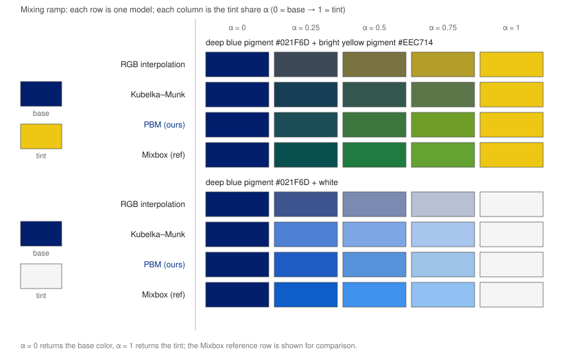
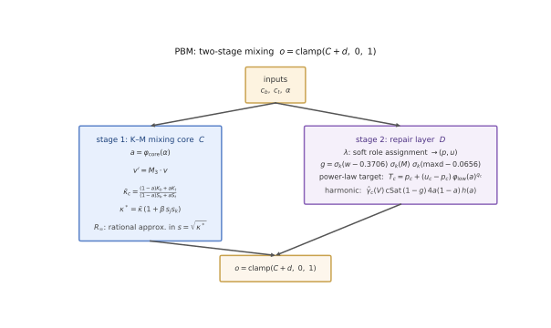
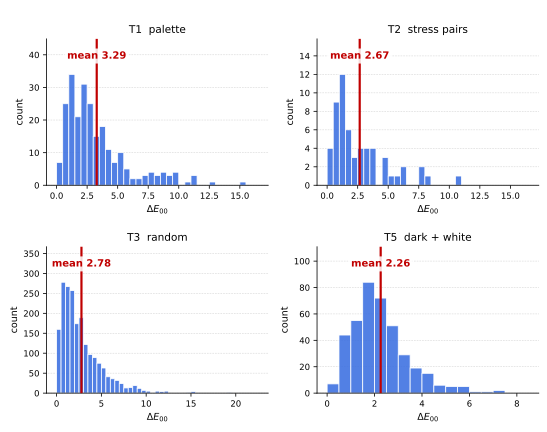
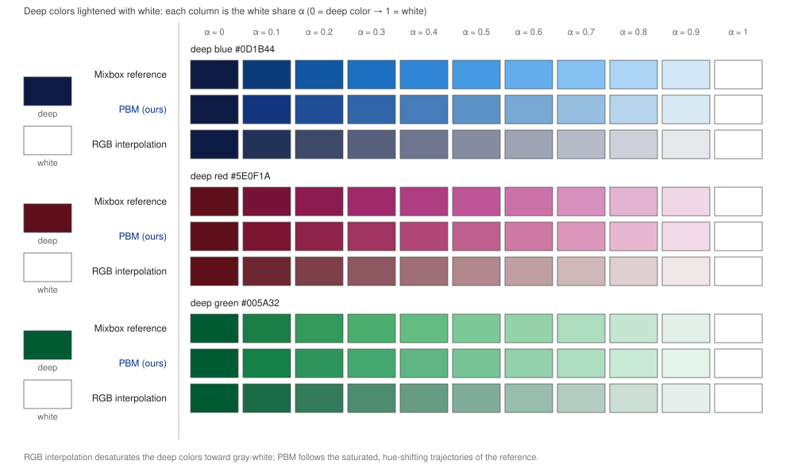
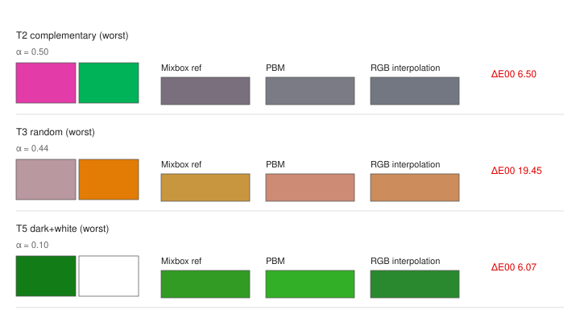
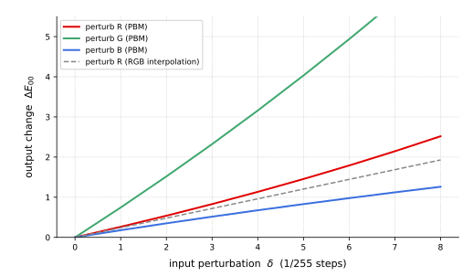
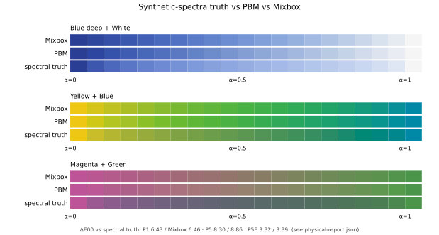
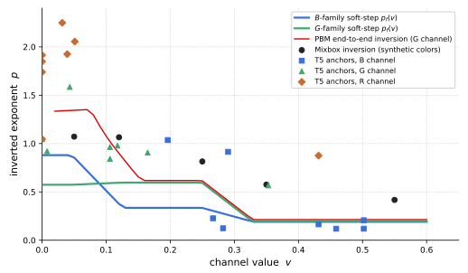

# 物理启发的解析颜料混色：无查找表的参考校准 Kubelka–Munk 模型

作者姓名，机构，国家

**摘要：** 类颜料介质的颜色由颜料混合产生，而渲染管线却用 RGB 线性插值混合，两者的行为截然不同：蓝加黄作为颜料混合得绿、作为色光混合得灰；深色加白在真实颜料中保持饱和，在软件中却趋于灰白。Kubelka–Munk（K–M）模型能预测颜料行为，但需要逐颜料光谱数据与逐波长积分——这使它在建立在 RGB 表示上的软件中始终未被采纳。

我们提出 PBM（颜料基混色，Pigment-Based Mixing）——一个直接工作于 sRGB 显示值、RGB-in / RGB-out 的解析混色模型。PBM 由 K–M/Duncan 混色核心与修复层组成，后者是三个连续混合的解析机制：修复"深色+白"的逐通道幂律目标、复现互补色对的加性谐波修正、以及使模型严格交换对称的软角色分配。模型是参考校准的：其常数拟合自 Mixbox 2.0 的输出——该参考的潜空间训练自实测颜料光谱——因此 PBM 传递性地继承参考的物理合理性。

PBM 是 O(1) 且完全解析的——无光谱数据、无查找表、无迭代——在 α = 0/1 端点精确、邻域连续、严格交换对称（最大 RGB 差 3.3×10⁻¹⁶）。相对 Mixbox 2.0，PBM 在深色+白套件上达到均值 ΔE00 2.41、留出随机对 2.9–3.1；相对由两常数光谱 K–M 混色计算的独立合成光谱世界，它在每个套件上与参考相当，表明不存在对参考的过拟合。

**关键词：** 颜料混色；Kubelka–Munk；sRGB；CIEDE2000；Mixbox；混色模型

## 1 引言

蓝加黄得绿，人人皆知；在绘画软件里混合同样的两种颜色，却得到灰色。原因不在软件本身，而在它的颜色表示：绘画程序以 RGB 为核心，而 RGB 描述的是色光混合。蓝色与黄色光叠加时，光谱相加、结果是灰——但颜料靠色素颗粒选择性吸收与散射光线，这一行为高度非线性。蓝加黄得绿是最醒目的后果，另外两个对绘画同样重要：互补色对混合产生浑浊中性色（橄榄色、棕色、深紫）而非灰色；深色加白保持饱和并发生色相偏移，而非变灰（图 1）。这些行为中的任何一项都无法由 RGB 线性插值产生（图 1 顶行）。



**图 1：** 现实中深蓝加黄得绿，深色加白保持鲜艳；如今的绘画软件却混合出灰色。PBM 纠正了这一点：上半块为深蓝颜料+亮黄颜料，下半块为深蓝+白；每一行是一个模型（RGB 插值、光谱 K–M、PBM、Mixbox 参考），每一列是染色占比 α = 0–1。K–M 行为 §5.8 的合成光谱真值——合成颜料光谱经两常数 Duncan 叠加混合——输入为纯颜料的渲染色；PBM 跟踪同样的色相家族（黄×蓝→绿、深+白保持饱和）。

颜料混色的物理参考是 Kubelka–Munk 双流模型：不透明颜料层的反射率为 R∞(κ) = 1 + κ − √(κ² + 2κ)，κ = K/S；Duncan（1940）证明混合颜料按浓度线性叠加 K 与 S。K–M 以惊人的精度复现颜料行为，却从未被绘画软件采纳——原因是现实的，不是科学上的。K–M 需要每种颜料的光谱反射率，无法从 RGB 值获得；持久化表示要从三通道增长为逐像素光谱；而且混合两个任意 RGB 颜色需要反解模型——一个没有解析逆的迭代优化，单次约 25 ms（§5.7）。

Mixbox（Sochorová and Jamriška, SIGGRAPH 2021）用另一条路让 K–M 变得实用：把每个 RGB 颜色映射到训练自实测颜料光谱的 7 维潜空间、线性混合潜向量再解码回 RGB。结果是迄今最精确的混色模型——代价是数兆字节查找表、无法化简为解析原语的训练映射，以及非商用授权的参考实现。

本文提出 PBM（颜料基混色），一个在纯 sRGB 显示值空间追求同一目标的完全解析模型。PBM 保留 K–M 结构，并修复其在显示值空间唯一的结构性缺陷——白色的散射（S = 1）主导混合物、冲淡深色颜料的每个通道（§3.2）。模型是两个阶段的复合。第一阶段是解析 **K–M 混色核心**（解析 K/S 默认、κ 浓度叠加、跨通道混合矩阵、互吸收修正、对称端点压缩进度映射 φ）。第二阶段是**修复层**，由三个连续混合的解析机制组成：

- **逐通道幂律目标**：修复"深色+白"结构性缺陷（§3.4）；
- **加性谐波修正**：以统一 19 特征模板 + 色度软衰减复现互补混色家族——单一连续公式，无任何条件补丁（§3.4）；
- **软角色分配** λ：使整个模型严格交换对称：F(b, t, α) ≡ F(t, b, 1−α)，实测 3.3×10⁻¹⁶（§5.6）。

全文所述"物理启发"指模型的 K–M/Duncan 结构：其常数拟合自参考实现（Mixbox 2.0，§4）的输出，而非对真实颜料的直接测量。由于参考的潜空间训练自实测颜料光谱，PBM 传递性地继承物理合理性；其相对真实颜料的精度由参考自身精度与相对参考的实测偏差（§5.3、§6）共同界定。

我们按以下需求设计 PBM，这些需求被认为是一个混色模型在真实软件中实用的必要条件：

1. 直接工作于 sRGB 显示值——无光谱数据、无额外逐像素通道；
2. 处理所有 RGB 颜色——无裁剪、无畸变，α = 0/1 精确恒等，邻域连续；
3. 完全解析——无预计算表、无训练数据，可独立实现。

*贡献。* 我们的主要贡献是一个在 sRGB 显示值空间结合物理启发的 K–M 骨架、完全解析性、严格交换对称与近参考精度的解析、参考校准颜料混色模型（表 1）——无需训练表与授权限制即可在任何平台上独立实现。此外还提供：基于参考实现输出测量的可复现参数估计方法（§4）、量化各组件贡献的消融研究（§5.4）、以及针对 Mixbox 2.0 与独立合成光谱世界的评估（§5.3、§5.8），含显式样本内/留出划分与 bootstrap 置信区间。参考实现见 https://github.com/Saikel-Orado-Liu/pigment-based-mixing。

**表 1：** PBM 相对设计需求 R1–R3（§1）与实测精度（均值 ΔE00；样本内 T5 与留出 T3，§5.3）的定位。

| 模型 | R1: RGB-in/RGB-out | R2: 恒等/连续 | R3: 完全解析 | T5 均值 | 留出 T3 均值 |
|-------|--------------------|--------------|-------------|---------|--------------|
| **PBM（本文）** | ✓ | ✓ | ✓ | 2.41 | 2.90–3.07 |
| Mixbox 2.0 | ✓ | ✓ | ✗（256³ LUT，训练） | 参考 | 参考 |
| RGB 插值 | ✓ | ✓ | ✓ | 8.13 | 3.27–3.46 |
| 原始 K–M 叠加 | ✓ | ✓ | ✓ | 10.30 | 3.92–4.01 |

本文其余部分组织如下。第 2 节回顾颜料混色的物理与相关工作。第 3 节形式化 PBM。第 4 节描述参数估计方法。第 5 节报告评估，第 6 节讨论局限。

## 2 背景与相关工作

### 2.1 颜料混色的物理

颜料薄膜的颜色源于颗粒对光的选择性吸收与散射——正是这种波长选择性使蓝加黄呈现绿色。Kubelka 与 Munk [1931] 的模型精确预测了这一结果：给定 N 种颜料的吸收与散射系数 K_i(λ)、S_i(λ) 及其浓度 c（非负且和为 1），混合物的系数由线性叠加确定 [Duncan 1940]，

$$
K(c, \lambda) = \textstyle\sum_i c_i K_i(\lambda), \qquad
S(c, \lambda) = \textstyle\sum_i c_i S_i(\lambda),
$$

不透明层的反射率为 R∞(κ) = 1 + κ − √(κ² + 2κ)（κ = K/S）。为显示混合物，反射光谱需与标准光源（D65）和 CIE 标准观察者函数积分，可选加 Saunderson [1942] 表面修正，再转换为 sRGB——这一管线由 Haase 与 Meyer [1992] 引入计算机图形学；底层色度学参考为 Wyszecki 与 Stiles [2000]。

K–M 模型在实践中从未被绘画软件采纳：它需要逐颜料光谱数据与逐波长积分，持久化表示必须从三通道 RGB 增长为逐像素光谱，且一些 RGB 颜色无法由任何已知颜料混合出来 [Pointer 1980]。

### 2.2 相关工作

**RGB 混色。** 线性插值（"lerp"，混合、涂抹、合成的基础）模拟彩色光混合：蓝加黄得灰、加白失饱和——正是 PBM 要修复的缺陷。

**RYB 混色。** Gossett 与 Chen [2004] 在 3D 立方体顶点插值 8 个手工颜色使蓝+黄得绿；结果远离真实颜料行为（表 1：T5 上 19.53）。

**减色混色。** 叠色滤光片模型只考虑吸收、不考虑散射：黄+蓝得绿但过暗且色相偏差。混合减加公式 [Simonot and Hébert 2014] 提亮结果但共享颜色误差。

**数据驱动方法。** Lu 等人 [2014] 仅对预定义比例的示例混合物插值；颜料调色板提取 [Aharoni-Mack et al. 2017; Tan et al. 2019] 与降阶参数化模型 [Shugrina et al. 2020] 面向作品操作，而非交互绘画。

**Mixbox。** Sochorová 与 Jamriška [2021] 将 RGB 编码为 7 维潜向量——相对一组主颜料（酞菁蓝、喹吖啶酮品红、汉莎黄、钛白）的四个浓度加三个加性残差——训练于真实颜料光谱，使潜空间混合保持在 sRGB 色域内，编码器/解码器为预计算的 256³ 查找表。Mixbox 是我们可获得的精度最高的混色模型，本文以其公开实现作为估计与评估的参考；但其映射是训练得到的、基于表的，而非解析的。PBM 追求同一目标——RGB-in / RGB-out 的实用 K–M 混色——但模型完全解析。

## 3 模型

### 3.1 概览与记号

PBM 完全工作于 [0, 1] 的 sRGB 显示值：全程不做线性化、传递函数或色彩空间转换。模型是两个阶段的复合：

$$
\mathbf o = \mathrm{clamp}\big(\mathbf C + \mathbf d,\ 0,\ 1\big), \qquad
\mathbf C = \mathrm{Core}(\mathbf c_b, \mathbf c_t, \alpha), \qquad
\mathbf d = \mathrm{RepairLayer}(\mathbf c_b, \mathbf c_t, \alpha, \mathbf C)
$$

修复层角色不对称而核心对称；两个角色分配的 λ 混合使整个模型**严格交换对称**：

$$
F(\mathbf c_b, \mathbf c_t, \alpha) \equiv F(\mathbf c_t, \mathbf c_b, 1-\alpha)
$$

实测最大 RGB 差 3.3 × 10⁻¹⁶（§5.6）。

记号：基色 $\mathbf c_b$ 与染色色 $\mathbf c_t$（[0, 1] 的 sRGB 显示值三元组），比例 $\alpha = \mathrm{clamp}(A, 0, 1)$——**染色占比**（α = 0 得基色，α = 1 得染色色）；**颜料端** $\mathbf p$ 与**亮端** $\mathbf u$ 由软角色分配 λ（§3.4）决定：max 通道较暗的输入扮演颜料；由颜料端导出 $M = \max(\mathbf p)$、$m = \min(\mathbf p)$、$\mathrm{maxd} = M - m$ 与共享白色下限 $w = \max(\min(\mathbf p), \min(\mathbf u))$；$\sigma_k(x) = \mathrm{clamp}(k x, 0, 1)$ 为斜率 k 的软阶跃，$\mathrm{ss}(x; a, b)$ 为 [a, b] 上的 C¹ smoothstep。

### 3.2 显示值 κ 混色的结构性缺陷

PBM 的物理核心在 sRGB 显示值空间混色。当其中一色为白色（显示值 1.0）时，白色颜料 K = 0、S = 1，而深色颜料的显示值散射系数仅约 S ≈ 0.05–0.35。白色散射在任意 α 下主导分母，所有通道的 κ 值一起塌缩。以深蓝 #0D1B44 = (0.051, 0.106, 0.267) 加白、α = 0.5（R 通道）为例：

$$
\bar\kappa_R = \frac{0.5 \cdot K(0.051) + 0.5 \cdot K(1)}{0.5 \cdot S(0.051) + 0.5 \cdot S(1)} = \frac{0.5 \cdot 0.451}{0.5 \cdot 0.051 + 0.5 \cdot 1} = 0.429
$$

得到 R∞ ≈ 0.41，而 Mixbox 参考为 R = 0.28——吸收通道被白色*冲淡*；同时亮通道（B）参考为 0.89、模型为 0.53——*提亮不足*。这是 K/S 在显示值空间混色的**结构性**缺陷：白色 S = 1 在任意 α 下主导深色颜料的散射，且 K̄ 与 S̄ 被 α 加权结构性钳制，任何 K/S 的缩放都无法在混色阶段修复。原始 K–M 叠加在深色+白套件上实测均值 10.30 ΔE00（§5.3）。

### 3.3 混色核心

两个输入先被行和为 1（宽带混色）的跨通道混合矩阵 M₃ 变换，吸收与散射系数为解析默认：

$$
\mathbf v' = M_3\,\mathbf v, \qquad
M_3 = \begin{pmatrix}
  0.74523981 & 0.30403013 & -0.04926994 \\
  0          & 0.74093256 &  0.25906744 \\
  0          & 0          &  1
\end{pmatrix}
$$

$$
K(v') = \tfrac12 (1-v')^2, \qquad
S(v') = \max(v',\ \varepsilon), \qquad \varepsilon = 0.00157634
$$

混合比 κ 按 Duncan 结构叠加，钳制到 [10⁻⁶, 10⁴]：

$$
\bar\kappa_c = \frac{(1-\alpha)\,K(v'_{b,c}) + \alpha\,K(v'_{t,c})}{(1-\alpha)\,S(v'_{b,c}) + \alpha\,S(v'_{t,c})}
$$

逐通道施加互吸收修正，{j, k} 为其余两通道：

$$
s'_c = \frac{\sqrt{\bar\kappa_c}}{1+\sqrt{\bar\kappa_c}}, \qquad
\kappa_c^* = \bar\kappa_c \left(1 + \beta_c\, s'_j\, s'_k\right), \qquad
\beta = (-0.69372345,\ -0.48397409,\ -0.24977842)
$$

反射率在 s = √κ 域用有理近似求值（匹配 R∞ 前四个 Taylor 系数，最大绝对误差 3.2×10⁻³），输出经逆矩阵映射回来：

$$
R_\infty \approx \frac{1}{1 + s\left(a_1 + s\left(a_2 + s\,a_3\right)\right)}, \qquad
s = \sqrt{\kappa^*}, \qquad
(a_1, a_2, a_3) = \left(\sqrt2,\ 1,\ \tfrac{1}{2\sqrt2}\right)
$$

$$
\mathbf o = \mathrm{clamp}\left(M_3^{-1}\, R_\infty(\boldsymbol\kappa^*),\ 0,\ 1\right)
$$

*动态进度 φ。* 参考在 α → 1 深重侧的收敛远快于显示值 κ 混色：在 α = 0.99 反解参考显示，幂律目标需要等效进度 a_eff ≈ 0.001——"99% 表现得像 99.9%"（§4）。我们将其编码为作用于核心混色比例的对称端点压缩映射：

$$
\varphi_{\mathrm{low}}(x) = \begin{cases} x, & x \ge w_\varphi \\ (1-\mathrm{ss}(x;0,w_\varphi))\,x^{p_\varphi} + \mathrm{ss}(x;0,w_\varphi)\,x, & x < w_\varphi \end{cases}
$$

$$
\varphi_{\mathrm{core}}(x) = \begin{cases} \varphi_{\mathrm{low}}(x), & x < 0.5 \\ 1 - \varphi_{\mathrm{low}}(1-x), & x \ge 0.5 \end{cases}
$$

其中 p_φ = 2.31336、w_φ = 0.08。φ_core 是 C¹ 的且关于 α = 0.5 反对称，核心保持交换对称；φ_low(x) 在 x ≥ w_φ 时恒等于 x，只影响尾端。该映射还修复模型的"盲区"——近中性深色（maxd < 0.0656）落在修复门之下、仅由核心混色，参考的尾端收敛在那里以同一方向偏离线性进度（实测：#FFFFFF + #0D1B44 在 α = 0.99 从 ΔE00 2.6 改善到 1.3；双侧尾端套件 T5E（§5.2）监督此区域）。

在 α = 0/1 端点核心原样返回输入。解析默认与修正项是拟合自参考输出（§4）的工程形式，而非来自颜料物理的推导量；PBM 的"物理"特征在于 K–M/Duncan 骨架，而非这些常数。

### 3.4 修复层

修复层在核心输出之上计算修正增量 d（图 2），由三个机制组成：*角色分配* λ、*幂律目标*（深色+白修复）与*谐波修正*（互补家族）。



**图 2：** PBM 数据流：两个输入送入 K–M 混色核心（C）；修复层分配颜料端与亮端角色（λ），求值被门 g 控制的逐通道幂律目标（T），并叠加谐波修正 γ̂；修正增量 d 加到核心输出上并钳制。

**软角色分配。** 颜料端是 max 通道较大的输入；硬 argmin 会在 max(c_b) = max(c_t) 处不连续切换。我们以 max 差上的软隶属度替代：

$$
\lambda = \mathrm{ss}\Big(\tfrac{\max(\mathbf c_t) - \max(\mathbf c_b) + E_W}{2 E_W};\ 0,\ 1\Big), \qquad E_W = 0.08
$$

λ = 1 选择 (p, u, a_eff) = (c_b, c_t, α)，λ = 0 选择 (c_t, c_b, 1−α)，平局带 |max(c_t) − max(c_b)| < E_W 内两个分支被混合：

$$
\mathbf d = \lambda\, D(\mathbf c_b, \mathbf c_t, \alpha) + (1-\lambda)\, D(\mathbf c_t, \mathbf c_b, 1-\alpha)
$$

带外（约 85% 随机对）λ 精确为 0 或 1，修复层退化为单次 D 求值。角色信号是 max 通道：以亮度信号替代会翻转 5000 随机对中 20.2% 的决策并使 T2 恶化 +6.2%（§4）。整个模型的交换对称性来自两个分支的组合。

**深色+白门。** 幂律目标只在深色+亮端区域接管。门是三个软阶跃的乘积，共享斜率 k = 12.584001，因此模型邻域连续、无硬截断：

$$
g = \sigma_k(w - 0.3706311) \cdot \sigma_k(M) \cdot \sigma_k(\mathrm{maxd} - 0.06556298)
$$

M 因子只在近黑区域（M < 1/k ≈ 0.08）活跃；早期版本的上带对整个 M ∈ [0, 1] 恒饱和为 1，已被移除（§4）。对亮色或近消色颜料门为 0，直接使用核心输出。

**幂律目标。** 门区域内，深色+亮端混色是自颜料端向亮端的逐通道幂律轨迹：

$$
T_c = p_c + (u_c - p_c)\,\varphi_{\mathrm{low}}(a)^{q_c^{\mathrm{eff}}}
$$

（φ_low 使目标比线性进度更快收敛到颜料；谐波修正保留原始 a_eff）。指数 q_c 控制通道 c 的提亮速度，由四部分组成。

*(a) 提亮指数 q_f(v)——软阶跃阶梯。* 在锚点色上反解参考（§4，附录 D.1）揭示了通道值 v 上的下降阶梯：暗段保持吸收（高 p）、中段过渡、亮段快速前进（低 p）。最小结构为两台阶，由单一解析软阶跃公式实现，共享斜率 k，台阶位置 t₁ = 0.04633146、t₂ = 0.24928142：

$$
q_f^f(v) = c_1^f + (c_2^f - c_1^f)\,\sigma_k(v - t_1) + (c_3^f - c_2^f)\,\sigma_k(v - t_2), \qquad f \in \{B, G\}
$$

**表 2：** 逐族软阶跃系数（拟合）。

| 族 | c₁（暗段） | c₂（中段） | c₃（亮段） | 台阶位置 / 斜率 |
|--------|-----------|----------|-----------|----------------|
| B（蓝，B 最大） | 0.88024633 | 0.33545176 | 0.19217412 | t₁ = 0.04633146, t₂ = 0.24928142, k = 12.584001（共享） |
| G（绿，G 最大） | 0.57387051 | 0.596528 | 0.19217412（与 B 共享） | 同上 |
| R（红） | — | — | — | 中性，q_R ≡ 1（见 (d)） |

*(b) 族软混合。* 族权重是颜料通道值上的成对主导比较，两通道都高时自然连续：

$$
g_R = \tfrac12\,\sigma_8(v_R - v_G) + \tfrac12\,\sigma_8(v_R - v_B), \qquad
g_G,\ g_B \ \text{同理}
$$

$$
q_c^{base} = \frac{g_B\, q^B_c + g_G\, q^G_c + g_R\, q^R_c}{g_R + g_G + g_B}
$$

当总主导 g_R + g_G + g_B 低于 10⁻⁶ 时，基准退化为三族等权均值 ⅓(q^B_c + q^G_c + q^R_c)，覆盖近灰颜料。

*(c) 通道残差。* 对近零通道，参考曲线取决于通道而非颜料（§4，附录 D.2）。残差项是共享振幅乘以随通道值衰减的分段线性包络：

$$
q_c \mathrel{+}= \mathrm{RES}_c\, e(v_c), \qquad
e(v) = \begin{cases} 0.9432 - 15.5475\,v, & v < 0.04 \\ 0.4580 - 3.735\,v, & 0.04 \le v < 0.12 \\ 0, & v \ge 0.12 \end{cases}
$$

RES = (0, −0.25693718, −0.25693718)——G、B 通道共享单值；R 通道残差为零，因为红族的近零行为由方向响应承载。

*(d) 通道耦合与族方向响应。* 紫/品红等两通道都高的颜色提亮更慢；各族携带关于颜料通道值的线性方向响应：

$$
q_c \mathrel{+}= 0.43251363 \cdot \sigma_{4.86795929}\Big(\max_{i\ne c} v_i\Big)
$$

$$
q_c \mathrel{+}= g_R\,g^{RTH}\,\delta^R_c + g_B\,\delta^B_c + g_G\,\delta^G_c, \qquad
g^{RTH} = \sigma_8(v_R - 0.21929798)
$$

三个族响应（对 11 个红主导固定色的反解残差做最小二乘，附录 D.3）：

$$
\delta^R = \big[\, -0.28030789 - 0.31011215\,v_R,\quad 0.33194666 - 1.19791733\,v_G,\quad -0.45218018 + 1.71390058\,v_G \,\big]
$$

$$
\delta^B = \big[\, 0.40713961,\quad -0.08390816 + 0.76274462\,v_G,\quad 0 \,\big]
$$

$$
\delta^G = \big[\, -0.2367074 + 0.72220875\,v_R,\quad 0,\quad -0.30067864 + 1.03098891\,v_G \,\big]
$$

门 g^RTH（v_R ≥ 0.219）承担负载：线性公式在其下翻转符号，移除门使 T5 近黑红子集均值从 ΔE00 2.9 升至 13.8（实测，§5.4）。物理：Mixbox 潜空间建立在 CMY 类颜料基之上；红族颜料提亮时保持绿色吸收同时透射红色，黄棕家族保持蓝色吸收——通道方向上的逐通道幂律即潜空间的族残差。所有项平滑，保持邻域连续。

**谐波修正。** 在互补对上反解参考（§4，附录 D.4）发现残差误差集中于混合范围中部、形状为 4α(1−α)，振幅是输入颜色的平滑函数。我们将互补修正建模为统一特征模板上的线性模型——覆盖所有色相对立家族的一个连续公式，无任何条件补丁：

$$
d_c \mathrel{+}= \hat\gamma_c(\mathbf p, \mathbf u) \cdot \mathrm{cSat}(\mathbf p, \mathbf u) \cdot (1 - g) \cdot 4\,a\,(1-a) \cdot h(a)
$$

其中 h(a) = σ₁₄(0.845 − a) 为端点抑制（修正于 α = 0/1 及深重侧尾端为零），(1 − g) 排除深色+白区域，cSat 为双侧色度软衰减：

$$
\mathrm{cSat}(\mathbf p, \mathbf u) = \mathrm{ss}(\max(\mathbf p) - \min(\mathbf p);\ 0.02, 0.15) \cdot \mathrm{ss}(\max(\mathbf u) - \min(\mathbf u);\ 0.08, 0.30)
$$

cSat 在任一端点接近消色轴时将修正驱动到零——对连续性至关重要：色相谐波特征在彩度 → 0 时梯度爆炸（灰白染色色的 1/255 扰动可使色相摆动 30°），cSat 平滑消除爆炸（实测：无 cSat 时全局最大单步 ΔE00 2.86，有 cSat 时 1.42，§5.6）。在锚点/互补区（彩度 ≥ 0.3）cSat ≈ 1，完整修正生效。

振幅 γ̂_c 是每对计算一次的 19 特征模板 V（表 3）的线性函数，三组系数在互补家族测量语料上最小二乘拟合（附录 D.4）：

$$
\hat\gamma_c(\mathbf p, \mathbf u) = w_0^c + \textstyle\sum_{j} w_j^c\, V_j
$$

**表 3：** 统一特征模板（19 特征，每对计算一次；§3.4 的三组系数使用标记 R/G/B 的子集）。

| 特征 | 定义 | 使用方 |
|---------|-----------|---------|
| un, um | min(u), max(u) | R, G, B |
| pm, pn | max(p), min(p) | R, B（pm）；B（pn） |
| wUcP | (u_R − u_B)(p_B − p_R) | B |
| gBp, gRp | 颜料主导门（σ₈） | R（gBp, gRp） |
| gRu | 染色色 R 主导门（σ₈） | B |
| s1hu | sin(h_u) | R |
| s2hp, c2hp | sin(2h_p), cos(2h_p) | R（s2hp）；G（c2hp） |
| s3hp, c3hp | sin(3h_p), cos(3h_p) | R（s3hp）；B（c3hp） |
| s2hu, c2hu | sin(2h_u), cos(2h_u) | G（s2hu）；B（c2hu） |
| logu | log(u_R + 0.01) | R |
| s1hu_pm | sin(h_u)·σ₁₂.₅₈(pm − 0.30) | R |
| pc, dcAbs | p_R, \|u_R − p_R\| | R（pc）；B（dcAbs） |

三组系数分别含 10、5、9 个特征加截距（共 27 个系数；数值见附录 B），在拟合语料上 R/G/B 通道的样本内 R² 为 0.71、0.52、0.51。与机器学习潜变量不同，该模板根据反解测量手工设计、系数最小二乘拟合；运行时无任何存储数据。

谐波修正是模型早期版本两个手工"锚点补丁"（19 个 smoothstep 门条件）被连续 cSat 衰减公式替代后的剩余物：它以同一公式复现锚点对（黄×深蓝 3.04、红×绿 3.47 均值 ΔE00，α ∈ [0.05, 0.95]；§5.5），并额外改善补丁未覆盖的家族，代价是调色板套件的小幅均匀退化（T1 均值 3.844 vs 无修正 3.65；§5.4）——这一取舍在拟合损失中已被接受。

### 3.5 实现与边界行为

完整混色流程见算法 1。

**算法 1：PBM 混色。**
```
φ_low(x):  x ≥ w_φ ? x : (1−ss(x;0,w_φ))·x^{p_φ} + ss(x;0,w_φ)·x      // §3.3
φ_core(x): x < 0.5 ? φ_low(x) : 1 − φ_low(1−x)

Core(b, t, a):                                    // K–M 核心（§3.3）
  a ← φ_core(a)
  v'_b ← M₃·b,  v'_t ← M₃·t
  κ̄_c ← ((1−a)·K(v'_{b,c}) + a·K(v'_{t,c})) / ((1−a)·S(v'_{b,c}) + a·S(v'_{t,c})),  K/S 解析默认
  κ*_c ← κ̄_c·(1 + β_c·s'_j·s'_k),  s'_c ← √κ̄_c/(1+√κ̄_c)
  return clamp(M₃⁻¹·R∞(κ*), 0, 1)                                   // 有理 R∞

RepairDelta(p, u, aEff, C):                        // 修复分支增量 (o′ − C)（§3.4）
  M ← max(p);  maxd ← M − min(p);  w ← max(min(p), min(u))
  g ← σₖ(w−0.3706311)·σₖ(M)·σₖ(maxd−0.06556298)    // σₖ = clamp(k·x,0,1), k = 12.584001
  d ← [0,0,0]
  if g > 1e−6:
    q_c ← q_f(v_c) | 族软混合 | RES·e(v_c) | CPL | 方向响应 δ   // §3.4(a)–(d)
    T_c ← p_c + (u_c − p_c)·φ_low(aEff)^{q_c}
    d ← g·(T − C)
  V ← 特征模板(p, u)                                // 表 3，19 特征
  cSat ← ss(pm−pn; 0.02, 0.15)·ss(um−un; 0.08, 0.30)
  gSup ← 1 − g;  hA ← σ₁₄(0.845 − aEff)
  for c ∈ {R,G,B}:  d_c += γ̂_c(V)·cSat·gSup·4·aEff·(1−aEff)·hA
  return d

输入：  基色 c_b、染色色 c_t（[0,1] sRGB 显示值）、比例 A
1  α ← clamp(A, 0, 1);  若 α = 0 返回 c_b;  若 α = 1 返回 c_t
2  C ← Core(c_b, c_t, α)
3  te ← clamp((max(c_t) − max(c_b) + E_W) / (2·E_W), 0, 1)         // λ 角色分配（§3.4）
4  若 te ≤ 0:  d ← RepairDelta(c_t, c_b, 1−α, C)                    // 带外单分支（逐位等价）
5  否则若 te ≥ 1:  d ← RepairDelta(c_b, c_t, α, C)
6  否则:  λ ← ss(te);  d ← λ·RepairDelta(c_b, c_t, α, C) + (1−λ)·RepairDelta(c_t, c_b, 1−α, C)
7  返回 clamp(C + d, 0, 1)
```

**表 4：** 边界行为。

| 性质 | 保证 |
|----------|-----------|
| α = 0/1 | 原样返回输入，精确恒等（T4 通道误差 0.00000） |
| 门区域外 | g = 0 → 混色核心直出；门内 → 幂律目标 + 谐波修正；过渡带平滑 |
| 邻域连续 | 全 σ/线性/clamp/smoothstep 结构加软角色分配；全局扰动探针：最大单步 ΔE00 1.42，1.53 阈值超阈次数 0（§5.6） |
| 交换对称 | F(b, t, α) ≡ F(t, b, 1−α)；实测最大 RGB 差 3.3×10⁻¹⁶（§5.6） |

## 4 参数估计

所有常数都拟合自或反解自 **Mixbox 2.0 公开 API 的输出测量**（`lerpFloat`，sRGB 显示值浮点路径）；拟合语料、损失与种子在附录 A 中枚举，以便该流程可对任何未来参考实现重跑。

设计由**反解测量**驱动：对每个候选色对，在进度 α 上反解参考输出，读出逐通道幂指数 p_c(α) = ln((r_c − v_c)/(1 − v_c)) / ln α——幂律轨迹所需的指数（附录 D.1）。三个结构事实决定修复层设计：(i) **α 不变性**——每个族的 p 在 α ∈ [0.1, 0.9] 上漂移小于 0.2，支持单指数模型（α → 1 处的漂移正是 φ 映射修复的区域）；(ii) **两台阶阶梯**——暗段保持吸收、亮段快速前进，是 §3.4(a) 软阶跃指数的经验基础；(iii) **族与残差结构**——近零通道取决于通道而非颜料（RES，§3.4c）、红族提亮时保持绿色吸收（方向响应，§3.4d）、互补混合物在范围中部留下 4α(1−α) 形残差（谐波修正，§3.4）。支撑测量见附录 D。

所有参数随后在固定语料上经**坐标下降**联合微调（损失：T5、T1、T2、T3、尾端集、T5E 与八个锚点对上的加权 mean + 0.35·max + 0.6·p95 + 0.25·median，T5 max 有硬惩罚；权重见附录 A），留下 **5 个可调参数**：qt2 = 0.24928142、pB0 = 0.88024633、pB1 = 0.33545176、cpl = 0.43251363、kc = 4.86795929。其余常数——包括 27 个谐波系数——保持拟合值（重拟合不降低损失）。基于实测证据的结构简化：q 阶梯斜率并入共享门斜率（12.584001）；G 与 B 上台阶电平共享（0.19217412）；上带门移除（对整个 M ∈ [0, 1] 恒饱和为 1）；φ 宽度 w_φ 与角色分配宽度 E_W = 0.08 共享；λ 的角色信号是 max 通道（亮度信号翻转 20.2% 的决策并使 T2 恶化 +6.2%——保留 max 信号）。拟合常数在未参与拟合的留出抽取上重估（§5.3）。

**阈值敏感性。** 为检查门参数未调到刀刃精度，将每个门阈值与共享斜率 k 在其余参数不变的情况下扰动 ±10% / ±20%（表 5）。

**表 5：** 门参数敏感性——各拟合门参数 ±10% / ±20% 扰动下的均值 ΔE00 变化（ΔT5 / ΔT3，实测）。

| 参数 | ×0.8 | ×0.9 | ×1.1 | ×1.2 |
|-----------|------|------|------|------|
| w₀ (0.3706311) | +0.000 / −0.119 | +0.000 / −0.059 | +0.000 / +0.038 | +0.000 / +0.102 |
| maxd₀ (0.06556298) | +0.003 / −0.005 | +0.000 / −0.002 | +0.003 / +0.003 | +0.007 / +0.005 |
| 共享斜率 k (12.584001) | +0.010 / −0.002 | −0.009 / −0.002 | +0.035 / +0.002 | +0.076 / +0.004 |

任何扰动的 T5 均值变化至多 0.08 ΔE00、T3 均值至多 0.12；除 k × 1.2（8.6）外 T5 max 保持 6.1。拟合阈值位于损失平台区。

## 5 实验评估

### 5.1 参考与度量

- **参考**：Mixbox 2.0 `mixbox.lerpFloat(base, tint, a)`——参考实现的公开 API（Sochorová and Jamriška 2021；自官方 CDN 加载，仅供研究对照）。
- 全部测量使用**浮点路径**（[0, 1] 的 sRGB 显示值浮点），避免 8 位量化噪声。
- **度量**：ΔE00（CIEDE2000，Sharma/Wu/Dalal 2005），经 34 组参考色差对验证（最大偏差 < 1×10⁻⁴）。随机集的均值报告 bootstrap 95% 置信区间（1000 次重采样）。

### 5.2 测试集

表 6 汇总测试集及其在拟合/评估划分中的角色；精确定义、α 网格、seed 与颜色列表见附录 A。

**表 6：** 评估测试集。

| 集合 | 内容 | n | 角色 |
|-----|---------|---|------|
| T1 调色板 | 预设调色板全部对（10 基色 × 8 染色色）× α ∈ {0.25, 0.5, 0.75} | 240 | 样本内（拟合语料） |
| T2 压力对 | 互补 3 / RYB 错配 6 / 白黑 6 / 相似 4 × 3 α | 57 | 样本内（拟合语料） |
| T3 随机 | 均匀 sRGB 对 × α ∈ [0, 1]，固定 seed | 2000 | 混合（见下） |
| T4 恒等 | 10 色 × α ∈ {0, 1} 自混合 | 20 | 结构性 |
| T5 深色+白 | 高饱和深色 × 白（20 固定 + 24 随机）× 9 α 电平 | 396 | 样本内（拟合语料） |
| T5-heldout | 随机深色（新 seed 20260812，同 T5 量化）× 9 α 电平 | 216 | 留出 |
| tail 尾端 | T5 固定色 × α ∈ [0.92, 0.99]（160）+ 深蓝盲区色 × 全 α（81） | 241 | 样本内（拟合语料） |
| T5E 双侧尾端 | 色度深色 × 深重侧 α（120）+ 近中性深色 × 深重侧 α（72）+ 近中性深色 × 浅重侧 α（48） | 240 | 样本内（拟合语料） |

**T5E——双侧尾端套件。** 标准套件覆盖 α ∈ [0.1, 0.9]（T5）与 α ∈ [0.92, 0.99]（tail），深重侧 α ∈ [0.001, 0.1] 空白；近中性深色（maxd 低于门阈值）落在修复门之下、仅由核心混色，实测在那里偏离（如 #F2F2EF + #000B2E 在 α = 0.05 实测 ΔE00 6.5，φ 映射之前）。T5E 为 20 个 T5 固定色与 12 个近中性深色（盲区）增加深重侧 α 电平 {0.001, …, 0.1}，并为同一批近中性色增加浅重侧电平 {0.92, …, 0.99}；以权重 0.15 进入拟合损失。

**样本内/留出划分。** 拟合语料含 T1、T2、T5、T5E、tail 集与 T3 前 800 对（seed 20260808）。留出：T3 不相交切片 [800:2000)、两个完全独立的 T3 抽取（seed 20260809、20260811，与所有拟合 seed 不相交）、以及 T5-heldout 套件（新 seed 20260812）。

### 5.3 结果

*样本内结果。* 相对 Mixbox 2.0 参考的 ΔE00 均值 / 最大值（表 7）。图 4 绘制完整 ΔE00 分布。



**图 4：** PBM 在 T1/T2/T3/T5 套件上的 ΔE00 直方图（bin 0.5；红线：均值）。质量集中于 4 ΔE00 以下；右尾由互补混色家族主导（§5.5）。

**表 7：** 样本内结果（ΔE00 均值 / 最大值）。

| 模型 | T1 均值/max | T2 均值/max | T3(拟合 800) 均值/max | T5 均值/max | tail 均值/max | T4 |
|-------|-------------|-------------|----------------------|-------------|---------------|-----|
| **PBM（本文）** | **3.844 / 26.1** | **3.244 / 9.4** | **3.017 / 19.4** | **2.407 / 6.1** | **1.713 / 7.9** | 0.00000 |
| RGB 插值 | 5.053 / 39.0 | 5.526 / 39.4 | 3.374 / 27.5 | 8.127 / 20.9 | 5.878 / 20.6 | 通过 |
| Kubelka–Munk（K/S 叠加） | 4.867 / 27.4 | 5.199 / 25.2 | 3.964 / 23.7 | 10.299 / 23.6 | 9.877 / 24.1 | 通过 |

*留出结果。* ΔE00 均值 / 最大值（均值 bootstrap 95% 置信区间）——表 8。T5-heldout 列为新 seed 20260812 的 24 个随机深色，量化定义与 α 网格同 T5：

**表 8：** 留出结果（ΔE00 均值 / 最大值 [95% CI]）。

| 模型 | T3 切片 [800:2000) 均值/max | T3 seed 09 均值/max | T3 seed 11 均值/max | T5-heldout 均值/max |
|-------|------------------------------|---------------------|---------------------|---------------------|
| **PBM（本文）** | **2.982 / 19.2** [2.841, 3.128] | **2.895 / 18.0** [2.788, 3.007] | **3.066 / 22.9** [2.951, 3.186] | **2.607 / 14.6** [2.405, 2.835] |
| RGB 插值 | 3.456 / 36.8 | 3.273 / 34.5 | 3.425 / 34.6 | 7.612 / 17.1 |
| Kubelka–Munk | 4.002 / 31.5 | 3.918 / 31.4 | 4.010 / 32.8 | 9.517 / 17.3 |

三点观察。第一，留出均值与拟合抽取相差至多 0.12 ΔE00（T3 切片 2.982 vs 3.017），独立抽取（2.895、3.066）保持在同一区间——无过拟合证据。第二，留出最大值（18.0–22.9）落在随机互补对上；互补家族是大误差的主导来源（§5.5）。第三，深色+白修复泛化：T5-heldout 上 PBM 实测 2.607——仅比样本内 T5 均值高 0.20——而 RGB 插值（7.61）与原始 K–M 叠加（9.52）保持样本内水平。图 5 以三个深色加白可视化该行为。



**图 5：** 三个模型下的深色加白。RGB 插值把梯度去饱和成灰白；PBM 跟随 Mixbox 参考的饱和、色相漂移轨迹——这正是 §3.4 深色+白修复被设计来产生的行为。

*双侧尾端。* 在 T5E 套件（240 样本）上 PBM 实测均值 ΔE00 2.353 / max 9.5（p95 7.75）——在设计阈值内（mean < 5，max ≤ 15）。φ 映射改善了它针对的对：#F2F2EF + #000B2E 在 α = 0.05 从 ΔE00 6.5 到 2.5，#FFFFFF + #0D1B44 在 α = 0.99 从 2.6 到 1.3（实测前后）。

### 5.4 消融研究

表 9 通过在参考实现中禁用各组件量化其贡献（ΔE00 均值 / 最大值；与 §5.3 同抽取，T3 为 seed-20260808 完整 n = 2000 抽取）。

**表 9：** 消融研究（ΔE00 均值 / 最大值）。

| 配置 | T1 | T2 | T3 | T5 | tail |
|---------------|-----|-----|------|------|-------|
| **PBM（完整）** | **3.844 / 26.1** | **3.244 / 9.4** | **2.996 / 19.4** | **2.407 / 6.1** | **1.713 / 7.9** |
| − 跨通道矩阵 M₃ | 4.314 / 33.5 | 4.181 / 19.1 | 3.395 / 30.0 | 2.408 / 6.1 | 1.713 / 7.9 |
| − 互吸收 β | 3.877 / 26.9 | 3.065 / 10.4 | 3.013 / 19.7 | 2.410 / 6.1 | 1.713 / 7.9 |
| − 通道耦合 | 4.354 / 26.1 | 3.545 / 9.4 | 4.144 / 30.5 | **9.255 / 21.4** | 5.157 / 21.4 |
| − 族方向响应 | 4.051 / 26.1 | 3.319 / 9.4 | 3.200 / 23.8 | 4.820 / 15.5 | 3.341 / 12.3 |
| − 谐波修正（γ） | 3.648 / 15.3 | 3.545 / 13.5 | 2.898 / 20.0 | 2.407 / 6.1 | 1.713 / 7.9 |
| − 幂律修复（gate ≡ 0） | 4.258 / 26.1 | 3.665 / 9.4 | 3.518 / 19.0 | **9.823 / 23.8** | 8.406 / 24.0 |
| 幂律全接管（gate ≡ 1） | 4.789 / 25.4 | 5.339 / 24.5 | 2.945 / 26.0 | 2.411 / 6.1 | 1.702 / 7.9 |

*小结。* (i) 幂律修复与通道耦合是深色+白套件的两个最大贡献者（T5 2.407 → 无修复 9.823、无耦合 9.255），耦合也是主三集的最强项（T3 2.996 → 4.144）。(ii) 跨通道矩阵 M₃ 是主三集的第二强项（T1 3.844 → 4.314、T2 3.244 → 4.181），对 T5 中性——那里由修复接管。(iii) 族方向响应在 T5（→ 4.820）与尾端（→ 3.341）重要。(iv) 互吸收 β 的效果小且有正有负（无 β 时 T2 改善 3.065、T1 恶化 3.877），因其移除实测增大互补家族的最大误差而保留。(v) 谐波修正的收益集中于互补家族（T2 均值 3.545 → 3.244、max 13.5 → 9.4），T1/T3 反方向至多 +0.2——一个编码进拟合损失的均匀取舍。(vi) 强制幂律目标处处接管（gate ≡ 1）大幅恶化主三集（T1 → 4.789、T2 → 5.339）——门的区域选择必要而非装饰。

### 5.5 最差对分析

最大误差集中于*互补混色家族*（橙/红 + 蓝、浅中性 + 橙等），ΔE00 9.4–26.1。T1 最差对为橙 #F07A2A + 群青 #2E5EFF 在 α = 0.5（26.14）；T3 最差对为浅粉灰 #BA98A0 + 亮橙 #E37C04 在 α ≈ 0.44（19.45）。这些正是品红的双带反射产生逐通道独立模型无法跟随的高阶跨通道关联、且线性谐波模型残差最大的混合物（§6）。谐波修正复现了它所拟合的家族：八个锚点对在 α ∈ [0.05, 0.95] 上实测均值 ΔE00 为 3.04（黄×深蓝 #FFC400 + #000F3D）、3.78（黄×近边界 #FFC400 + #000724）、3.47（红×绿 #A30000 + #00B359）、5.40（红×青 #A30000 + #00D5C0）、3.01（品红×绿 #E33BA8 + #00B359）、5.77（橙×蓝 #FF7A1A + #2E5EFF）、8.10（橙×深蓝 #FF7A1A + #001B75）、6.61（红×深蓝 #A30000 + #001B75）——相比原始核心单独作用的 10–23 区间显著下降（实测，§5.4）。T5 上最差对是随机深绿加白、α = 0.1（ΔE00 6.07）；固定色中最差为近黑紫 #2A0A5E 在 α = 0.5（6.05）——近黑区域仍是深色+白修复的残差。红族固定子集实测均值 2.9 / max 4.3，有范围门时近黑红成员为 2.9、无门时为 13.8（§3.4d）。图 6 显示三个套件的最差对。



**图 6：** T2 互补、T3 随机与 T5 深色+白套件的最差对：输入颜色、Mixbox 参考输出、PBM 输出、RGB 插值输出与 ΔE00。最大误差集中于互补混合物——参考的四颜料潜空间在其中产生逐通道独立模型无法跟随的跨通道关联（§5.5）。

### 5.6 邻域连续性与交换对称

- 8 位输入步长扰动：全局随机探针（4000 对，每通道 ±1/255 与 α + 0.004）产生最大单步输出 ΔE00 **1.42**，1.53 阈值超阈次数**0**；
- 所有门为共享斜率的软 σ 门；族权重、残差包络与耦合平滑；角色分配与色度衰减为 C¹ smoothstep——模型处处连续；
- 色度衰减 cSat 对连续性承担负载：禁用后同一探针实测 2.86（24 次超阈）——色相谐波特征在消色轴附近梯度爆炸（图 7）；
- **交换对称**：5000 随机对上 F(b, t, α) ≡ F(t, b, 1−α)，最大 RGB 差 3.3 × 10⁻¹⁶（两个分支的浮点顺序内逐位一致）。



**图 7：** 邻域连续性：输出变化 ΔE00 相对未扰动输出作为输入扰动的函数（深蓝 #0D1B44 每通道 1/255 步长，加白 α = 0.5）；虚线为 RGB 插值响应。

### 5.7 性能

需求 R3 将 PBM 定位为完全解析——无预计算表、无训练数据。表 10 报告本文所用参考 JavaScript 实现的单次混色耗时，在 Node.js 上以相同确定性输入测量（T3 seed 20260808；PBM/Mixbox/lerp：预热后 100 000 对 × 5 次重复；光谱 K–M 路径在前 2 000 对上测量——其迭代反解主导运行时）。

**表 10：** 单次混色运行时成本（实测，Node.js；5 次运行中位数）。

| 模型 | 路径 | ns/op | ops/s |
|-------|------|-------|-------|
| PBM（本文） | 解析浮点运算 | 3 630 | 275 000 |
| Mixbox 2.0 | 256³ LUT 查询 | 1 970 | 508 000 |
| RGB 插值 | 线性混合 | 21 | 48 000 000 |
| K–M 光谱（光谱已知） | 逐波长 K/S + D65×CMF | 1 290 | 778 000 |
| K–M 光谱（RGB-in） | 迭代 unmix（RGB→颜料浓度）+ 光谱混合 | 25 400 000 | 39 |

PBM 单次混色约 3.6 µs——参考 LUT 查询的约 1.85 倍、线性混合的约 175 倍。光谱 K–M 管线本身并不慢：光谱已知时逐波长前向积分仅约 1.3 µs。墙在**接口**：要混合两个任意 RGB 颜色，光谱 K–M 必须先把每个颜色反解为颜料浓度——一个迭代优化，单次约 25.4 ms——比 PBM 慢约 7 000 倍。这是绘画软件从未采纳光谱 K–M 的实际原因：混合本身便宜，但 RGB→光谱反解不便宜，且不存在解析逆。PBM 的优势因此不在原始速度，而在接口：无需光谱表示、无需反解、无需数兆字节的表，可直接移植到任何平台（演示页与评估套件在 Node 与浏览器中运行同一份代码）。在交互绘画中，混色按笔触或操作应用而非按渲染像素；逐像素渲染时两种模型都会使用向量化或 GPU 实现，此时解析形式移植性更强。严格交换对称只在平局带内（约 15% 随机对）付出第二个修复分支的代价；带外分支被跳过。

### 5.8 独立合成光谱世界验证

§5.3 的评估以 Mixbox 参考实现为基准。本节以**合成颜料光谱**计算的独立光谱真值为基准进行交叉验证。

*为什么用合成。* 为让本验证摆脱第三方数据权利、且完全可复现，我们从**第一性原理两常数 K–M 模型**合成 29 个颜料光谱（附录 C.1）：每颜料分离的吸收 K(λ) 与散射 S(λ)，高斯吸收带（过渡金属 d–d 跃迁、有机 π–π* 宽带）与逻辑斯蒂吸收边（半导体型颜料）的带位置按第一性原理颜料化学给定（黄/橙/红在蓝-绿区陡吸收边、蓝/绿红侧上升边、品红绿区吸收带），另加 5 个深色派生颜料用于深色+白套件。数值参数（幅度/宽度/基底/散射）标定自公开可得的 BabelColor X-Rite ColorChecker Classic 平均光谱 [Pascale 2012]（30 张色卡平均、24 个配方色卡补丁、10 nm）——有据可查的参考来源 [Pascale 2012]（附录 C.1；`spectral/calibrate.js` 可从本地副本复现拟合）。

*设置。* 混合的光谱真值是 §2.1 的前向 K–M 管线，现在**对 K 与 S 分别做 Duncan 叠加**（K̄ = (1−α)K_A + αK_B、S̄ 同理——真实涂料使用的两常数形式）、10 nm 网格上的 D65 × CIE 1931 2° 积分、IEC sRGB 转换（附录 C.2）。所有模型的**输入**是纯颜料渲染出的 sRGB，规避"无法由颜料混出的 RGB"问题 [Pointer 1980]。六个套件镜像 T 套件结构：P1 颜料全对 × α ∈ {0.25, 0.5, 0.75}；P2 互补/压力对；P3 随机颜料对（新 seed 20260813）；P5 深色 × 白；P5-buff × buff；P5E 双尾端 α 网格（附录 C.3）。被评模型为 PBM、Mixbox、RGB 插值与显示值 K–M 叠加，全部以 ΔE00 对同一光谱真值打分。

*结果。* 表 11 报告 mean / max ΔE00。

**表 11：对合成光谱真值的 ΔE00（mean / max；随机集 bootstrap 95% CI 方括号内；越界样本 clamp 并计数）。**

| 模型 | P1 (n=828, oog 6) | P2 (n=27, oog 0) | P3 (n=2000, oog 35) | P5 (n=135, oog 0) | P5-buff (n=135, oog 2) | P5E (n=150, oog 6) |
|-------|--------------------|------------------|----------------------|--------------------|-------------------------|----------------------|
| **PBM（本文）** | 6.43 / 32.9 [6.12, 6.75] | 12.42 / 24.5 | 5.42 / 31.4 [5.22, 5.63] | 8.30 / 22.2 [7.51, 9.12] | 5.03 / 16.6 | 3.32 / 13.9 |
| Mixbox 2.0（参考） | 6.46 / 31.5 [6.10, 6.83] | 12.71 / 24.9 | 5.10 / 30.2 [4.86, 5.33] | 8.86 / 25.0 [7.95, 9.75] | 4.56 / 18.9 | 3.39 / 20.9 |
| RGB 插值 | 6.14 / 29.5 | 11.25 / 20.4 | 4.89 / 25.4 | 8.24 / 27.0 | 5.95 / 15.8 | 3.88 / 26.9 |
| K–M 显示值 | 5.55 / 30.5 | 8.82 / 16.6 | 4.38 / 30.5 | 12.13 / 30.8 | 4.95 / 18.1 | 4.25 / 28.2 |



**图 8：** 三个代表性颜料对（深蓝×白、黄×蓝、品红×绿）的合成光谱真值 vs PBM vs Mixbox，α = 0–1（21 步）。色相家族一致——深蓝沿蓝色轨迹变亮、黄×蓝变绿、品红×绿变浊——论文的定性主张在独立合成世界得到复现。

三点观察。第一，**在这个独立合成世界面前 PBM 与参考相当**：每套件均值差在 −0.71（P2）到 +0.56（P5）之间、每对 bootstrap CI 均重叠。两者都未训练于这个世界，因此这种平价表明 PBM 的精度不是对参考输出的过拟合伪影；套件间小幅差异（PBM 更近：P1 6.43 vs 6.46、P2 12.42 vs 12.71、P5 8.30 vs 8.86、P5E 3.32 vs 3.39；参考更近：P3 5.42 vs 5.10、P5-buff 5.03 vs 4.56）均在噪声内。第二，**色相轨迹一致度更好**：PBM 追踪合成真值 P1 mean |Δhue| 10.4°/中值 6.1°（Mixbox 11.0°/6.0°）、P5 9.6°/6.3°、P5E 2.6°/0.6°——每个套件与 Mixbox 相当或更优（表 12）；黄×蓝仍变绿、深色加白在两常数光谱混色本身下保持色相（图 8）。第三，**剩余绝对误差是结构性的**：光谱真值以光谱 K–M 混色、Mixbox 在训练潜空间多项式上混色；显示目标端点下残差为 3.3–12.9 ΔE00，下限由 §3.2 的显示值空间非线性决定。

**表 12：与合成光谱真值的色相一致度——色度样本（C* > 10）上 |Δhue| 的 mean / median（度）。**

| 套件 | PBM | Mixbox |
|-------|-----|--------|
| P1 | 10.39 / 6.07 | 11.01 / 5.96 |
| P2 | 19.11 / 9.55 | 21.46 / 18.01 |
| P3 | 8.43 / 4.32 | 8.64 / 3.73 |
| P5 | 9.63 / 6.32 | 9.67 / 7.15 |
| P5-buff | 8.73 / 5.90 | 8.62 / 5.30 |
| P5E | 2.59 / 0.61 | 2.73 / 0.74 |

*本实验确立了什么、没有确立什么。* 实验验证了 (i) PBM 的精度不是对 Mixbox 输出的过拟合伪影——在独立合成光谱世界面前它与参考的精度相当，并复现参考的定性行为家族；(ii) 论文的定性主张——互补混合产生绿/浊色家族、深色+白保持色相——在两常数光谱 K–M 混合本身下成立。它**不**声称预测真实颜料混合，也不断言 PBM 比参考更接近真实颜料物理：合成世界本身只是近似（两常数 K–M），PBM 的物理合理性通过参考——训练自实测颜料光谱——传递继承，并受自身相对参考偏差的界定（T5 均值 2.41、留出 T3 2.90–3.07；互补族 max 9–26，§5.5）。

## 6 局限与未来工作

*残差误差的性质。* T5 最大残差（近黑区域，ΔE ≈ 6）与主三集最大残差（互补家族，ΔE 9.4–26.1）同源：Mixbox 潜空间以四颜料基（酞菁蓝/喹吖啶酮品红/汉莎黄/钛白）表达色域，红族颜料（品红的双带反射）的高阶跨通道关联是潜空间多项式所固有、逐通道独立形式不可达的。PBM 沿四个维度逼近潜空间行为——K–M 核心、幂律指数、谐波修正与 φ 端点映射——把 T5 均值降到 2.41 的同时保持完全解析；剩余互补家族误差（红×深蓝、橙×深蓝的深重侧、品红×绿的非单调轨迹）主导主三集的最大值统计。

*近中性深色盲区。* 近中性深色（maxd ∈ [0.02, 0.06]）落在门之下、仅由核心混色；q 阶梯拟合自色度深色，其通道结构与灰调深色所需的 ~1.3 全通道指数不同。残差在浅重侧（α ∈ [0.92, 0.99]）实测 max ΔE00 ≈ 9.5、全套件均值 2.35——在设计阈值内，但该 max 是全部套件中最大的。φ 映射缓解但未消除；阶梯重拟合或盲区专属项留作未来工作。

*与 Mixbox 的关系。* Mixbox = 训练自实测颜料光谱的线性潜混合 + 多项式潜映射；PBM = 解析 K–M 结构 + 解析修复层，常数拟合自参考输出。由于参考的潜空间训练自实测颜料数据，PBM **传递性地**继承物理合理性：它相对真实颜料混色的误差由参考自身误差加上 PBM 相对参考的偏差（T5 均值 2.41、T5-heldout 均值 2.61、留出 T3 均值 2.90–3.07；互补族 max 9–26，§5.5）界定。实测差距（上述均值）是一个无需训练表、无授权限制即可独立实现的完全解析模型的代价。

*局限。*

1. 逐通道独立结构无法跟随互补混合物的高阶跨通道关联（§5.5）；最大值统计由这些家族主导。
2. 参数拟合自 Mixbox 输出；若参考变化需重新估计（§4 流程可复现，附录 A）。
3. 线性方向响应表达式的品红局限（T5 品红成员实测均值 1.9 / max 2.2，§4，附录 D.3）——品红与深红在单变量线性形式下不可调和；以统一表达式为代价接受。
4. 谐波修正是手工设计特征模板上的线性模型；其残差最大的地方是含品红的互补对，其参考轨迹在混色比例上非单调。非线性（但仍解析）的修正是未来工作。
5. §5.8 的合成光谱验证确认了模型平价与定性家族行为在独立光谱 K–M 世界下成立；实测对应物需要授权发布的实测颜料光谱，留作未来工作。

未来工作包括：扩展 19 特征模板之外的特征结构、为近中性盲区重拟合阶梯、推广到分层合成场景、以及在获得此类数据时对真实颜料测量重拟合模型。

## 7 结论

PBM 实现了物理启发、参考校准的颜料混色：解析 K–M/Duncan 混色核心与一个由三个连续混合的解析机制组成的修复层——修复"深色+白"结构性缺陷的逐通道幂律目标、复现互补混色家族的加性谐波修正、以及使整个模型严格交换对称的软角色分配。模型完全解析（无查找表、无迭代、无条件补丁），α = 0/1 精确，邻域连续（8 位输入扰动下最大单步输出变化 1.42 ΔE00），5 个可调参数拟合自 Mixbox 2.0 参考输出。由于参考的潜空间训练自实测颜料光谱，PBM 传递性地继承其物理合理性，由相对参考的实测偏差界定：深色+白套件均值 ΔE00 2.41 / max 6.1（留出深色+白 2.61）、留出随机对 2.90–3.07，一致优于 RGB 插值与原始 K–M 叠加；剩余最大值（9–26）集中在互补家族（§5.5）。在独立合成光谱世界（§5.8，两常数光谱 K–M 混色）面前，PBM 在每个套件上与参考相当——无过拟合证据——并复现定性家族行为。所有参数、测试集与 seed 均已枚举，论文中的每个数字都可复现；参考实现见随附仓库。

从实践者角度看，PBM 的价值在于它*不需要*什么。与训练得到的潜映射不同，PBM 无需查找表、无需训练数据、不依赖任何第三方授权组件：整个模型只需几十行代码，在 CPU、GPU 与嵌入式目标上运行一致。因此它可以作为 RGB 插值的现成替代品，进入绘画软件、游戏引擎与 Web 应用——在参考实现的表体积或授权限制不可接受的场景中——在完全不改动宿主软件颜色表示的前提下，复现真实颜料混色的定性行为：蓝加黄得绿、互补色对趋于泥色、深色加白保持饱和。

## 参考文献

[1] KUBELKA P, MUNK F. Ein Beitrag zur Optik der Farbanstriche[J]. Zeitschrift für Technische Physik, 1931, 12: 593-601.
[2] DUNCAN D R. The colour of pigment mixtures[J]. Proceedings of the Physical Society, 1940, 52: 390-400.
[3] SAUNDERSON J L. Calculation of the color of pigmented plastics[J]. Journal of the Optical Society of America, 1942, 32: 727-736.
[4] POINTER M R. The gamut of real surface colours[J]. Color Research & Application, 1980, 5(3): 145-155.
[5] HAASE C S, MEYER G W. Modeling pigmented materials for realistic image synthesis[J]. ACM Transactions on Graphics, 1992, 11(4): 305-335.
[6] GOSSETT N, CHEN B. Paint inspired color mixing and compositing for visualization[C]//Proceedings of IEEE InfoVis '04. 2004: 113-118.
[7] SHARMA G, WU W, DALAL E N. The CIEDE2000 color-difference formula: implementation notes, supplementary test data, and mathematical observations[J]. Color Research & Application, 2005, 30(1): 21-30.
[8] LU J, DIVERDI S, CHEN W, et al. RealPigment: paint compositing by example[C]//Proceedings of NPAR. 2014: 21-30.
[9] SIMONOT L, HÉBERT M. Between additive and subtractive color mixings: intermediate mixing models[J]. Journal of the Optical Society of America A, 2014, 31(1): 58-66.
[10] AHARONI-MACK E, SHAMBIK Y, LISCHINSKI D. Pigment-based recolorings of watercolor paintings[C]//Proceedings of NPAR '17. 2017: Article 1.
[11] TAN J, DIVERDI S, LU J, et al. Pigmento: pigment-based image analysis and editing[J]. IEEE Transactions on Visualization and Computer Graphics, 2019, 25(9).
[12] SHUGRINA M, KAR A, FIDLER S, et al. Nonlinear color triads for approximation, learning and direct manipulation of color distributions[J]. ACM Transactions on Graphics, 2020, 39(4): Article 97.
[13] SOCHOROVÁ Š, JAMRIŠKA O. Practical pigment mixing for digital painting[J]. ACM Transactions on Graphics, 2021, 40(6): Article 234.（Mixbox；参考实现作为评估基线。）
[14] WYSZECKI G, STILES W S. Color Science: Concepts and Methods, Quantitative Data and Formulae[M]. 2nd ed. New York: John Wiley & Sons, 2000.
[15] PASCALE D. The ColorChecker pages: ColorChecker data（30 张色卡的平均光谱测量）[EB/OL]. 2012. BabelColor. babelcolor.com/colorchecker-2.htm.（公开可得的 X-Rite ColorChecker Classic **配方色卡光谱——非纯颜料 masstone 光谱**；附录 C.1 合成光谱数值标定的参考来源，经 `tools/spectral/calibrate.js` 复现。）

## 附录 A 评估套件规范

### A.1 参考系统

- 参考模型：Mixbox 2.0 `mixbox.lerpFloat(base, tint, a)`——参考实现的公开 API，自官方 CDN 加载（仅供研究对照，不属于算法）。
- 仅使用浮点路径（[0, 1] 的 sRGB 显示值浮点），避免 8 位量化噪声；全部混色在 sRGB 显示值空间进行。
- 加载参考需要网络；离线时评估优雅降级。

### A.2 度量与验证

- **ΔE00（CIEDE2000，主度量）**：Sharma/Wu/Dalal 实现说明（kL = kC = kH = 1），含 G 因子、色相角回绕、加权函数 SL/SC/SH 与旋转项 RT。
- **复刻检验（标准实践）**：实现经 Sharma、Wu 与 Dalal（2005）发表的 34 组参考色差对验证。通过条件：最大偏差 |计算值 − 论文参考值| < 0.001。实测：最大偏差 < 1×10⁻⁴（通过）。
- **置信区间**：每个随机集均值上的 bootstrap 95% CI（2.5–97.5 百分位，1000 次重采样）。
- ΔE00 知觉尺度：< 1 不可感知，1–2 细看可察觉，2–4 清晰可见，> 4 显著。设计目标套件（T5、T5E）上目标为均值 < 5、max ≤ 15；主三集最大值由互补混色家族主导（§5.5），如实记录。

### A.3 测试集

| 集合 | 内容 | n | 用途 |
|-----|---------|---|---------|
| T1 调色板 | 预设调色板全部对（10 基色 × 8 染色色）× α ∈ {0.25, 0.5, 0.75} | 240 | 真实使用 |
| T2 压力对 | 互补 3、RYB 错配 6、白/黑 6、相似 4，各 × 3 α | 57 | 最难的色对 |
| T3 随机 | 均匀随机 sRGB 浮点对 × α ∈ [0, 1] 连续均匀，固定 seed | 2000（可配置） | 统计置信 |
| T4 恒等 | 10 色 × α ∈ {0, 1} 自混合恒等检查（通道容差 0.01） | 20/模型 | 完备性 |
| T5 深色+白 | 高饱和深色 × 白（#FFFFFF）：痛点 10 + 家族扩展 10 + 随机深色 24，α 全扫描（0.1–0.9，步进 0.1） | 396 | 深色+白修复的设计目标 |
| T5-heldout | 随机深色 × 白（#FFFFFF）：同 T5 量化，新 seed 20260812，全 α 扫描 | 216 | 深色+白修复的留出泛化 |
| tail 尾端 | T5 固定色 × α ∈ [0.92, 0.99] + 深蓝盲区色 × 全 α | 241 | T5 套件之外的 α → 1 行为 |
| T5E 双侧尾端 | 色度深色 × 深重侧 α + 近中性深色 × 双侧 | 240 | 双侧尾端；φ 映射的监督集 |

**T2 压力对细节（sRGB hex）：**

| 类别 | 对 |
|----------|-------|
| 互补（3） | #E8321F + #00D5C0；#FFD61A + #2E5EFF；#E33BA8 + #00B359 |
| RYB 错配（6） | #E8321F + #00B359；#2E5EFF + #FF7A1A；#E8321F + #2E5EFF；#FFD61A + #00B359；#FFD61A + #00D5C0；#E33BA8 + #00D5C0 |
| 白/黑（6） | #E8321F、#2E5EFF、#FFD61A 各 × {#FFFFFF, #000000} |
| 相似（4） | #E8321F + #FF7A1A；#FFD61A + #FF7A1A；#2E5EFF + #8A5BE0；#00B359 + #00D5C0 |

### A.4 T5 深色+白套件与 T5E 双侧尾端套件

**T5 动机**：深色+白混色遭受显示值 κ 混色的结构性缺陷（§3.2）——白色散射（S = 1）稀释深色颜料的吸收；PBM 的深色+白修复（§3.4）正为这一区域设计。

**深色量化定义**（T5）：基色 = 高饱和深颜料色，染色色 = 钛白 #FFFFFF，要求：

```
max 通道 ∈ [0.30, 0.60]
min 通道 ≤ 0.08
彩度范围 max − min ≥ 0.25
```

**α 电平**：ALPHAS_T5 = 0.1–0.9 步进 0.1（9 电平；α = 0/1 恒等由 T4 覆盖）。

**对构成（20 固定 + 24 随机）**：

1. **痛点（10）**：`#0D1B44` `#000080` `#001B75` `#001E80` `#080248`（深蓝）、`#5F1708` `#5E0F1A`（深红）、`#4A3A05`（深黄棕）、`#280501` `#250903`（近黑红）；
2. **家族扩展（10）**：`#0A2A6E`（深蓝）`#8E1F0A`（深红）`#005A32` `#00552B`（深绿）`#00585E`（深青）`#2A0A5E` `#4A0B6E`（深紫）`#6E0B4A`（深品红）`#7A3B00`（焦橙）`#6E4A00`（赭黄）；
3. **随机深色（24）**：拒绝采样直至满足量化定义，PRNG seed 20260810（与 T3 拟合 seed 20260808 区分；仅用于拟合语料）。

**留出深色（T5-heldout，seed 20260812）**：以相同量化定义与拒绝采样自新 seed 20260812 生成 24 个随机深色，展开到同一 α 网格（216 样本）。该 seed 与论文中所有其他 seed 不相交（T3 拟合 20260808、T5 随机 20260810、T3 留出 20260809/20260811），为拟合语料之外的深色+白修复提供独立检验（§5.3）。

**尾端盲区色（枚举）**：`#0D1B44` `#001B75` `#000080` `#001E80` `#080248` `#0A2A6E` `#2A0A5E`（T5 套件深蓝家族）加 `#060538` `#000333`（拟合叙述引用的近黑深蓝）；各 × 全 α 扫描。

**T5E 双侧尾端套件（240 样本）**：

- 深重侧 α 电平：DEEP = {0.001, 0.005, 0.01, 0.02, 0.05, 0.1}；浅重侧 α 电平：LIGHT = {0.92, 0.95, 0.98, 0.99}；
- (i) 20 个 T5 固定色 × DEEP（120 样本）——色度深色深重侧，修复分支（a_eff → 0）；
- (ii) 12 个近中性深色 × DEEP（72 样本）——门之下的盲区（maxd ∈ [0.02, 0.06] < maxd₀），仅核心；
- (iii) 同样 12 个近中性色 × LIGHT（48 样本）——盲区浅重侧；
- **近中性量化定义**：max ∈ [0.04, 0.10]、彩度范围 max − min ∈ [0.02, 0.06]；固定色 `#000B2E` `#06052E` `#1A0F22` `#0A1A18` + 新 seed 20260816 的 8 个随机（拒绝采样）。

### A.5 样本内/留出划分

- **拟合抽取**：T1、T2、T5、T5E、tail 与 `buildT3(20260808, 800)`——seed 20260808 的 T3 序列前 800 对（已验证与拟合语料逐对相同）。
- **留出 T3 切片**：`buildT3(20260808, 2000)` 的第 800–1999 对——与拟合抽取不相交。
- **留出独立抽取**：`buildT3(20260809, 2000)` 与 `buildT3(20260811, 2000)`——独立 PRNG 流，与生成拟合语料组件的每个 seed（T3 20260808、T5 随机深色 20260810、T5E 近中性 20260816）不相交。
- **留出深色+白（T5-heldout）**：`buildT5Random(20260812, 24)` 展开到 T5 α 网格——216 样本，新 seed（§5.3）。
- T3 随机对使用确定性 PRNG（mulberry32）；套件核心（Lab/ΔE/模型/套件函数）实现为纯函数，可在 Node 与浏览器中无头运行，整个评估可作为 CI 回归基线重跑验证。

### A.6 统计与报告

对每个模型与每个测试集：

- ΔE00：max / mean（随机集附 bootstrap 95% CI）；
- 类别细分：互补 / RYB 错配 / 白黑 / 相似 / 调色板 / 随机 / 深色+白 / 深色+白·随机；
- 最差 5 对细节：两个 RGB 颜色、α、混合结果、参考结果、ΔE00。

### A.7 图表

所有图表由 `tools/` 中的工具从参考实现生成（零依赖 Node 脚本；`suite-loader.js` 无头加载评估套件，`run-heldout.js` / `run-ablation.js` / `run-bench.js` / `run-sensitivity.js` / `run-continuity-probe.js` / `run-figures.js` 复现表 1–10 与图 1–7）。图 3 使用附录 D.1 的反解测量；图 4 与 6 使用与表 7–8 相同的抽取；§5.6 的连续性数字来自 `run-continuity-probe.js` 的全局扰动探针。

## 附录 B 谐波修正系数

§3.4 的 27 个系数（特征顺序见表 3；截距在前）：

- **R 通道**（10 特征 + 截距）：−0.07339164、−0.085953（gBp）、0.1295769（un）、−0.04714988（s2hp）、0.12208017（pm）、−0.00677685（logu）、−0.03406281（s1hu）、0.01174257（s3hp）、0.02505266（s1hu_pm）、0.0360914（gRp）、−0.04872395（pc）；
- **G 通道**（5 特征 + 截距）：−0.04704706、0.10921572（un）、−0.06204143（gRp）、−0.02021518（c2hp）、0.05506322（um）、0.00698984（s2hu）；
- **B 通道**（9 特征 + 截距）：−0.04887766、0.09651812（un）、−0.07000325（pn）、0.02119207（c3hp）、0.08138486（um）、−0.06336064（pm）、0.01773538（c2hu）、−0.09771287（wUcP）、0.0736705（dcAbs）、−0.03704948（gRu）。

## 附录 C 合成光谱验证数据（§5.8）

### C.1 合成颜料数据集

- **模型（两常数 K–M，第一性原理）**：每个颜料的吸收 K(λ) 与散射 S(λ) 分别建模，10 nm 网格、380–750 nm（31 点）：
  - K(λ) = κ_base + Σᵢ Aᵢ·exp(−((λ−μᵢ)/σᵢ)²)（高斯带）+ Σⱼ Bⱼ/(1+e^±((λ−λⱼ)/wⱼ))（逻辑斯蒂边）；
  - S(λ) = S_base（每个颜料平坦）。
  处处 K ≥ 0、S > 0，故 R∞ ∈ (0, 1)、Duncan 叠加封闭；全部参数为固定常数，由 `tools/spectral/pigments.js` 完全可复现。
- **合成依据——第一性原理颜料化学**：带位置为发色团化学决定的物理常数——黄/橙/红/土色系携带蓝-绿区陡峭逻辑斯蒂吸收边（λ₀ ≈ 490–585 nm，半导体型带隙）、蓝/绿携带红侧上升边（≈ 610–660 nm）、品红/紫携带绿区高斯带（≈ 550–580 nm，醌吖啶酮双带风格）、过渡金属与有机色料在可见区各特征 d–d / π–π* 跃迁带（≈ 430–660 nm）。
- **数值参考来源——公开测量数据标定（[Pascale 2012]，BabelColor ColorChecker Avg30）**：幅度/宽度/基底/散射标定自公开可得的 BabelColor X-Rite ColorChecker Classic 平均光谱（30 张色卡平均、24 个配方色卡补丁、10 nm），坐标下降拟合到各补丁经同一管线的渲染色（拟合 ΔE00 ≤ 1.2、多数 ≤ 0.2）。补丁是**配方调制色卡光谱、非纯颜料 masstone 光谱**——但 K–M 方程对任意反射光谱封闭（数学上色卡光谱可以代替颜料数据：其有效 K/S 混色完全自洽），且色卡面向 RGB 显示器设计 → 24 个补丁渲染色全部在 sRGB 色域内（23/24 零 clip）→ **无需显示校准**、混色物理天然保持。30 张色卡平均也消除了批次/厂商差异。参考数据为来源站点公开测量数据 [Pascale 2012]；`tools/spectral/calibrate.js` 可从本地 CGATS 副本复现渲染目标与形状统计。
- **颜料（29）**：24 个功能色相覆盖色相环与灰阶（white、black、buff、gray_light/mid/dark、gray_blue、yellow_1/2、orange_1/2、red_1/2、magenta_1/2、purple_1、blue_1/2/3、cyan_1、green_1/2、earth_1/2）+ 5 个深色颜料（deep_blue/red/green/magenta/purple，对应色相的加深高吸收低散射派生），用于 P5 深色+白套件。
- **IP 政策**：本仓库不包含也不需要任何第三方测量数据随仓库分发；合成模型由第一性原理生成，数值参数离线标定自文献记载的公开参考来源，发布的是拟合参数与统计区间而非原始测量值。

### C.2 前向管线与验证

- 前向混色（逐波长，10 nm 网格）：K 与 S 分别做 Duncan 叠加 K̄ = (1−α)K_A + αK_B、S̄ = (1−α)S_A + αS_B → κ = K̄/S̄ → R∞ = 1 + κ − √(κ² + 2κ) → XYZ = k·∫R·D65·CMF1931(2°)（梯形法，归一化 Y(白) = 100）→ IEC 61966-2-1 sRGB（clamp + 越界标记）。CIE 1931 2° 观察者与 D65 表内嵌于 `pigments.js`（CIE 15:2004，10 nm 子集）。
- **管线自洽**（`verify-synthetic.js`）：29 个颜料全部满足 R∞ ∈ (0, 1) 且 K ≥ 0、S > 0；主颜料 unmix 重建 ΔE00 = 0.000；spectralLatentMix 端点恒等（a=0/1 ΔE00 = 0.000）；黄×蓝渲染为绿（h° ∈ (110,190)）、品红×绿变浊（C* < 30）、红×青变浊（C* < 40）、深色+白保持色相（α ∈ 0.25–0.75 全区间 |Δh| < 40°）；每个颜料渲染落在族色相窗内；29 个颜料的光谱形状事实（带边位置/宽度）全部成立。
- **越界**：高饱和纯颜料超出 sRGB 色域是真实物理现象（如实标记 CLIPPED 并在模型输入前 clamp），计数已报告（P1: 6/828、P3: 35/2000、P5: 0/135）。
- **标定复现**：对本地下载的 BabelColor CGATS 文件运行 `calibrate.js` 可复现渲染目标（各补丁拟合目标）、用中性补丁（C* < 3）验证管线，并报告参考带边宽度统计（报告输出到用户临时目录）。

### C.3 套件

- P1：全部 C(24,2) 颜料对（24 色相调色板）× α ∈ {0.25, 0.5, 0.75}（828 样本）。
- P2：互补/压力对（9 对）：yellow_1×blue_2、magenta_1×green_1、orange_1×blue_2、red_1×green_1、purple_1×yellow_1、orange_2×blue_1、red_2×green_2、yellow_2×blue_3、cyan_1×red_1，× α ∈ {0.25, 0.5, 0.75}（27 样本）。
- P3：2000 随机颜料对 × 均匀 α，mulberry32 seed 20260813（全新——与论文所有 seed 不相交：20260808/09/10/11/12/16）。
- P5：15 个深色颜料（deep_blue、deep_red、deep_green、deep_magenta、deep_purple、blue_1、blue_2、blue_3、red_1、red_2、green_1、green_2、purple_1、magenta_1、magenta_2）× white × α ∈ {0.1…0.9}（135）。
- P5-buff：同深色组 × buff（近白）× 同一 α 网格（135）。
- P5E：深色组 × α ∈ {0.001, 0.005, 0.01, 0.02, 0.05, 0.1, 0.92, 0.95, 0.98, 0.99} × white（150）。
- 运行器：`tools/run-physical.js`（报告统计、bootstrap CI、色相/色度一致度、最差对、图数据）；`verify-synthetic.js` 验证数据集本身。

## 附录 D 参数估计测量（§4）

支撑修复层设计的反解测量（§4、§3.4）。全部数字在 Mixbox 2.0 参考（浮点路径）上实测。

### D.1 反解幂指数

对锚点色，在进度 α 上逐通道反解参考输出：

$$
p_c(\alpha) = \frac{\ln\big((r_c - v_c)/(1 - v_c)\big)}{\ln \alpha}
$$

*α 不变性。* 表 D1 报告吸收带（合成锚点色，反解最大通道）上 α ∈ {0.1, …, 0.9} 的反解指数。每个族的指数在整个 α 范围内漂移小于 0.2，支持单指数设计；红族吸收带调制由族方向响应承载（D.3）。α 不变性仅在尾端 α → 1 处失效（指数爆炸——参考收敛到颜料快于线性进度），这正是 §3.3 中 φ 映射修复的区域。

**表 D1：** 吸收带反解指数 p 随 α 变化（实测）。

| 族 | α = 0.1 | α = 0.3 | α = 0.5 | α = 0.7 | α = 0.9 |
|--------|---------|---------|---------|---------|---------|
| B | 0.97 | 0.97 | 0.98 | 1.00 | 1.03 |
| R | 0.98 | 1.00 | 1.04 | 1.09 | 1.16 |
| G | 1.00 | 1.03 | 1.07 | 1.12 | 1.18 |

*阶梯结构。* 表 D2 为锚点反解表（摘录，α = 0.5，s 为通道沿彩度方向的位置）：

**表 D2：** 锚点反解表（摘录，α = 0.5）。

| 颜色 | 通道 | v | s | p | 颜色 | 通道 | v | s | p |
|---|---|---|---|---|---|---|---|---|---|
| #0D1B44 | R | 0.051 | 0.00 | 2.05 | #5F1708 | R | 0.373 | 1.00 | 0.76 |
| #0D1B44 | G | 0.106 | 0.26 | 0.84 | #5F1708 | G | 0.090 | 0.17 | 1.77 |
| #0D1B44 | B | 0.267 | 1.00 | 0.23 | #5F1708 | B | 0.031 | 0.00 | 0.90 |
| #080248 | R | 0.031 | 0.09 | 2.25 | #8E1F0A | R | 0.557 | 1.00 | 0.62 |
| #080248 | B | 0.282 | 1.00 | 0.12 | #005A32 | G | 0.353 | 1.00 | 0.57 |
| #4A0B6E | B | 0.431 | 1.00 | 0.85 | #005A32 | B | 0.196 | 0.56 | 1.04 |
| #6E0B4A | G | 0.043 | 0.00 | 1.59 | #6E0B4A | B | 0.290 | 0.64 | 0.91 |

对合成色 (0.01, v, 0.01)，s = 1 通道（G = max）：v = 0.05 → 1.07、0.12 → 1.06、0.25 → 0.81、0.35 → 0.58、0.55 → 0.42——"亮端快进"只在 v > 0.25 生效。图 3 绘制数据点与两族软阶跃近似及 PBM 输出的端到端反解；两台阶阶梯（暗段保持、中段过渡、亮段快进）是 §3.4 逐通道幂律修复的经验基础。



**图 3：** α = 0.5 时反解指数 p 作为通道值 v 的函数。点：Mixbox 对合成色与 T5 锚点的反解。线：B/G 族软阶跃近似与 PBM 输出的端到端反解（G 通道）。

### D.2 通道残差与耦合

对 v = 0 通道，参考曲线与颜料无关、只取决于通道（如 #000080 的 R 与 G 均为 0 但参考曲线不同），这引出 §3.4(c) 的残差项 RES——实测残差 R ≈ 1.85、G ≈ 1.0、B ≈ 1.1，拟合中微调并随通道值衰减。§3.4(d) 的耦合由固定 B = 0.431、G = 0.043 扫 R（α = 0.5）测得，见表 D3——单调 S 形：紫色 #4A0B6E（R = 0.29）的 p_B = 0.85，而纯蓝（R ≈ 0）为 0.12–0.17；耦合对称（高 B 减慢 R：B 从 0 到 0.431 时 p_R 从 1.04 升到 2.02）。

**表 D3：** 通道耦合——反解 p_B 作为 R 的函数（实测）。

| R | 0.03 | 0.06 | 0.10 | 0.15 | 0.20 | 0.25 | 0.30 |
|---|---|---|---|---|---|---|---|
| p_B | 0.17 | 0.21 | 0.35 | 0.60 | 0.73 | 0.80 | 0.85 |

### D.3 族方向响应

逐 α 反解 T5 红主导固定色（方法同 D.1）保持 α 不变性（σ < 0.1）；表 D4 报告每通道需求：

**表 D4：** 红族反解——逐通道反解指数需求（实测）。

| 颜色 | R 需求 | G 需求 | B 需求 |
|-------|--------|--------|--------|
| #5E0F1A 深红 | 0.77 | 1.78 | 0.89 |
| #8E1F0A 深红 | 0.62 | 1.71 | 0.88 |
| #906D00 赭黄 | 0.72 | 0.95 | 1.49 |
| #940C7C 品红 | 0.99 | 1.31 | 0.98 |

三个独立结构信号：(i) *红族 G 保持*（#5E0F1A/#8E1F0A 需 G ≈ 1.7–1.8——深红/品红家族提亮时保持绿色吸收）；(ii) *黄棕 B 保持*（#906D00 需 B ≈ 1.5）；(iii) *红透射*（R 需求 0.62–0.77——红族主导通道提亮更快）。对 11 个红主导固定色的反解残差做最小二乘、三通道使用同一线性形式 δ_c = a + k·v，即 §3.4(d) 的统一解析响应。范围门 g_R·σ₈(v_R − RTH)（RTH = 0.219）承担负载：方向系数在其下翻转符号，移除门使 T5 近黑红子集均值从 ΔE00 2.9 升至 13.8。品红成员留给线性拟合的残差（T5 套件实测均值 1.9 / max 2.2，远低于 15 的设计上限）；品红与深红 G 同样低但 δB 需求相差约 0.5，任何单变量线性形式都无法表达（§6）。

### D.4 反解互补家族

在互补对上反解参考行为暴露族结构残差：对每个色相对立家族，误差集中于混合范围中部、形状为 4α(1−α)，振幅是两个输入颜色的平滑函数（如亮黄×深蓝家族：G 通道误差 ≈ 0、B 通道误差 ≤ 0.05、R 通道误差符合 α ∈ [0.4, 0.9] 上振幅 0.28–0.29 的 4α(1−α)）。由于参考潜空间非线性，振幅跨家族平滑变化——每族单振幅不够。因此将 §3.4 的谐波修正拟合为 19 特征模板（表 3）上的线性模型，语料为互补家族测量（权重 ×10），三组系数按通道最小二乘拟合；语料上样本内 R² 为 0.71（R）、0.52（G）、0.51（B），残差由非单调轨迹的品红×绿家族主导（§6）。端点抑制 h(a) 与色度衰减 cSat 是结构性的（由实测形状与 §5.6 的连续性要求导出），不参与拟合。
